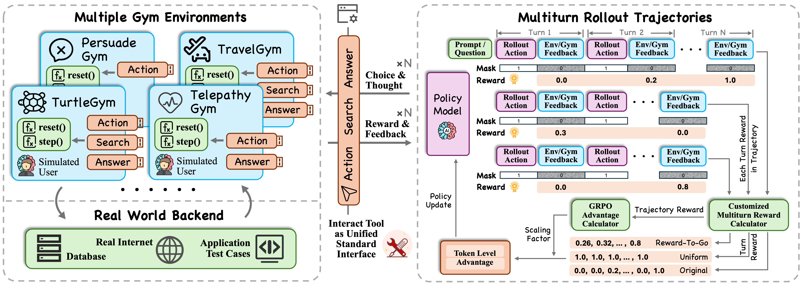
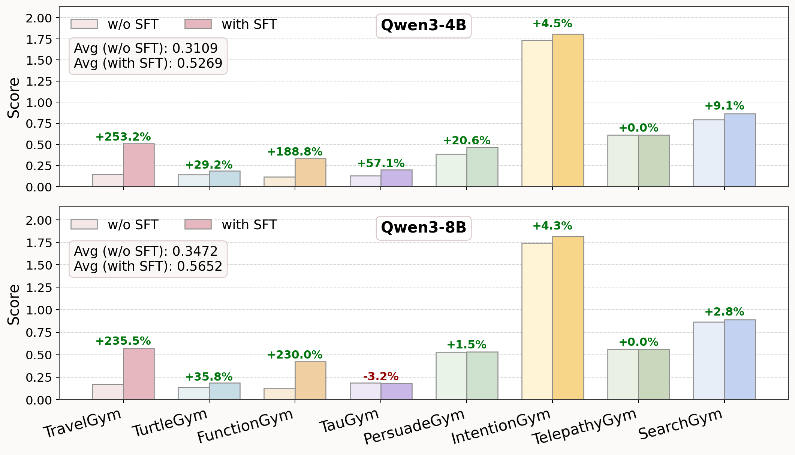

# UserRL：通过模拟用户与多轮奖励设计训练交互式 Agent

## 1. 基本信息与核心判断

- **论文**：UserRL: Training Interactive User-Centric Agent via Reinforcement Learning。
- **作者**：Cheng Qian、Zuxin Liu、Akshara Prabhakar、Jielin Qiu、Zhiwei Liu、Haolin Chen、Shirley Kokane、Heng Ji、Weiran Yao、Shelby Heinecke、Silvio Savarese、Caiming Xiong、Huan Wang。
- **机构**：Salesforce AI Research；University of Illinois Urbana-Champaign。
- **版本**：arXiv:2509.19736v1，2025-09-24；所读 PDF 共 28 页，页眉为 Under Review。此处不据会议模板推断录用状态。
- **阅读日期 / 主题 / 层级**：2026-10-08 / Agent / detailed（细粒度）。
- **原文**：[arXiv 摘要](https://arxiv.org/abs/2509.19736) · [在线 PDF](https://arxiv.org/pdf/2509.19736) · [本地 PDF](arxiv_2509_userrl_training_interactive_user_centric_agent_via_reinforcement_learning.pdf)。
- **源码**：[TeX 入口](../arxiv_all/arxiv_2509_userrl_training_interactive_user_centric_agent_via_reinforcement_learning_tex/iclr2026_conference.tex) · [方法源码](../arxiv_all/arxiv_2509_userrl_training_interactive_user_centric_agent_via_reinforcement_learning_tex/sections/4_method.tex) · [附录](../arxiv_all/arxiv_2509_userrl_training_interactive_user_centric_agent_via_reinforcement_learning_tex/sections/Appendix.tex)。
- **开源**：[SalesforceAIResearch/UserRL](https://github.com/SalesforceAIResearch/UserRL)，包含 gyms、VERL 修改、SFT、评估和数据文件。本次只对照与论文关键问题相关的代码，未安装或运行完整训练。
- **代码快照**：commit `34c024f94159b4043972d4bce1c0fe133a8b5dc6`；[快照清单](assets/arxiv_2509_userrl_training_interactive_user_centric_agent_via_reinforcement_learning_tex/repository_snapshot/snapshot.json)。当前仓库已包含论文之外的扩展，不能默认等同于 2025 年原始实验版本。

**一句话理解**：把用户作为动态环境的一部分，通过统一接口让 agent 反复“问用户—取信息—尝试回答”；先用高质量多轮示范完成 SFT 冷启动，再用 GRPO 比较同一任务的多条对话，研究怎样奖励有效且及时的交互。

这篇最值得读的不是一个复杂新优化器，而是三个训练问题：

1. 没有即时奖励的澄清问题，可能是后续成功的前提，不能简单当成无价值动作。
2. “这一整条对话好不好”与“每一轮贡献多少”应分开处理。在本文的实验里，前者的设计比几种启发式细分轮次权重更重要。
3. SFT 初始化和模拟用户的行为，会显著影响 RL 能否学到交互能力，以及这种能力能否迁移。

**阅读时必须保留的边界**：主文 advantage 公式与当前官方实现不一致；当前 `Sum` 实现实际上求均值；SFT 数量有主文/附录冲突；环境评分并非全部纯规则；汇总分也不是统一的成功率。下文分别记录原文和代码，不悄悄把差异修成同一套算法。

## 2. 背景：为什么“解题 Agent”还不够？

传统 agent 训练常把用户当作一次性给出目标的人，后面模型只需操作工具、求解任务。真实辅助场景更复杂：用户最初没说全需求，偏好需要询问，沟通会改变用户理解，任务可能要靠反复反馈才能推进。

UserRL 强调用户交互的 **diversity** 与 **dynamics**：不同用户有不同偏好、表达方式和知识；同一个用户也会在对话中补充条件。固定输入—固定答案式训练数据难以完整表达这些变化。

例如，帮助订旅行，不应只搜索最便宜机票；要知道日期、预算、舒适度或酒店位置等偏好。但问题也不是问得越多越好：宽泛、重复或太晚的问题可能浪费轮次。训练需要同时评价完成效果和过程效率。

该问题可从部分可观测交互的角度理解：用户真正的偏好、谜底或隐藏函数不直接可见，agent 通过动作更新自己的判断。**这是阅读视角，不是论文提出了一个新的 POMDP 定理。** 原文更强调 Gymnasium 式接口和可执行的训练管线。

与单轮 RL 的区别在于：一轮生成后环境还会返回新信息，下一轮策略的条件发生变化；最终成功可能依赖很早以前一个看似零奖励的探索动作。

## 3. 框架原图与统一接口

读图顺序：左侧是各类 Gym 和模拟用户/后端；中间统一成 interact tool；右侧为同一任务采样多条轨迹，把环境反馈变成 trajectory score 与 turn credit，再构造 token advantage，更新 policy。图中 mask=1 对应 agent 生成，mask=0 对应环境观察，不应训练模型去模仿模拟用户的输出。

### 3.1 Gym 同时包含任务状态机和用户模拟

任务侧使用 `reset()` 初始化，`step()` 按动作推进状态、返回 observation、reward 和终止信息。用户侧则在需要时调用 LLM 生成回答、偏好反馈、线索或立场变化。

原文将任务推进描述成规则化的有限状态机制，但需要区分：**奖励汇总和终止条件可以是规则，决定“问中了什么”“解释对不对”“立场变了吗”的上游判断仍常由 LLM 给出。** 因而评分不是全部确定性，也不是 temperature=0 就能保证跨服务、跨版本严格复现。

### 3.2 三类 choice

统一工具名为 `interact_with_env`，参数为字符串 `choice` 与 `content`：

- `action`：与用户交流，或向特定环境提交探索动作。
- `search`：检索外部信息、取测试输入或发现可用工具，具体语义由 Gym 决定。
- `answer`：提交候选答案或执行特定任务动作；在 TauGym 中，它代表提交一个内部工具调用，不只是结束对话。

所以统一的是最外层调用合同，不是把所有任务强行变成同一行为。`content` 在不同环境中可能是自然语言、数字列表、检索词或序列化 JSON。

训练与评估针对同一个 Gym 使用相同 system prompt；它说明目标、可用 choice、具体格式、常见交互策略与轮次限制。并非一个完全不给任务提示的通用零样本 agent。

原文存在一个小的不一致：框架图及正文示例把 TurtleGym 画为支持 Action/Search/Answer，但 Table 1 与具体附录主要定义 Action/Answer。复现时应以实际环境 action space 和配置为准，不能从框架图推断所有分支已经使用。

## 4. 八种 Gym：训练的是哪些能力？

### 4.1 原文 Table 1：任务与接口

以下保留原表类别与接口意义，长文本译为中文。原表写 `IntentGym`，正文/代码多数使用 `IntentionGym`，本笔记统一后者并保留这一命名差异。

| Gym | 任务 | 数据来源 | 主要能力 | 接口 |
|---|---|---|---|---|
| IntentionGym | 从模糊请求中揭示真实需求 | IN3 | 意图理解、消歧 | Action：澄清问题 |
| TurtleGym | 海龟汤游戏，揭示故事隐藏情节 | 新构建 | 创造性推理、上下文适应 | Action：询问；Answer：解释故事 |
| PersuadeGym | 通过论证改变用户立场 | Persuasion | 策略推理、说服沟通 | Action：提出论据 |
| TelepathyGym | 猜出用户心中的实体 | 新构建 | 假设检验、策略推理 | Action：求线索；Answer：猜实体 |
| FunctionGym | 推断隐藏数值映射 | 新构建 | 数学推理、模式泛化 | Action：查询映射；Search：取测试例；Answer：提交结果 |
| TravelGym | 个性化旅行选择 | UserBench | 偏好获取、个性化规划 | Action：问偏好；Search：取选项；Answer：推荐 |
| TauGym | 沟通并调用工具完成用户任务 | Tau-Bench | 工具使用、任务交互 | Action：问用户；Search：发现工具；Answer：执行工具 |
| SearchGym | 搜索并回答一般问题 | Bamboogle | 检索、综合推理 | Search：网络检索；Answer：提交回答 |

### 4.2 IntentionGym：奖励问到关键缺失信息

每次提问有两条独立调用：温度 0.7 的用户回答模型不持有完整 missing-detail 标注，负责自然回复；温度 0 的评估模型看见剩余缺失项和重要性，判断问题覆盖了哪些细节。

高、中、低重要性的基础奖励分别为 1.0、0.7、0.4；一次覆盖额外细节会受每项 0.2 的惩罚，鼓励聚焦而非一口气问所有问题。当前代码 `_calculate_reward` 取本轮新覆盖项中的**最高重要性**作为基础奖励，然后扣除额外覆盖项的罚分，并非把所有项的奖励简单相加。若配置要求，再裁到 [0,1]。

这实际上主要奖励“问题是否触及标注的缺失维度”。它没有直接证明用户的回答正确、偏好长期一致，或最终任务已经被解决；多轮累计分可以大于 1，所以主表里 1.9025 并不等于 190.25% 成功率。

### 4.3 TurtleGym：问题不给进展分，答案按最佳改善计分

用户模拟器知道表面故事和底层真相，针对问题回答 Yes/No/Maybe。候选故事解释按若干加权标准打 0、0.5、1，再汇总成 [0,1] 分数。

若新答案优于之前最佳分数，只奖励增量。用 $q_t$ 表示本次答案评分、$b_{t-1}$ 表示此前最佳，默认无 step penalty 时可概括为：

$$
r_t=\max(0,q_t-b_{t-1}),\qquad b_t=\max(b_{t-1},q_t).
$$

这是对附录描述的数学展开。反复提交同一个已得分解释通常不能重复取同样的奖励。达到默认 success threshold=0.9 或预算耗尽时结束。评估解释的仍是 LLM，不是程序证明故事答案正确。

### 4.4 PersuadeGym：立场变化，不等于客观正确性或满意度

初始为 Strongly Agree，目标是移动到 Strongly Disagree，七个等级对应 0、约 0.167、0.333、0.5、0.667、0.833、1。一次模拟用户调用同时返回对话回复、更新后的 stance 与内部判断。

附录一方面使用“exponential scaling”措辞，另一方面给出的计算描述是朝反对方向移动的等级数除以 6，倒退或不变不给正奖励。这两者并不一致；不要据一句形容就补写指数函数。并且这里的环境立场奖励与训练算法中的 **EM turn weighting** 是两件不同的事。

该任务衡量模拟立场能否被改变，不是论据是否真实、建议是否符合用户利益的完整评价。说服成功只是这组 benchmark 的一个代理目标，不能泛化为所有用户中心行为都应该以改变用户立场为目的。

### 4.5 TelepathyGym：澄清动作价值的典型例子

隐藏对象可能是人物、动物、物品或地标。Agent 提问获取 Yes/No/Maybe，再提交猜测。只有正确或明确同义的实体判断成功时得到 1 分，没有部分分。

提问可能每轮即时奖励都为零，却持续缩小候选空间。这正是“零即时奖励不等于零因果贡献”的最直观例子。等价实体判定在附录里依赖 LLM 判断，不能将其误写为纯字符串 exact match。

### 4.6 FunctionGym：没有 LLM 用户模拟的环境

Agent 向隐藏函数提供四个数，环境返回函数值；`search` 取出最终测试输入；`answer` 提交预测结果，误差在 $10^{-6}$ 内判对。询问函数值本身不给分，成功答案给 1。

所有用户反馈由规则计算，不需要 LLM simulator。这点很重要：当替换训练用户模型后，FunctionGym 分数变化反映混合训练产生的间接影响，而不能解释为这个环境自身换了更聪明的用户。

### 4.7 TravelGym：训练过程奖励与评估最终选择不同

覆盖机票、酒店、租车、公寓、餐馆等方面。附录中，有效偏好询问可得 0.2，成功检索可得 0.2，最优选项得 1.0、正确但次优选项得 0.8。检索过程中每五次尝试可模拟一次系统错误。

主结果按 UserBench 的最终 choice correctness 评价，不是把所有提问和搜索的 0.2 都算成最终任务完成分。当前评估脚本按方面收集 answer 的最佳分，再除以方面数。这解释了为什么训练曲线、时间加权分和最终 Travel score 不能直接比较量级。

### 4.8 TauGym 与 SearchGym

TauGym 复用 Tau-Bench 的 retail/airline 任务与后端：需要通过对话获取信息，用 search 发现内部工具，再把工具名与参数 JSON 放进 answer 执行。外层适配器改变了动作表达，但不是新增一套真实商业业务系统。这里的 **TauGym/Tau-Bench 与此前讨论的 twotimespi.dev 的 tau 编码 harness 不是同一个项目**。

SearchGym 用 Serper 返回网页标题与 snippets，默认最多五次 search。原表称最终指标为 exact match，但附录明确允许 normalized string comparison 或 LLM evaluation，且 LLM 是默认；本次核对的 `SearchGymConfig.eval_method` 也是 `llm`。因此它不能无条件被描述成纯 exact-match 评测。

多数环境配置类默认 20 步，TauGym 默认 30 步；论文主训练/评估统一覆盖为 **16 轮**，且不额外施加 step penalty。默认值与实验覆盖值要分开。

## 5. 数据划分与 SFT 冷启动

### 5.1 原文 Table 2：完整数据统计

| Gym | Train Num. | Test Num. | 原表评估指标 |
|---|---:|---:|---|
| Travel | 925 | 471 | Choice Correctness，按 UserBench |
| Turtle | 423 | 48 | Sum Turn Reward |
| Function | 460 | 78 | Test Case Correctness |
| Tau | 500 | 165 | Task Completion，按 Tau-Bench |
| Persuade | 378 | 42 | Sum Turn Reward |
| Intention | 380 | 40 | Sum Turn Reward |
| Telepathy | 360 | 41 | Final Guess Correctness |
| Search | 0 | 125 | Final Answer Exact Match（附录另有 LLM 判断，见上文） |
| **Total** | **3,426** | **1,010** | — |

训练只使用 Travel、Turtle、Function、Tau、Persuade 五类，Intention、Telepathy、Search 完全保留作环境级 held-out 测试。因此表中的 3,426 是各环境可用 train split 总数，不是本实验全部 RL 训练题数；五个训练 Gym 的表列数量相加为 2,686。

官方当前 `merge_customize.py` 的 train 合并列表确实没有 intention/telepathy/bamboogle，而 test 列表包含它们。这支持论文的环境级划分，但本次没有检查所有 parquet 行与 SFT 样本，不能据一个合并脚本断言实际数据绝无重叠或污染。

### 5.2 SFT 数量的原文冲突

主文 Data 段说从每个训练 Gym 保留 1K 轨迹，读起来相当于五类共 5K；附录 Training Data 明确说每类挑选 top-K 后合成**总共 1K 样本**。附录还说其余任务用于 RL，预算估计又用约 2K 任务。

本笔记按更具体的附录，把 SFT 总量记录为 **约 1,000 条，需复现时核实**，同时保留主文冲突；不能把两段默默合并成确定的 5,000 或确定的 RL 题数。

这些轨迹由 GPT-4o 同时扮演 agent 和 user，按各 Gym 的质量排名选出。因此训练中“使用开源用户模拟器”只适用于主 RL 阶段；主流程依然包含 GPT-4o 示范蒸馏，不能声称完全不依赖闭源模型。

### 5.3 SFT 的作用

SFT 先教模型遵循统一工具格式、保持多轮交互、提出有效动作，而不是直接让模型从很低的接口成功率里靠 RL 摸索。这样一方面提高初始 reward，另一方面让同任务的多条 rollout 更有可能产生有信息量的差异。

这是对结果的机制性解释，不是原文做过独立的格式掌握率或探索覆盖率因果分解。后面的消融支持“本设置中 SFT+RL 比直接 RL 更好”，但不证明所有 agent RL 都必须先 SFT。

## 6. 两层奖励：先把符号和概念分清

### 6.1 多轮轨迹与 token

原文定义：

$$
\tau=\{(s_1,a_1,r_1),(s_2,a_2,r_2),\ldots,(s_T,a_T,r_T)\},\qquad a_t\sim\pi_\theta(\cdot\mid s_t).
$$

$s_t$ 是第 $t$ 轮模型可用的交互上下文/状态，$a_t$ 是动作，$r_t$ 是环境原始奖励，$T$ 是轨迹轮数。该轮 agent 输出 token 为 $x_t=(x_{t,1},\ldots,x_{t,L_t})$。

需要分开四层：**原始环境奖励 → 每轮 credit/weight → 整轨迹 score → 最终带正负号的 advantage**。尤其 EM 把零奖励映射到正数，不能直接解释为这条失败轨迹会被正向强化；在代码中方向由组内轨迹优势决定。

### 6.2 Turn-level shaping：轮内 token 共享信号

原文把每轮 reward 变换成 $\tilde r_t$，再广播到该轮所有生成 token：

$$
R(x_{t,k})=\tilde r_t,\qquad k=1,\ldots,L_t.
$$

四种方案：

**Naive**：$\tilde r_t=r_t$。若问问题、取信息都为零，只有最后答案得分，训练信号高度稀疏。作者说实测迅速崩溃，因此不列入主表；没有完整曲线或多种稳定化控制，不能视作对所有直接 step-reward 方法的普遍否定。

**Equalized**：$\tilde r_t=c$，每轮相同，当前代码为 $c=1$。它不声称所有步骤因果贡献真的一样，而是在没有可靠局部 credit 时避免把早期支持动作排除在训练之外。

**Reward-to-Go（R2G）**：

$$
\tilde r_t=\sum_{j=t}^{T}\gamma^{j-t}r_j,\qquad \gamma\in[0,1].
$$

这是从当前轮往后看。成功答案的奖励被折扣传回此前的提问。实验 $\gamma=0.8$，越早的步骤收到的远期奖励折扣越强；这只能表达时间远近，不一定表达因果贡献。

**Exponential Mapping（EM）**：

$$
\tilde r_t=\phi_k(r_t)=0.5+0.5\frac{1-\exp(-kr_t)}{1-\exp(-k)},\qquad k>0.
$$

原文假设 $r_t\in[0,1]$，从而映射范围为 [0.5,1]；$k=2$。有 $\phi_2(0)=0.5$、$\phi_2(1)=1$，小正奖励也得到较大的权重。这种映射没有办法分辨两个同样零奖励的动作，一个高信息量提问与一个无意义重复可能得到一样权重。

如果扩展 Gym 允许负奖励或单轮大于 1，不能继续无条件沿用上述值域结论；需要明确裁剪/归一化政策。源码的该映射本身没有在入口强制裁到 [0,1]。

### 6.3 Trajectory-level scoring：整条轨迹怎么排序？

原文提供两种 scorer，使用原始 $r_t$，不是先做 EM 再求和：

$$
\begin{aligned}R_{\mathrm{traj}}^{\mathrm{sum}}(\tau)&=\sum_{t=1}^{T}r_t,\\R_{\mathrm{traj}}^{\mathrm{r2g}}(\tau)&=\sum_{j=1}^{T}\gamma^{j-1}r_j.\end{aligned}
$$

Sum 表达总体进展，R2G 是从开局计算的折扣 return，偏好早获得收益。它不是“所有 turn-level R2G 再相加”，也不是反向给越晚的奖励越大权重。

**阅读例子，非论文实验**：两条对话都最终得 1 分，一条第三轮成功，另一条第八轮成功。Sum 同为 1；$\gamma=0.8$ 时 R2G 分别为 0.64 和约 0.2097，因此前者排序更高。到第 16 轮才得 1 分则只有约 0.0352。

这是一种实质的目标偏好：提高及时性，却可能压低需要长期澄清才能解决的任务。它没有不改变最优策略的 potential-based shaping 保证，也没有显式对真人疲劳或延迟做测量。

### 6.4 A/B 命名不能读反

主表四组为 **Equalized/Sum、Equalized/R2G、EM/R2G、R2G/R2G**。斜线左边是轮次权重，右边是轨迹 scorer。

因此 Equalized/R2G 表示：整条轨迹按折扣奖励排序，但同一条轨迹内所有有效 token 使用相同 advantage（按当前代码推导）；不是把折扣奖励逐 token 简单复制。

## 7. Advantage 与 PPO：论文公式和代码必须分别看

### 7.1 原文的组内统计

对同一个任务 $Q$，收集 $n$ 条完整对话 $G_Q=\{\tau^{(i)}\}_{i=1}^{n}$。原文给出：

$$
\begin{aligned}\mu_Q&=\frac{1}{n}\sum_{i=1}^{n}R_{\mathrm{traj}}(\tau^{(i)}),\\\sigma_Q&=\sqrt{\frac{1}{n}\sum_{i=1}^{n}\big(R_{\mathrm{traj}}(\tau^{(i)})-\mu_Q\big)^2}.\end{aligned}
$$

组内比较能减少不同任务难度/奖励量级的影响，但模拟用户也会引入随机性：同一个任务的 rollout 差别不一定全部来自 agent 的动作质量。

### 7.2 原文写出的 token advantage

方法章节原式为：

$$
A_{\mathrm{paper}}(x_{t,k}\mid Q)=\frac{\tilde r_t^{(i)}-\mu_Q}{\sigma_Q+\eta},\qquad \eta>0.
$$

**这条式子按字面读有问题。** $\mu_Q$ 是轨迹分数的均值，但被减数是一个轮次信号；尤其 Equalized 若给组内所有轨迹、所有轮相同常数 $c$，则每条轨迹的 token 都得到相同值，无法区分这组里哪条对话更好。它也不等于标准 GRPO 的轨迹优势广播。

原图显示“trajectory advantage 作为 scaling factor 作用于 turn rewards”，这一图示与当前代码更吻合。不能自行把原式改成标准 GRPO 而宣称那就是原文，也不能照字面解释 Equalized 已经正确保留了优劣排序。

### 7.3 当前官方实现：先定方向，再分配权重

已核对 [core_algos.py 本地快照](assets/arxiv_2509_userrl_training_interactive_user_centric_agent_via_reinforcement_learning_tex/repository_snapshot/verl/trainer/ppo/core_algos.py) 的 `compute_turn_credits` 和 `compute_grpo_multiturn_advantage`，以及 [ray_trainer.py](assets/arxiv_2509_userrl_training_interactive_user_centric_agent_via_reinforcement_learning_tex/repository_snapshot/verl/trainer/ppo/ray_trainer.py) 的实际调用。下面是**对该 commit 代码的等价数学整理，不是论文原公式**。

令 $S_i$ 为轨迹 scorer，$w_{i,t}$ 为该轮 credit，$m_{i,t,k}$ 为 token loss mask。先计算轨迹组内优势：

$$
z_i=\frac{S_i-\overline S_Q}{s_Q+\eta}.
$$

代码用 `torch.std` 的默认样本标准差，因此这里 $s_Q$ 的分母是 $n-1$（组大小大于 1 时），与原文写的 $n$ 不同。组内只有一条时设 baseline mean=0、std=1；主实验每组为 8 条。

定义该轨迹未归一化权重和 $W_i$、非零加权 token 数 $C_i$：

$$
W_i=\sum_{t,k}m_{i,t,k}w_{i,t},\qquad C_i=\sum_{t,k}\mathbf 1[m_{i,t,k}w_{i,t}\ne 0].
$$

当 $W_i\ne0$ 时，最终 token advantage 为：

$$
A^{\mathrm{code}}_{i,t,k}=m_{i,t,k}w_{i,t}\,z_i\frac{C_i}{W_i}.
$$

$W_i=0$ 时代码将该轨迹 advantages 全置零。这个归一化令非零权重 token 上的平均 advantage 为 $z_i$。在非负 credit 假设下，各轮的正负方向由整条对话相对组均值的好坏决定，轮次 credit 只改变幅度。

特别地，Equalized 的有效 token 权重都是 1，$W_i=C_i$，所以：

$$
A^{\mathrm{code}}_{i,t,k}=m_{i,t,k}z_i.
$$

这才解释了为什么成功轨迹里零即时奖励的提问也能得到学习信号：它参与一条较好的完整对话，其 token 一起被强化。失败或低于组均值的轨迹则整体受到负向更新，而不是因为 EM 给了正权重就得到正向强化。

需要再细一层：Equalized 给的是**相同每-token 信号**，不保证每个 turn 的总梯度权重一样；较长的 agent turn 有更多 token。R2G 中有些轮的 credit 为零时，$C_i$ 只数非零 token，但 actor loss 分母是否仍数全部有效 token取决于 loss aggregation 配置，也影响轨迹间权重。

### 7.4 一个反例能看出两种公式的差异

**阅读例子**：同一组两条轨迹分数为 0 和 1，每轮 credit 都设为 1，忽略极小稳定项。

- 原文人口标准差是 0.5，mean=0.5；按原文 token 式，两条轨迹的每个 token 都是 +1。
- 当前代码样本标准差约 0.7071，先形成轨迹优势约 −0.7071、+0.7071，再广播到各自所有有效 token。

因此差异不是无关紧要的常数比例，而是是否区分成功/失败轨迹的训练方向。复现必须先确定实际所需算法。

### 7.5 第二个关键差异：代码的 Sum 是 mean

当前 `compute_turn_credits` 的 `trajectory_score_method == "Sum"` 分支实际上执行 `round(sum(turn_rewards) / len(turn_rewards), 4)`；R2G 分支则确实是从末轮向前递推的折扣累计。

因此当前名为 Equalized/Sum 的运行配置，严格说是 **Equalized/Mean**。若两条轨迹轮数不同，mean 已包含长度偏好，与论文未折扣求和不一样：第三轮成功与第八轮成功在 mean 下分别为 1/3、1/8，已经能分出先后，而论文 Sum 同为 1。

这使“论文 R2G 相对 Sum 的提升究竟对应哪段实验实现”需要历史 commit、配置和日志确认。本次只检查当前固定 commit，没有据此断言论文所有原始实验一定用了 mean，也没有修改官方代码。

### 7.6 原文 PPO 目标

在原文记号下，策略更新使用 clipped objective，并移除参考模型 KL loss：

$$
\begin{aligned}J_{\mathrm{UserRL}}(\theta)&=\mathbb E_{Q\sim\mathcal D,\,\tau\sim\pi_{\mathrm{old}}}\left[\frac{1}{\sum_{t=1}^{T}L_t}\sum_{t=1}^{T}\sum_{k=1}^{L_t}\ell_{t,k}(\theta)\right],\\\ell_{t,k}(\theta)&=\min\left(\rho_{t,k}A_{t,k},\operatorname{clip}(\rho_{t,k},1-\epsilon,1+\epsilon)A_{t,k}\right),\\\rho_{t,k}&=\frac{\pi_\theta(x_{t,k}\mid\mathrm{context}_{t,k})}{\pi_{\mathrm{old}}(x_{t,k}\mid\mathrm{context}_{t,k})}.\end{aligned}
$$

这是对原文较长表达式的分行重排。$\rho$ 衡量新旧 policy 对同一 token 的概率比，clip 限制过大更新；$\epsilon$ 是 PPO clip 参数，不是前面标准化分母中的 $\eta$。模型自己的推理和动作 tokens 可被训练，工具/用户反馈应被 loss mask 排除。

没有 KL 不表示完全无约束：PPO ratio clipping 仍在。当前训练脚本同时设 `actor.use_kl_loss=False` 和 `algorithm.use_kl_in_reward=False`，虽还保留非零 kl_loss_coef 字段，但关闭开关时不能把它读成 KL 已启用。

## 8. 实验设置与完整主结果

### 8.1 训练与评估协议

主训练模型为 Qwen3-4B、Qwen3-8B；所有主 RL 行均从 SFT checkpoint 开始。Qwen3-14B/32B 提供 raw model 对照，闭源基线为 Gemini-2.5-Pro/Flash、GPT-4o/mini。

RL 每批 128 个任务，每任务 8 条 rollout，训练 15 epochs；actor temperature=1.0，无 KL、无额外 step penalty，最多 16 轮。主 RL simulator 为 Qwen3-32B，评估 simulator 为 GPT-4o；模型评估 temperature=0。RL 留出 5% validation，最终选验证最好的已保存 checkpoint，不能当作所有结果来自最后一步。

### 8.2 Avg. 的量纲与权重

主表 Avg. 是按各 Gym 测试题数量进行 micro-average：

$$
\mathrm{Avg}=\frac{\sum_gN_g\,\mathrm{Score}_g}{\sum_gN_g}.
$$

Travel 占 471/1,010≈46.6%，Tau 占 16.3%。Intention 累计 reward 又可大于 1，因此 **Avg.=0.5652 不是 56.52% 的统一成功率**，也不是八种能力等权平均。

本次用表列题数重新计算了全部 15 行 Avg.，均与原表在舍入误差内一致。混合量纲与样本权重是解释整体排序时必须知道的设计选择。

### 8.3 原文 Table 3：五个训练环境上的测试

为避免超宽表，将原表按列分成两部分；数值、原始粗体与下划线保留。前八行为训练后模型，之后三行为 raw Qwen，最后四行为闭源模型。斜体的 held-out 列移到下一表。

| 模型 / 设置 | Travel | Turtle | Function | Tau | Persuade |
| --- | --- | --- | --- | --- | --- |
| Qwen3-8B (Equalized/R2G) | <u>**0.5730**</u> | 0.1854 | <u>**0.4231**</u> | 0.1818 | 0.5317 |
| Qwen3-8B (EM/R2G) | 0.5025 | <u>0.1917</u> | 0.4103 | 0.2000 | <u>**0.5397**</u> |
| Qwen3-8B (R2G/R2G) | 0.5724 | 0.1615 | <u>**0.4231**</u> | 0.1394 | 0.5238 |
| Qwen3-8B (Equalized/Sum) | 0.5054 | 0.1323 | 0.2692 | <u>**0.2121**</u> | 0.5040 |
| Qwen3-4B (Equalized/R2G) | <u>0.5086</u> | <u>0.1844</u> | 0.3333 | <u>0.2000</u> | 0.4643 |
| Qwen3-4B (EM/R2G) | 0.5076 | 0.1417 | 0.3333 | 0.1576 | 0.4563 |
| Qwen3-4B (R2G/R2G) | 0.4629 | 0.1687 | <u>0.3974</u> | 0.1333 | <u>0.5794</u> |
| Qwen3-4B (Equalized/Sum) | 0.4456 | 0.1615 | 0.2308 | 0.1333 | 0.4524 |
| Qwen3-32B (Raw) | 0.1724 | <u>0.1510</u> | 0.1538 | 0.0000 | 0.4841 |
| Qwen3-14B (Raw) | <u>0.1924</u> | 0.1417 | <u>0.1667</u> | <u>0.1030</u> | <u>0.5317</u> |
| Qwen3-4B (Raw) | 0.1405 | 0.0854 | 0.0769 | 0.0364 | 0.4048 |
| Gemini-2.5-Pro | 0.3468 | 0.2740 | <u>0.4103</u> | 0.1939 | 0.4246 |
| Gemini-2.5-Flash | 0.2553 | 0.1958 | 0.3205 | 0.1212 | 0.4087 |
| GPT-4o | <u>0.3643</u> | <u>**0.2917**</u> | 0.2821 | 0.0303 | 0.3770 |
| GPT-4o-mini | 0.0976 | 0.0906 | 0.1538 | 0.2061 | <u>0.5317</u> |

### 8.4 同一张原表：三个 Held-out 环境与总分

| 模型 / 设置 | Intention（held-out） | Telepathy（held-out） | Search（held-out） | Avg. |
| --- | --- | --- | --- | --- |
| Qwen3-8B (Equalized/R2G) | 1.8175 | 0.5610 | <u>0.8880</u> | <u>**0.5652**</u> |
| Qwen3-8B (EM/R2G) | <u>**1.9025**</u> | 0.5366 | 0.8640 | 0.5343 |
| Qwen3-8B (R2G/R2G) | 1.8525 | <u>0.5854</u> | 0.8480 | 0.5539 |
| Qwen3-8B (Equalized/Sum) | 1.6275 | 0.5366 | 0.8320 | 0.5076 |
| Qwen3-4B (Equalized/R2G) | <u>1.8075</u> | 0.6098 | <u>0.8640</u> | <u>0.5269</u> |
| Qwen3-4B (EM/R2G) | 1.7375 | <u>0.6341</u> | <u>0.8640</u> | 0.5154 |
| Qwen3-4B (R2G/R2G) | 1.5975 | 0.4634 | <u>0.8640</u> | 0.4895 |
| Qwen3-4B (Equalized/Sum) | 1.7150 | 0.4878 | <u>0.8400</u> | 0.4656 |
| Qwen3-32B (Raw) | <u>1.8300</u> | 0.5610 | 0.7920 | <u>0.3128</u> |
| Qwen3-14B (Raw) | 1.7000 | <u>0.5854</u> | 0.5120 | 0.3027 |
| Qwen3-4B (Raw) | 1.7400 | 0.4878 | <u>0.8560</u> | 0.2929 |
| Gemini-2.5-Pro | 1.5900 | <u>**0.9024**</u> | <u>**0.9280**</u> | <u>0.4702</u> |
| Gemini-2.5-Flash | 1.6850 | 0.6341 | <u>**0.9280**</u> | 0.3973 |
| GPT-4o | <u>1.8975</u> | 0.8537 | 0.8800 | 0.4449 |
| GPT-4o-mini | 0.2500 | 0.0488 | 0.3520 | 0.1729 |

原表说明下划线表示分组最佳，粗体表示全局最佳；但标注本身有不一致，例如 4B Equalized/Sum 的 Search=0.8400 也被加下划线，4B R2G/R2G 的 Persuade=0.5794 大于粗体的 8B EM/R2G=0.5397。本笔记保留原标记，不把它们作为重新计算排名的依据。

### 8.5 主结果应该怎样解读？

**整体最好的方案是 Equalized/R2G。** 8B Avg.=0.5652，4B=0.5269；各自 Equalized/Sum 为 0.5076、0.4656，差值为 0.0576、0.0613。这里是混合分数差，不应写成全任务成功率提高 5.76/6.13 个百分点。

**不代表每个 Gym 最好。** 8B Tau 的最好配置是 Equalized/Sum=0.2121；8B EM/R2G 在 Intention 与 Turtle 更高；4B R2G/R2G 的 Function、Persuade 更高。全局目标和各类任务的最佳 credit 设计不同。

**小模型可以在这个协议下得到更高总分，但没有全面超过闭源模型。** 8B Equalized/R2G 总分比 Gemini-2.5-Pro 高 0.0950，比 GPT-4o 高 0.1203；其 Travel 很强，而 Turtle=0.1854 低于 GPT-4o 的 0.2917，Telepathy=0.5610 低于 Gemini 的 0.9024，Search=0.8880 也低于 Gemini 的 0.9280。

主文说 Qwen3-8B 在 Intention 上超过 GPT-4o，需要细看具体 variant：Equalized/R2G=1.8175 低于 GPT-4o=1.8975，只有 EM/R2G=1.9025 略高。不能把不同配置各自的最佳项拼成一个统一最强模型。

**Raw scaling 的收益有限，但这是特定接口下的观察。** Raw 4B→32B 的 Avg. 只提高 0.0199，训练后的 4B→8B 提高 0.0383；但 raw 8B 不在主表，不能从中构造完整的四点 scaling law，更不能断言模型规模普遍没有用。

**Held-out 泛化是存在但不均匀的。** 4B 主方法相对 raw 4B，在 Intention 1.7400→1.8075，Telepathy 0.4878→0.6098，Search 0.8560→0.8640。搜索只增加一个 125 题中的正确例子；大部分总分提升来自训练域及其接口适配，不是所有未见能力都大幅增长。

**训练增益包含 SFT 与 RL。** 主表没有独立 SFT-only 行；不能把 raw→主模型的全部差值归因于 RL。下一节的 w/o SFT 也是“直接 RL”对“先 SFT 再 RL”，不是纯 SFT 对纯 RL。

## 9. SFT 消融、用户模拟器和训练曲线

### 9.1 SFT 冷启动：整体明显有益

图中 4B Avg. 从直接 RL 的 0.3109 到 SFT+RL 的 0.5269；8B 从 0.3472 到 0.5652。Travel 和 Function 的相对增益很大，但不能把图上的 +253.2% 之类数值误读为百分点。

局部也有例外：Equalized/R2G 中 8B 的 Tau 略降，Telepathy 在两种尺寸下不变。该结果证明本训练设置的整体初始化收益，不是每个任务逐项单调提高。

带 SFT 的曲线起点更高，后续也继续增长；直接 RL 较早进入较低平台。要推断纯 RL 带来的绝对收益，还需要保存并评估 SFT-only checkpoint。

附录在 EM/R2G 上重复比较，也显示总体收益：4B 0.2986→0.5154，8B 0.3363→0.5343。

附录图中 4B 的 Intention、Telepathy，以及 8B 的 Tau、Persuade、Search 有负向相对变化，仍需与整体均值区分。没有 SFT 的 4B EM/R2G 后期出现明显下降。

### 9.2 更强模拟用户：质量与分布匹配混在一起

都以 GPT-4o 作评估用户时，把 RL 训练用户换成 GPT-4o，4B Avg. 从 0.5269 提高到 0.5973，8B 从 0.5652 到 0.6147。多数任务上升，但 4B Turtle 下降约 4.0%，8B Function 下降约 18.2%（原图的相对变化标注）。

作者也指出，这既可能来自更好的用户模拟，也可能因为训练和测试使用同一个 simulator，交互风格更匹配。没有完整的 train-user × test-user 交叉矩阵，无法分离二者。

主设置 Qwen3-32B→GPT-4o 的迁移仍说明低成本开源模拟器可用，但它仅验证特定模拟器间迁移，不能代替对广泛真实用户分布的验证。FunctionGym 自身无 LLM simulator，其变化还提醒我们混合训练的影响可以跨环境传播。

### 9.3 不同奖励策略的曲线不等于最终排行榜

附录规定，所有图纵轴统一使用每条轨迹**原始 turn rewards 的总和**，即使实际优化用 R2G 或其他权重。因此纵轴不是直接的 advantage，也不是对应 Gym 的最终测试指标。

EM/R2G 的训练 reward 常高于 Equalized/R2G，但最终 Avg. 低于它。这说明提高训练环境原始累计 reward 与改善最终评估并不完全一致；原文没有单独诊断究竟是过拟合、reward shaping 偏好还是模拟器分布导致。

实线经 Gaussian 1D filter（$\sigma=2$）平滑，阴影来自 raw 与平滑值的偏差，再平滑边界。**这些阴影不是跨随机种子标准差，也不是置信区间。** 不能用阴影重叠与否来推断统计显著性。

## 10. 交互效率与真人实验

### 10.1 Effective Turns 的精确定义

它是最后一次非零奖励所在的交互轮次（再对任务取平均），不是非零奖励次数，也不是“多少轮真的有因果贡献”。例如仅第 6 轮得分，这个指标可以是 6，并不表示前五轮都有效。

作者希望它体现模型能在较后阶段继续获得进展；raw 模型常在前两三轮之后就不再获益。但这个指标不宜单独最大化：第三轮就正确完成任务，未必比第六轮才完成更差。必须结合最终效果、停止轮次和每轮收益一起解释。

### 10.2 Time-Weighted Performance

原文使用第 $i$ 轮奖励乘 $1/(i+1)$ 再求和，鼓励早点获得进展：

$$
\mathrm{TWP}(\tau)=\sum_i\frac{r_i}{i+1}.
$$

原文文字没有在此处明确 $i$ 从 0 还是 1 开始，复现时必须固定约定；不能把它误当作训练中 $\gamma^{i}$ 的同一个折扣。它也是 reward-based 时序代理指标，不是实际秒数、用户主观满意度或付费 token 成本。

### 10.3 原文 Table 4：完整效率结果

| Model | Effective Turns ↑ | Time-Weighted Performance ↑ |
| --- | --- | --- |
| Qwen3-8B (Equalized/R2G) | **6.6463** | **0.6516** |
| Qwen3-8B (EM/R2G) | 5.8792 | 0.5586 |
| Qwen3-8B (R2G/R2G) | 5.1050 | 0.6510 |
| Qwen3-8B (Equalized/Sum) | 6.1842 | 0.4530 |
| Qwen3-4B (Equalized/R2G) | 6.1307 | 0.6423 |
| Qwen3-4B (R2G/R2G) | 5.7317 | 0.6213 |
| Qwen3-4B (EM/R2G) | 5.6743 | 0.5355 |
| Qwen3-4B (Equalized/Sum) | 5.3881 | 0.5118 |
| Qwen3-32B (Raw) | 2.8079 | 0.2852 |
| Qwen3-14B (Raw) | 3.4129 | 0.3211 |
| Qwen3-4B (Raw) | 2.2545 | 0.2674 |
| Gemini-2.5-Pro | 5.7731 | 0.5263 |
| Gemini-2.5-Flash | 4.2465 | 0.4525 |
| GPT-4o | 3.4087 | 0.4024 |
| GPT-4o-mini | 1.9461 | 0.1614 |

R2G 轨迹评分的各主配置在 TWP 上都优于同尺寸 Equalized/Sum。8B 最好方法为 6.6463 effective turns、0.6516 TWP，但“6.65 小于预算 16 的一半”不能直接解释成剩余预算都被浪费，因为提前完成和最后一次拿分后的行为需要分别统计。

TWP 可以高于主表 Avg.，因为 Travel 等环境训练/过程 reward 包含中间进展，而最终主指标主要看最终 choice；两列不具备统一量纲。

### 10.4 原文 Table 5：真人替代模拟用户

| Model / User | TurtleGym | TelepathyGym |
|---|---:|---:|
| Qwen3-4B / GPT-4o User | 0.1844 | 0.6098 |
| Qwen3-4B / Real User | 0.2952（↑0.1108） | 0.7805（↑0.1707） |
| Qwen3-8B / GPT-4o User | 0.1854 | 0.5610 |
| Qwen3-8B / Real User | 0.3127（↑0.1273） | 0.7805（↑0.2195） |

这是**同一个训练后 agent 面对两种用户时的比较**；不是 Qwen agent 在真人任务上打败了 GPT-4o agent。

研究招募五位计算机科学博士生，志愿参与且无报酬，知情同意交互用于研究，分担两种 Gym 的全部任务。他们知道谜底，充当问答与答案判断的 oracle，被要求不直接泄露答案。

但真人常将它视为协作游戏，会给出“发生在过去，但没那么久”之类额外提示，而 GPT-4o 受限于 Yes/No/Maybe。Agent 表现更好说明能利用更丰富的合作线索，但用户信息通道和评分主体同时改变；不是严格等信息条件下的模拟到真人泛化证明。

样本用户只有五位，且都是 CS PhD，没有用户级方差、人口多样性或更困难用户行为的系统评估。作者明确称其为 preliminary test，应保留这个定位。

## 11. 训练配置与可复现性

### 11.1 原文 Table 6：RL 与 SFT

| RL 参数 | 值 |
|---|---|
| algorithm.gamma | 0.8 |
| algorithm.k | 2.0 |
| data.train_batch_size | 128 |
| data.max_prompt_length | 1,152 |
| data.max_response_length | 8,192 |
| actor.optim.lr | $10^{-6}$ |
| actor.ppo_mini_batch_size | 16 |
| actor.use_kl_loss | False |
| actor.entropy_coeff | 0 |
| rollout.name | sglang |
| rollout.n | 8 |
| rollout.multi_turn.max_turns | 16 |
| trainer.n_gpus_per_node / nnodes | 8 / 1 |
| trainer.total_epochs | 15 |

| SFT 参数 | 值 |
|---|---|
| finetuning_type | full |
| cutoff_len | 16,384 |
| per_device_train_batch_size | 2 |
| gradient_accumulation_steps | 4 |
| learning_rate | $10^{-5}$ |
| num_train_epochs | 3 |
| lr_scheduler_type | cosine |
| warmup_ratio | 0.1 |
| bf16 | true |

SFT 使用 LLaMA-Factory，论文报告 4 张 H200、每次约 1 小时；RL 使用 VERL + SGLang，8 张 H200、每次约 1.5 天。若只按这些 worker 数量与时间估算，单次 RL 约 288 GPU-hours，但没有计入完整模拟器独立服务、数据生成和多配置 sweep，不能当成总项目成本。

最大 response length、每轮生成上限、累计交互上下文的关系要依据运行代码确认，不能把 8,192 直接理解为每一轮都能输出这么多再乘 16。

作者预算估计使用约 2K 数据 ×15 epochs ×8 rollouts ×16 turns，约 3.84M 次请求。它是按最大轮数估计交互量，不是精确 API 账单：不同 Gym 可能一轮多个 LLM 调用、Function 完全无 LLM 用户调用、提前停止又会减少轮数。

### 11.2 本次对照的关键代码入口

- [核心 advantage 算法](assets/arxiv_2509_userrl_training_interactive_user_centric_agent_via_reinforcement_learning_tex/repository_snapshot/verl/trainer/ppo/core_algos.py)：`compute_turn_credits`、`compute_grpo_multiturn_advantage`，见该文件约 682、735 行。
- [Trainer 调用](assets/arxiv_2509_userrl_training_interactive_user_centric_agent_via_reinforcement_learning_tex/repository_snapshot/verl/trainer/ppo/ray_trainer.py)：multi-turn 分支改用 `loss_mask`，传入 conversation histories、turn boundaries、uid 和两种 method。
- [运行脚本](assets/arxiv_2509_userrl_training_interactive_user_centric_agent_via_reinforcement_learning_tex/repository_snapshot/examples/sglang_multiturn/train.sh) 与 [配置](assets/arxiv_2509_userrl_training_interactive_user_centric_agent_via_reinforcement_learning_tex/repository_snapshot/examples/sglang_multiturn/config/grpo_multiturn.yaml)：选择训练方法与环境参数。
- [数据合并脚本](assets/arxiv_2509_userrl_training_interactive_user_centric_agent_via_reinforcement_learning_tex/repository_snapshot/examples/data_preprocess/merge_customize.py)：train/test 的 Gym 列表。
- [评估聚合脚本](assets/arxiv_2509_userrl_training_interactive_user_centric_agent_via_reinforcement_learning_tex/repository_snapshot/eval/analyze.py)：测试题数加权、Travel choice 的特殊计算。
- [Intention reward 实现](assets/arxiv_2509_userrl_training_interactive_user_centric_agent_via_reinforcement_learning_tex/repository_snapshot/gyms/IntentionGym/intentiongym/env/intention_env.py) 与 [Search 配置](assets/arxiv_2509_userrl_training_interactive_user_centric_agent_via_reinforcement_learning_tex/repository_snapshot/gyms/SearchGym/searchgym/config.py)：补充环境奖励与默认评分方式。

### 11.3 直接照仓库运行不等于复现论文主设置

当前示例 `train.sh` 默认选择 Equalized/Sum 和 GPT-4o user，而论文主训练用 Qwen3-32B、最佳方法为 Equalized/R2G；脚本头注释写 H100，而论文报告 H200。运行路径仍有占位符，也需要自行指定模型与数据。

更值得注意的是脚本的 `data.val_files` 指向 `data/alltest_multiturn/test.parquet`，而论文说从训练数据留 5% validation。若直接用该默认脚本选择最佳 checkpoint，测试集可能参与模型选择，尤其 held-out 环境也可能进入选择流程。**这说明当前示例不符合论文宣称的严格划分；不据此反推作者原始实验一定发生了该问题。** 复现应建立真正的训练域 validation 并固定测试集。

当前 README 使用 “Proactive” 标题、提到 10+ gyms，SFT README 又写九类环境；这与论文八类、五类训练的设置并非一一对应。论文主张与当前扩展项目需按版本分开。

此外，`verl/utils/reward_score/interact.py` 的 `compute_score` 是空的 `pass`，不能把它当作本方法唯一奖励入口。实际对照的 multi-turn advantage 分支使用 conversation histories 里的逐轮 reward；完整执行链仍需结合工具和 rollout worker 检查。

### 11.4 最小复现核验项

首先固定论文版本、代码 commit、模型 revision 与用户服务版本；确认 Sum 究竟是 sum 还是 mean、优势公式采取哪一套、组内 std 用哪个分母。接着确认 turn boundary 与 loss mask 对齐：模型 token 有 loss，环境/user tokens 无 loss，early stop 后 padding 不应误入统计。

然后检查 SFT 总量和抽样来源、数据去重、train/dev/test 的实际行级划分，不能只照路径名称判断。最后用小规模 Gym 任务确认原始 reward、用于排序的 score、token credit 与终局 metric 的日志可逐项追溯，再启动昂贵训练。

本次已核对主表加权平均和核心代码逻辑，但没有跑训练、没有证明论文指标可以逐数复现，也没有将仓库当前全部扩展环境当作论文实验。

## 12. 论文结论的证据边界

**支持较强的结论**：这套统一接口可组织多类用户交互任务；在所测 Qwen3 设置中，SFT 冷启动显著改善后续 RL 整体表现；Equalized/R2G 得到最好的综合分；更换模拟用户和少量真人交互下有一定迁移能力。

**还不能直接成立的更强结论**：

1. **“全部奖励严格规则可验证”。** 多个 Gym 的语义判定和用户立场由 LLM 生成，规则只负责后续数值映射和状态更新。
2. **“更细粒度 credit 没有用”。** 本文比较的是 Equalized、EM、折扣 return 这些启发式，没有可靠因果/反事实 process reward，不能否定更高质量的局部 credit。
3. **“RL 训练后全面超过大闭源模型”。** 总分受 Travel 题量影响，Turtle/Telepathy 等仍有明显差距；不同任务的最优 variant 也不相同。
4. **“更强 simulator 必然泛化更好”。** 训练/评估同为 GPT-4o 带来分布匹配优势，并有部分任务负向变化。
5. **“原基准降分证明数据泄漏”。** 作者在 Travel/Tau 适配后降分时提出可能泄漏/过拟合的解释，但外层工具接口变化本身就能造成分布偏移；没有污染检测，不能以降分确证泄漏。
6. **“真人实验已经验证真实用户广泛有效”。** 只有五位专业参与者、两个游戏环境，而且真人更愿意给提示。
7. **“阴影显示统计稳健”。** 训练曲线阴影是平滑偏差，不是重复试验的不确定性。
8. **“论文与开源实现完全一致”。** advantage、Sum、默认用户和 validation 路径都有需核实之处；这影响可复现性及对消融机制的归因。

主文把某些 turn shaping 称为 “Distance-based”，但方法与主表使用 R2G；应理解为文字命名不一致，不应虚构第五种有独立结果的算法。

还有一个更基础的任务设计问题：user-centric 不只包括“多问”“会说服”“更快拿奖励”。真实用户可能希望 agent 少打扰、保持诚实、适时承认未知、不要改变已明确的偏好。本文 Gym 覆盖了其中若干可训练代理目标，但并非全面的人类体验评价。

## 13. 与 WEFT、EvoIn 以及后续研究的联系

### 13.1 与前两篇的关系

[WEFT](arxiv_2609_weft_scaling_tool_use_post_training_for_general_purpose_agents.md) 关注可执行任务、系统演化和 atomic-task 粒度 RL；[EvoIn](arxiv_2609_evoin_bridging_evolution_and_internalization_for_agent_fine_tuning.md) 关注把演化 harness 中的决策流程变成部署兼容的 SFT 示范；UserRL 则把用户作为动态交互环境，研究在多轮对话中如何定义进展与分配训练信号。

UserRL 的 turn 通常对应一次 agent 生成及环境反馈，不等于 WEFT 的 atomic task；后者一个原子任务可能含多个 assistant/tool turns。粒度不同，所以不能看到两者都叫 credit assignment 就假定算法可以直接替换。

EvoIn 的 Tailor 提醒我们：用户模拟器、工具格式和临时训练提示也可能造成部署依赖。UserRL 则提醒我们：真实训练分布不只取决于 agent，合作对象的反馈策略也是环境的一部分。下面的组合方向是阅读建议，原文未做这些实验。

### 13.2 优先可做的研究实验

**一，建立不含歧义的基线。** 明确区分 raw sum、mean 和 discounted sum，使用相同 rollout、相同 SFT 数据和同一独立 dev；同时记录文本公式与代码等价式。否则很难知道收益来自折扣、长度归一化还是实现差异。

**二，设计有信息价值的澄清奖励。** 在隐藏偏好或实体候选任务中，用可信的 belief uncertainty 下降、后续成功概率改善或反事实评估衡量提问价值，并控制额外 judge 成本。不能只奖励“问到了标注关键词”，更不能把模拟器的事后解释直接当成正确 credit。

**三，建立完整模拟用户交叉矩阵。** 分别用 Qwen、GPT、混合用户训练，在同样多种 simulator、不同 persona 和独立真人条件下测试，区分质量、同分布匹配和迁移。

**四，分离 SFT 与 RL 的贡献。** 同时报告 raw、SFT-only、RL-only、SFT+RL，固定样本/计算预算，并统计非法调用率、有效提问率、task success、token 和 turn 成本。

**五，改善效率指标。** 保留最终正确率，再报告有效澄清数量、冗余提问率、用户打断次数、实际延迟、每次成功的交互成本；按最终成功/失败分组解释 last-reward turn，避免把拖延本身当成更有效。

**六，做策略不变的接口迁移测试。** 工具改名、schema 同义改写、返回格式变化但底层任务不变，比较性能；加入等量格式 SFT，区分“适应 benchmark 包装”与“真正更会与用户合作”。

**七，加入更真实的用户边界。** 测试不愿回答、暂时不知道、纠正前文、偏好冲突、拒绝提供信息等情况，让最优策略包含适时行动、澄清或停止，而非无休止追求奖励。

## 14. 图表与资料索引

本笔记保留了源文件引用的九张图片：框架图；Equalized/R2G 的 SFT 对比与训练曲线；模拟用户对比与训练曲线；4B/8B 奖励方案曲线；附录 EM/R2G 的 SFT 对比与曲线。所有图片为原始本地资产，未重绘。

六张原表的关键信息均已转录：八种 Gym、数据统计、完整主结果、效率、真人实验、训练参数。原始 prompt boxes 在 [附录 TeX](../arxiv_all/arxiv_2509_userrl_training_interactive_user_centric_agent_via_reinforcement_learning_tex/sections/Appendix.tex) 中完整保留；本笔记在对应 Gym 和训练章节解释其行为与评估边界，没有把第三方 prompt 当作执行指令。

复现前最应先阅读的材料是论文方法、Training Experiment Details、当前 `core_algos.py` 与 `train.sh`：它们之间的差异，比仅记住“Equalized/R2G 最好”更值得注意。

**排版检查**：48 处行内公式与 15 处独立公式均通过 Markdown-it/KaTeX 解析；九张原图正常加载，并在浏览器预览中检查了行内符号、分式、多行 PPO 公式和主结果表。独立公式居中、正文左对齐。Markdown 使用 Typora 支持的 `$...$` 与独占行 `$$`，但本次未在 Typora 本体中验证主题或设置。
