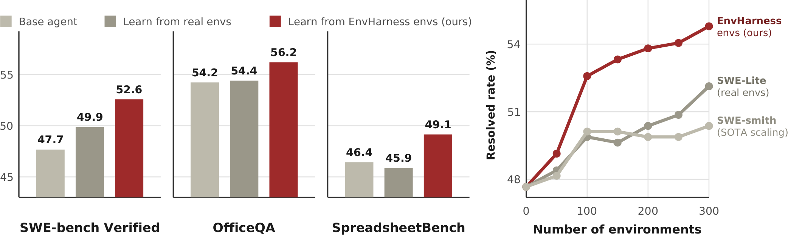
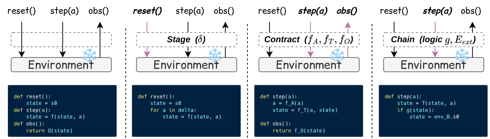

# EnvHarness：让静态环境根据 Agent 的弱点主动变化

## 1. 基本信息

- **论文**：EnvHarness: Awakening Static Worlds for Agent Learning
- **作者**：Chengsong Huang 等，Washington University in St. Louis、Google Cloud AI Research、Google Cloud、University of North Carolina at Chapel Hill
- **arXiv**：[2608.19880](https://arxiv.org/abs/2608.19880)
- **PDF**：[在线 PDF](https://arxiv.org/pdf/2608.19880) · [本地 PDF](arxiv_2608_envharness_awakening_static_worlds_for_agent_learning.pdf)
- **代码**：[google-research/envharness](https://github.com/google-research/envharness)
- **项目主页**：[envharness.com](https://www.envharness.com)
- **提交时间**：2026-08-20
- **阅读层级**：细粒度（detailed）

**一句话理解**：EnvHarness 不重写原来的环境，也不改变环境的 verifier，而是在环境外面套一层可编程 wrapper。这个 wrapper 根据目标 policy 的失败轨迹，自动改变初始状态、动作/观察规则或任务组合，让环境专门练习模型当前缺失的能力。

它和 agent harness 的关系是一个镜像：

```text
Agent = frozen model + agent harness
       （工具、记忆、循环、上下文管理）

Customized environment = static environment + EnvHarness
       （初始状态、动作规则、观察规则、任务组合）
```

论文的重点不是“让模型直接学会修改 harness”，而是让**环境生成更有针对性的训练信号**，然后用 skill learning 或 RL 训练 policy。

## 2. 论文要解决什么问题？

### 2.1 静态环境的问题

Agent 通过环境学习，但传统环境通常在设计完成后就固定不变：

- agent 总是从同样的状态开始；
- 可以使用同样的动作和观察接口；
- 失败时得到的反馈不一定针对具体弱点；
- agent 变强后，环境可能只剩下已经会做的题。

例如，一个 coding agent 总是在提交代码前忘记运行测试。静态 SWE-bench 环境只会在最后给出成功或失败，不会主动制造“必须先验证才能提交”的训练情境。

已有 environment generation 方法可以生成新任务，但作者指出它们通常有两个问题：

1. 每个领域都要重新设计一套生成器；
2. 生成的 transition、observation 或 verifier 可能由 LLM 合成，容易出现逻辑错误或评测漂移。

EnvHarness 的策略是：**保留原环境的真实执行逻辑和可信 verifier，只改变 agent 看到和能做什么。**

### 2.2 论文的核心假设

如果我们能观察 policy 的失败轨迹，就可以判断它缺少哪种能力，然后把原环境改造成针对这个弱点的训练环境。

因此，EnvHarness 需要满足三个条件：

| 条件 | 含义 |
|---|---|
| 可组合 | 初始状态、动作规则、观察规则和任务组合可以叠加 |
| 与领域无关 | 只依赖统一的 `reset/step` 接口，不深入修改 benchmark 内部代码 |
| 评测可信 | 原环境的 verifier 保持不变，改造后的任务仍由原 verifier 判分 |

## 3. 整体流程

论文方法可以拆成两条循环：一条是 policy 与环境交互的执行循环，另一条是 designer 根据轨迹修改环境的设计循环。



### 3.1 执行循环

```text
当前环境 E 或 EnvHarness(E)
           ↓ reset / step
目标 policy π 执行动作
           ↓
得到 observation、终止状态和 verifier 结果
           ↓
保存 rollout trajectory
```

### 3.2 Designer 循环

```text
Observe：收集 policy 的成功和失败轨迹
        ↓
Diagnose：分析失败的根因
        ↓
Write：生成 Stage / Contract / Chain 组件
        ↓
Validate：用新的 policy rollout 验证组件
        ↓
ACCEPT / REFINE / REJECT
```

如果候选组件被接受，就叠加到当前 EnvHarness；如果候选让任务变得不可解或没有增加有效训练信号，就拒绝或要求修改。

### 3.3 训练时到底发生了什么？

主实验的流程不是直接把 EnvHarness 代码交给模型，而是：

```text
原始环境 E
   ↓ designer 根据 policy 轨迹生成
针对弱点的环境 E' = EnvHarness(E)
   ↓ policy 在 E' 中执行
成功 trajectory
   ↓ ReasoningBank 风格的 skill extraction
skill bank
   ↓
在原始 held-out 任务上评估 policy + skills
```

此外，作者单独做了在线 RL 实验：在 ALFWorld 和 WebShop 中，直接使用 EnvHarness 环境进行 GRPO，比较原始环境训练和改造环境训练的 policy。

## 4. EnvHarness 的形式化定义

将基础环境写成：

$$
E=(\mathcal S,\mathcal A,\mathcal O,T,R,s_0).
$$

其中：

- $\mathcal S$：环境状态空间；
- $\mathcal A$：agent 可执行动作空间；
- $\mathcal O$：agent 能看到的 observation 空间；
- $T$：状态转移函数；
- $R$：由原始 verifier 产生的 reward；
- $s_0$：初始状态。

EnvHarness 组件是一个只作用于接口的变换 $w$：

$$
E'=w(E),\qquad E'=(\mathcal S',\mathcal A',\mathcal O',T',R',s_0').
$$

关键点是：虽然接口层看到的 $\mathcal A'$、$\mathcal O'$、$T'$ 或 $s_0'$ 可能发生变化，但底层 simulator 和原始 verifier 不被直接修改。特别是论文中的 `Contract` 不改变任务最终的成功判定，`Chain` 的复合 reward 由各子环境原有 verifier 的结果组合得到。

### 4.1 与 agent harness 的对应关系

| Agent harness | EnvHarness |
|---|---|
| 基础系统：冻结的 LLM | 基础系统：静态环境 |
| 解决模型没有工具、记忆或循环的问题 | 解决环境交互逻辑固定的问题 |
| 外部工具、memory、skill | 外部 Stage、Contract、Chain |
| 得到可执行的 agent | 得到可定制的 environment |


## 5. 三类环境组件



### 5.1 Stage：改变 episode 的起点

`Stage` 在 `reset()` 之后、policy 开始行动之前，通过普通的环境动作 replay 一串操作，把环境带到新的可达状态。

$$
s'_0=T(\cdots T(T(s_0,a_1),a_2)\cdots,a_k).
$$

以 ALFWorld 的“把干净的杯子放到桌上”为例，Stage 可以先执行：

```text
take mug 1
open drawer 1
put mug 1 in drawer 1
close drawer 1
```

这样 policy 开始时看不到桌面上的杯子，必须先搜索抽屉。相反，也可以预先执行清洁动作，让 policy 只练习最后的放置步骤。

Stage 的重要性质是：它通过环境自己的 action vocabulary 改变状态，不直接写内部状态字段，所以产生的起点是可达的。

### 5.2 Contract：重写每一步的交互

`Contract` 由三个 transformation map 组成：

$$
(\mathcal A',\mathcal O',T')=(f_A(\mathcal A),f_O(\mathcal O),f_T(T)).
$$

对应三个 hook：

| hook | 作用 | 例子 |
|---|---|---|
| `filter_action` / $f_A$ | 改写或阻止 agent action | 删除 teleport，迫使 agent 逐步搜索 |
| `filter_observation` / $f_O$ | 修改 agent 看到的 observation | 截断房间描述，训练跨步建立空间表示 |
| `modify_transition` / $f_T$ | 修改动作执行后的 response | 没拿着杯子时阻止 `clean mug` |

例如 coding 任务中可以生成如下 Contract：

```python
class _Contract(Contract):
    def modify_transition(self, action, response, env_state):
        if is_submission(action) and not env_state["ran_tests"]:
            return failed(response, "Run tests before submitting.")
        return response
```

这个组件没有修改最终 verifier，而是让“未经测试就提交”变成一个即时反馈，从而把验证行为变成训练信号。

### 5.3 Chain：拼接多个环境或任务

`Chain` 把两个 `ActionableEnv` 连接成一个更长的 episode。最简单的形式是：

```text
完成环境 A
    ↓
切换到环境 B
    ↓
只有 A 和 B 都成功，复合任务才成功
```

论文中的例子是先完成“把杯子放到桌上”，再完成“加热土豆并放到台面上”。这样可以训练：

- 不要在第一个子任务结束后过早停止；
- 在任务切换后重新识别环境；
- 管理共享的 episode step budget；
- 保持跨子任务的目标。

原论文正文主要使用串行连接；附录的代码还展示了按结果分支、中途切换和交替执行等扩展形式。

### 5.4 组件可以组合，但顺序有影响

多个组件可以嵌套：

$$
E'=w_{\mathrm{chain},\ell}\left(w_{\mathrm{contract},r}\left(w_{\mathrm{stage},\delta}(E)\right)\right).
$$

一个组合示例是：

```text
Stage：先把杯子藏进抽屉
  ↓
Contract：限制 observation，只显示两句话
  ↓
Chain：完成当前任务后追加第二个任务
```

组件变换通常不可交换，即 $w_1\circ w_2\neq w_2\circ w_1$。例如，先 Stage 再 Contract 与先 Contract 再 Stage，可能产生不同的初始化和观察结果。

## 6. Designer：怎样自动生成环境组件？


### 6.1 任务与 policy 条件化

给定基础环境 $E$、任务 $t$ 和目标 policy $\pi$，论文希望找到：

$$
E'=\mathcal H(E,t;\pi)=(w_k\circ w_{k-1}\circ\cdots\circ w_1)(E).
$$

单个组件本身不读取模型权重，也不绑定某个特定模型；但组件的选择和参数化要根据任务和 policy 的执行轨迹来决定。

这一区分很重要：

```text
组件实现：policy-agnostic
组件选择：task-policy-conditioned
```

### 6.2 Observe：收集成功和失败轨迹

Designer 先让 policy 在当前环境中运行一批 rollout。

- 失败轨迹暴露问题在哪里；
- 成功轨迹说明哪些能力已经具备；
- 成功率和失败分布帮助判断环境是太容易、太难，还是某个局部行为出了问题。

作者特别强调：如果 policy 已经 100% 成功，Designer 不应该继续把任务变简单，而要增加适度困难来暴露潜在弱点。

### 6.3 Diagnose：从行为归纳弱点

Designer 重点诊断系统性行为，例如：

- 在同一个动作上反复循环；
- 无法处理过长 observation；
- 错误理解工具约束；
- 依赖一个不稳定的 shortcut；
- 提交前没有进行测试或复核。

诊断结果是文本描述，之后交给 Write 阶段生成组件。

### 6.4 Write：写出一个或多个组件

Designer 可以只写一个组件，也可以组合多个组件。例如：

```text
诊断：policy 直接提交 patch，没有运行测试
        ↓
Contract：如果没有测试记录，则阻止提交
        ↓
policy 被迫学习“修改 → 测试 → 修复/提交”流程
```

代码组件可以覆盖动作过滤、transition 修改、observation 过滤和 reset 前动作 replay。

### 6.5 Validate：用新 rollout 验证候选

候选组件被套到当前环境上，再让 policy 运行新的 rollout。Designer 根据成功率、失败分布和 timeout 情况决定：

| 决定 | 含义 |
|---|---|
| `ACCEPT` | 候选产生了有效、可解的训练信号 |
| `REFINE` | 方向可能正确，但强度需要调整 |
| `REJECT` | 候选使任务不可解、过于简单或没有带来有效变化 |

这里有一个重要的防退化规则：如果候选让大多数 rollout 都 timeout 或成功率降到 0，不能继续叠加更多限制，而应该放松或撤销刚才的修改。

## 7. 工程实现

### 7.1 统一接口：`ActionableEnv`

每个 benchmark 都被 Bridge 适配成统一的 `ActionableEnv` 接口，核心方法包括：

```text
reset(seed, options)
step(action)
evaluate()
observe()
get_env_state()
save_state()
from_state(state)
```

`step(action)` 返回 observation、reward、terminated、truncated 和 info；`evaluate()` 返回最终 `EvaluationResult`。

`get_env_state()` 只暴露一个 runtime-safe 的数据视图。组件不能直接拿 Docker handle、浏览器 page 或 socket，避免生成的组件依赖具体运行时。

论文实现了七个 Bridge，覆盖：

- Toy24 等内存环境；
- ALFWorld 文本冒险环境；
- SWE-bench、OfficeQA 和 SpreadsheetBench 的 Docker 环境；
- WebArena 和 WebShop 的 Playwright 浏览器环境。

所有上层 policy loop、Designer 和 EnvHarness 组件都复用同一套接口。

### 7.2 装饰器式组件栈

代码中的 `EnvHarness` 是一个 `ActionableEnv`，同时包裹另一个 `ActionableEnv`：

```text
Rules(Setups(Toy24Bridge))
```

仍然是一个 `ActionableEnv`。每个组件只重写自己关心的方法，其余调用转发给 inner environment。

论文中的名字与代码中的名字有对应关系：

| 论文名称 | 代码类名 | 主要字段 |
|---|---|---|
| Stage | `Setups` | `in_env_actions` |
| Contract | `Rules` | `rules_code` |
| Chain | `Link` | 环境组合参数 |

`Rules` 生成的 Python 源码会在受限 namespace 中加载，并在每个 episode 的子进程中执行。这样生成代码出错时只会让当前 episode 失败，不会直接崩掉整个框架。

### 7.3 Bridge 与组件的边界

Bridge 是唯一了解具体 runtime 的层：

```text
benchmark runtime
        ↓
Bridge / ActionableEnv
        ↓
EnvHarness components
        ↓
policy / designer
```

组件只读取 `env_state` 的公开字段，不能访问底层 simulator 的私有状态。这是 EnvHarness 能跨领域复用的关键，也是它与直接修改 benchmark 内部逻辑的 environment generation 方法的区别。

## 8. 实验设置

### 8.1 Benchmark

论文覆盖四个领域、五个 benchmark：

| 领域 | Benchmark | 训练/评估设置 |
|---|---|---|
| embodied text interaction | ALFWorld | 100 个训练任务，剩余任务 held-out |
| web interaction | WebArena | 每个子域 20 个训练任务，其余评估 |
| software engineering | SWE-bench Verified | 100 个 SWE-bench Lite 任务训练，407 个不重叠 Verified issue 评估 |
| office automation | OfficeQA | 50 个训练任务，172 个官方测试任务 |
| office automation | SpreadsheetBench | 100/400 个 verified task 训练，299 个 held-out task、897 个实例评估 |

Designer 和 policy 在每个 benchmark 使用相同 backbone：

- ALFWorld、WebArena：Gemini 3.1 Flash-Lite；
- 其他任务：Gemini 3.5 Flash。

因此主实验不是“强 teacher 给弱 student 蒸馏”，而是同一 backbone 的 Designer 和 policy 协同使用。

### 8.2 Skill learning 设置

主实验使用 skill-based learning：

1. policy 在原环境或 EnvHarness 环境中执行；
2. 从轨迹中提取 skills；
3. 用 skill-equipped policy 在 held-out 原始任务上评估。

对比项包括：

- `No Skills`：不使用 skill；
- `Original Envs`：从未修改环境中抽取 skill；
- `GenEnv`、`VeriEnv`、`SWE-smith`：对应领域的专用环境生成方法；
- `EnvHarness Envs`：从 EnvHarness 改造环境中抽取 skill。

主自动化流程没有把 `Chain` 放进去，因为 Designer 难以观察连接环境的内部状态；Chain 的效果单独分析。

## 9. 主要结果

### 9.1 Skill learning 主结果

#### ALFWorld 与 WebArena

| Skill source | ALFWorld In-Dist | ALFWorld OOD | ALFWorld Avg. | WebArena Avg. |
|---|---:|---:|---:|---:|
| No Skills | 62.6 | 60.7 | 61.7 | 38.7 |
| Original Envs | 63.3 | 61.4 | 62.4 | 38.5 |
| GenEnv | 63.3 | 61.9 | 62.6 | -- |
| VeriEnv | -- | -- | -- | 39.6 |
| **EnvHarness Envs** | **66.2** | **70.4** | **68.3** | **41.6** |
| EnvHarness - Original | +2.9 | +9.0 | +5.9 | +3.1 |

WebArena 分域结果中，EnvHarness 的 Reddit、Shopping、Shop Admin、GitLab 分别为 40.6、37.4、50.8、37.7。

#### SWE-bench、OfficeQA 与 SpreadsheetBench

| Skill source | SWE SR | SWE Avg. Steps | OfficeQA EM | OfficeQA F1 | Spreadsheet Pass@1 | Spreadsheet Mean Score |
|---|---:|---:|---:|---:|---:|---:|
| No Skills | 47.67 | 53.58 | 54.23 | 55.77 | 46.44 | 61.32 |
| Original Envs | 49.88 | 55.01 | 54.40 | 55.77 | 45.88 | 61.47 |
| SWE-smith | 50.12 | 54.72 | -- | -- | -- | -- |
| **EnvHarness Envs** | **52.58** | **49.61** | **56.20** | **57.73** | **49.15** | **62.48** |
| EnvHarness - Original | +2.70 | +5.40 | +1.80 | +1.96 | +3.27 | +1.01 |

EnvHarness 在 SWE-bench 上同时提高成功率并减少平均步数：49.88% → 52.58%，55.01 → 49.61 steps。

### 9.2 为什么改造环境能带来收益？

作者的解释是，原始环境只允许 policy 重复自己已经会做的行为；EnvHarness 会针对它的弱点制造“刚好需要改进”的情境。

例如：

```text
原始行为：修改代码 → 直接提交
诊断：缺少测试验证
Contract：未运行测试时阻止提交
抽取的 skill：修改后先运行相关测试，再提交
```

在 SWE-bench 中，EnvHarness skills 将平均步数从 53.6 降到 49.6，而 Original Envs skills 反而增加到 55.0。这说明抽取到的不只是“完成任务”的模板，也包含更高效的执行顺序。

### 9.3 跨任务类型泛化

ALFWorld leave-one-out 结果：从除某一类型外的其他类型抽取 skills，再在被留出的类型上评估。

| Held-out type | Original | EnvHarness | 差值 |
|---|---:|---:|---:|
| clean | 54.8 | **71.2** | +16.4 |
| cool | 38.5 | **39.3** | +0.8 |
| heat | **61.1** | 52.4 | -8.7 |
| look_lamp | 79.0 | **82.7** | +3.7 |
| simple | 83.6 | 83.6 | 0.0 |
| two_obj | 46.4 | **52.9** | +6.5 |
| 平均 | 60.6 | **63.7** | +3.1 |

结果不是所有类型都提升，`heat` 反而下降 8.7 个百分点。更准确的结论是：改造环境平均提升了跨类型泛化，但并不能保证每个任务族都受益。

## 10. EnvHarness 是否真的能帮助 RL？

论文用 Qwen3-8B-base 在 ALFWorld 和 WebShop 上做 GRPO：

| Training environment | ALFWorld In-Dist | ALFWorld OOD | ALFWorld Avg. | WebShop Score | WebShop SR |
|---|---:|---:|---:|---:|---:|
| Original Envs | 81.4 | **89.6** | 85.5 | 75.6 | 66.0 |
| **EnvHarness Envs** | **87.9** | 88.8 | **88.4** | **79.2** | **67.4** |

EnvHarness 训练环境在 4 个指标中有 3 个超过原始环境：

- ALFWorld In-Dist：81.4 → 87.9；
- ALFWorld OOD：89.6 → 88.8，略有下降；
- WebShop Score：75.6 → 79.2；
- WebShop SR：66.0 → 67.4。

因此，论文支持的结论是：**动态改造环境可以提供更好的 online RL signal**。但它不是 model-harness joint RL：GRPO 更新的是 policy，EnvHarness 组件由 Designer 另外生成。

## 11. Chain 的长程效果

| Training source | Success Rate | Average Steps |
|---|---:|---:|
| No Skills | 47.67 | 53.58 |
| Original Envs | 49.88 | 55.01 |
| EnvHarness Stage/Contract | 52.58 | 49.61 |
| EnvHarness Chain | 49.63 | **41.96** |
| Stage/Contract + Chain | **54.30** | 43.12 |

Chain 单独使用时成功率略低，但平均步数显著下降，说明它主要训练了长程目标保持和预算管理。和 Stage/Contract skill 组合后，成功率达到 54.30%，同时保持较低的平均步数。

## 12. 环境扩展、跨模型与用户约束

### 12.1 环境数量扩展

在 SWE-bench 上，每批增加 50 个环境，并保持相同的环境预算和 skill retrieval protocol：

- EnvHarness：47.67 → 54.79；
- 原始环境：最高约 52.13；
- SWE-smith：约 50.37。

区别在于，EnvHarness 下一批环境会针对已经装备历史 skills 的 policy 继续诊断，因此环境和 policy 会一起向能力边界推进。

### 12.2 跨模型

在 SWE-bench Verified 上测试：

- Gemini 3.1 Flash-Lite；
- Qwen3.6 27B；
- Gemini 3.5 Flash；
- Claude Sonnet 4.6。

EnvHarness skills 相比 Original Envs skills 在四个模型上都提升了 2.7–3.7 个百分点。模型能力改变的是诊断内容，而不是整个 Designer loop 是否有效。

### 12.3 目标化环境生成

Designer 不只能根据自然失败轨迹工作，也可以接受用户指定的目标：

- 让 success rate 落在 `[0.4, 0.6]`；
- 让平均步数落在 `[25, 35]`；
- 让 policy 在提交前必须运行测试。

在 ALFWorld 上，命中 success-rate 目标区间的任务比例从 6.0% 提升到 80.0%；命中平均步数目标区间的比例从 18.0% 提升到 53.0%。

## 13. 计算成本与可复现性

EnvHarness 的设计循环需要额外 rollout，因此不是免费地获得更好的训练数据。

| Benchmark | 方法 | Design tokens | Rollout tokens | Total tokens |
|---|---|---:|---:|---:|
| ALFWorld | GenEnv | 38K | 64.2M | 64.2M |
| ALFWorld | EnvHarness | 1.46M | 226.6M | 228.0M |
| WebArena | VeriEnv | 20K | 137.7M | 137.8M |
| WebArena | EnvHarness | 1.58M | 135.7M | 137.3M |

和 VeriEnv 相比，WebArena 总 token 成本接近；但 ALFWorld 上 EnvHarness 的 rollout 成本明显更高。作者将这解释为“grounding cost”：EnvHarness 的 rollout 在真实环境和可信 verifier 中执行，而 GenEnv 的 rollout 是 LLM 模拟的。

代码仓库中的命名与论文略有不同：

```text
论文 Stage    ↔ 代码 Setups
论文 Contract ↔ 代码 Rules
论文 Chain    ↔ 代码 Link
```

实现需要 benchmark bridge、统一 `ActionableEnv` 接口以及可恢复的 reset/state 机制。尤其是 Stage 和 Chain 都依赖环境能可靠 reset；真实用户账户、不可撤销订单或无法恢复的物理机器人状态不适合直接套用当前实现。

## 14. 这篇工作和 Harness RL 的关系

这是理解本文最容易混淆的地方。

### 14.1 它做了什么

```text
冻结 policy 或用 policy 做 RL
        ↓
观察 policy 的失败
        ↓
修改训练环境的接口行为
        ↓
让环境提供更有针对性的训练信号
```

### 14.2 它没有做什么

EnvHarness 没有：

- 通过 RL 更新 EnvHarness 组件参数；
- 把环境 wrapper 的代码蒸馏进 LLM 权重；
- 移除运行时后让模型凭空拥有 verifier、文件系统或浏览器能力；
- 在同一个梯度优化中同时更新模型和环境 wrapper。

它更准确的定位是：

> **designer-driven environment co-evolution + policy learning**

而不是严格意义上的 end-to-end model-harness joint RL。

## 15. 优点、局限与我的判断

### 15.1 优点

1. **保留原 verifier**：环境改造发生在接口层，避免 LLM 生成 verifier 带来的评测漂移。
2. **统一抽象**：同一套 Stage、Contract、Chain 和 Designer loop 可以跨 ALFWorld、WebArena、SWE-bench、OfficeQA 使用。
3. **针对当前弱点**：不是盲目增加任务数量，而是根据 policy 的失败模式构造训练情境。
4. **可用于 skill learning 和 RL**：论文同时展示了从改造环境抽 skill 以及直接用改造环境做 GRPO。
5. **支持持续 co-evolution**：上一轮 skills 装备后的 policy 会成为下一轮环境设计的目标。

### 15.2 局限

1. **设计成本较高**：每次提案都需要 rollout、验证和可能的多轮修订。
2. **依赖可 reset 的环境**：不可撤销的真实服务和难以恢复的物理环境不适用。
3. **Chain 仍主要是串行组合**：复杂分支、共享中间状态和语义相关性没有被充分解决。
4. **当前主要是文本动作/观察**：视觉 GUI 和多模态状态还需要新的组件接口。
5. **训练收益和环境收益没有完全拆开**：skill extraction、environment reshaping 和 policy learning 同时存在，难以完全归因。
6. **强度控制依赖 rollout 统计**：候选太弱没有训练信号，候选太强会导致不可解；Designer 的 `ACCEPT/REFINE/REJECT` 判断质量非常关键。

### 15.3 对当前 Harness 研究的启发

如果要把 EnvHarness 思路接到 coding/search agent 上，可以采用：

```text
真实 agent harness H0
        ↓
记录 action、observation、verifier 和失败类型
        ↓
Designer 生成环境侧 Contract
        ↓
在 H0 + EnvHarness wrapper 中做 rollout / RL
        ↓
只保留能在原 verifier 下验证的轨迹
        ↓
再用 SFT / OPD / RL 训练模型
```

最值得借鉴的不是“三个组件的具体名字”，而是两个原则：

1. **环境增强必须保持 verifier 不变**，否则训练信号可能只是评测漏洞；
2. **环境修改要针对 policy 的当前失败分布**，而不是无条件增加难度或任务数量。

若进一步和 EvoIn、VACE、CoTrace 结合，可以把流程扩展为：

```text
policy RL
   ↓
EnvHarness 根据失败轨迹改造环境
   ↓
验证候选环境
   ↓
收集与当前 harness 匹配的轨迹
   ↓
Tailor / replay / checker
   ↓
SFT、OPD 或下一轮 RL
```

## 16. 关键图表索引

- 总体性能图：[figure1.png](assets/arxiv_2608_envharness_awakening_static_worlds_for_agent_learning_tex/figure1.png)
- Agent harness 与 EnvHarness 类比：[Harness.jpg](assets/arxiv_2608_envharness_awakening_static_worlds_for_agent_learning_tex/Harness.jpg)
- 三类组件：[components.png](assets/arxiv_2608_envharness_awakening_static_worlds_for_agent_learning_tex/components.png)
- Designer 闭环：[loop.jpg](assets/arxiv_2608_envharness_awakening_static_worlds_for_agent_learning_tex/loop.jpg)
- UML 接口结构：[uml_envharness.png](assets/arxiv_2608_envharness_awakening_static_worlds_for_agent_learning_tex/uml_envharness.png)
- SWE-bench 环境扩展：[coevolution_swe_dual.png](assets/arxiv_2608_envharness_awakening_static_worlds_for_agent_learning_tex/coevolution_swe_dual.png)
- 跨模型结果：[crossmodel_bars_python.png](assets/arxiv_2608_envharness_awakening_static_worlds_for_agent_learning_tex/crossmodel_bars_python.png)

## 17. 读后索引

- **Environment Harness**：包装静态环境的可编程接口层。
- **Stage / Setups**：通过 action replay 修改 episode 起点。
- **Contract / Rules**：修改动作、transition 或 observation。
- **Chain / Link**：串联或组合多个环境。
- **Designer / EnvRigger**：观察轨迹、诊断弱点、生成并验证组件的 agent。
- **ActionableEnv**：所有 benchmark bridge 和组件共同遵守的统一接口。
- **Skill learning**：从改造环境轨迹中抽取 procedural skills。
- **Online RL**：论文中使用 Qwen3-8B-base + GRPO，比较原始环境和 EnvHarness 环境作为训练信号。
- **Verifier preservation**：底层任务 verifier 保持不变，是本文可信度的核心。

