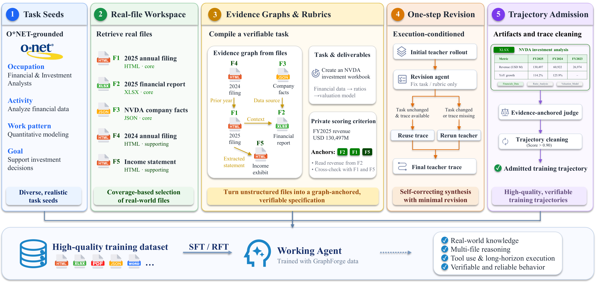

# GraphForge：用图锚定的工作区合成训练 Working Agents

- **论文**：GraphForge: Training Working Agents with Graph-Anchored Workspace Synthesis
- **作者**：Qisheng Su 等
- **来源**：[arXiv:2609.38923](https://arxiv.org/abs/2609.38923) · [PDF](https://arxiv.org/pdf/2609.38923)
- **主题**：agent / working agent / workspace synthesis / evidence-grounded verification
- **代码与模型**：作者提供的 [GraphForge checkpoints](https://huggingface.co/collections/groundhogLLM/graphforge)

## 一句话结论

GraphForge 的核心不是让模型凭空编任务，而是先用 O*NET 职业活动控制任务方向，再从真实文件组装 workspace，构建跨文件 **evidence graph**，由图同时编译出任务说明和可验证 rubric。这样生成的轨迹既有真实文件工作的复杂性，又能用文件证据检查结果。用 2,169 条轨迹 SFT 后，Qwen3.6-27B 在 GDPVal、Workspace-Bench-Lite、SpreadsheetBench II 上分别提升 65.7 Elo、7.7 分和 13.7 分（主文报告的代表性 scaffold）。

## 1. 研究问题与定位

Working agent 要在文件系统、表格、文档和终端中完成长链路工作：检索材料、跨文件对齐、计算、修改文件并交付可用 artifact。训练这类 agent 的瓶颈有两个：

1. **任务环境要真实且多样**：模型生成的文件通常缺少真实业务冗余、格式差异和跨文件依赖；只靠少量模板容易让任务坍缩成泛化的“总结/分析”。
2. **结果要能细粒度验收**：仅检查文件是否存在或脚本状态，无法判断表格中的数字、引用、结论是否正确；但完全人工写 rubric 成本很高。

论文将 GraphForge 与两类工作区数据管线对比：EnvCraft 生成文件并用状态脚本检查，无法深入文档内容；NexForge 使用真实文件，但没有 task-specific rubric/verifier。GraphForge 的差异是把“任务要求”和“验证信号”都绑定到真实文件中的证据。

## 2. 总体流程

流程可拆成五步：

1. **O*NET seed 构造**：确定职业、详细工作活动（DWA）、工作需求和主要执行模式。
2. **真实文件 workspace 构造**：搜索一个连贯的公开案例，下载并解析原生文件，赋予隐藏文件角色。
3. **Evidence graph 构建**：节点记录“哪个文件提供哪个事实/字段”，边记录跨文件解释、比较、对账或推导关系。
4. **任务与 rubric 编译 + 一步修订**：从图生成 task statement、deliverable requirements、正/负 criteria；让 teacher 先执行一次，再针对歧义、错误锚点和不可验证项修订。
5. **artifact admission**：先做确定性文件检查，再由 evidence-anchored judge 按锚点逐条评分；只保留质量超过阈值的轨迹。

工作 agent 只能看到任务 $q_i$ 和 workspace $W_i$，看不到 graph node ID 和文件隐藏角色；judge 才能看到 evidence anchors 和 verification procedure。这避免把解题路径直接泄露给训练中的 agent。

## 3. 方法细节

### 3.1 O*NET-grounded seeds：控制方向而非直接写答案

论文保留 AI4Work 标记为 DIGITAL 的 O*NET 任务，并通过官方 task-to-DWA 映射得到受控任务类型。过滤后有 **246 个职业、16 个 sector、43 个 sub-sector、891 个 DWA 类型、3,419 个有效 occupation-task-type pair**。

每个 seed 表示为：

$$
s_i=(o_i,a_i,w_i,p_i,u_i,e_i^{\mathrm{occ}}),
$$

其中 $o_i$ 是职业，$a_i$ 是 DWA，$w_i$ 是有职业证据支撑的工作需求，$p_i$ 是 16 类执行模式之一，$u_i$ 是预期输入文件族，$e_i^{\mathrm{occ}}$ 是检索到的职业证据。作者明确要求：没有直接证据支持的 work demand 会被丢弃，而不是为了凑配额编造。

为避免高频职业和泛化分析任务占满数据，候选 seed 按 occupation、DWA、execution pattern、input family 的边际覆盖贪心选择：

$$
\Delta(s\mid\mathcal S)=\sum_{d\in\mathcal D}\frac{1}{1+n_d(v_d(s))}.
$$

文件实际落地后，作者还按 materialized input/output family 再平衡一次，并对执行模式、sector、重复归一化需求 $w$ 设置配额/上限。这个设计使 seed 只负责“做哪类工作”，而具体公司、事件、数据集和结论由后续真实 workspace 决定。

### 3.2 Real-file workspace 与隐藏角色

搜索 agent 为 case-neutral seed 找到一个连贯公开案例，形成：

$$W_i=\{f_{i1},\ldots,f_{im}\}.$$

文件以原生格式下载，用格式专用工具解析，去除精确重复和无效文件。每个文件被赋予不会展示给工作 agent 的角色：

| 角色 | 作用 |
|---|---|
| `core` | 驱动主要计算或决策 |
| `supporting` | 提供政策、背景或上下文 |
| `confuser` | 看似相关但不适用的替代材料 |
| `ambient` | 增加真实冗余和工作区噪声 |

因此 workspace 不只是“若干相关文档”，还包含选择、排除和跨文件核对所需的干扰项。

### 3.3 Evidence graph：把事实、来源和依赖显式化

GraphForge 构建 $G_i=(V_i,E_i)$：

- 节点 $v$：来源文件、文件提供的事实/字段、以及该事实在任务中的角色。
- 边 $e$：解释、比较、reconcile 或 derive 某信息所需的跨文件依赖。

图不是不可质疑的 ground truth；它的每个 claim 必须能回溯到原始文件。图随后编译任务规格：

$$
\mathcal C_i=(q_i,\mathcal D_i,\mathcal R_i^+,\mathcal R_i^-;G_i),
$$

包括自然语言任务 $q_i$、交付要求、正向 criteria 和负向 penalty criteria。每个正向 criterion 为：

$$
c_k=(d_k,r_k,z_k,w_k,A_k,\phi_k),\quad A_k\subseteq V_i,
$$

分别表示目标 artifact、具体要求、预期值/计算、权重、证据锚点集合、验证程序。负向 criteria 只在有直接证据证明违反时处罚，降低 judge 对主观“看起来不理想”的过度惩罚。

关键分离是：**agent 执行自然语言任务；judge 按文件锚点验证交付物**。锚点既用于生成 rubric，也用于后续评分，但不会泄露 node ID 或 hidden role。

### 3.4 Execution-conditioned one-step revision

仅静态检查无法发现长任务中的歧义。对初始规格 $\mathcal C_i^0$，teacher $\pi_T$ 先在真实 workspace 执行一次，得到 $\tau_i^0$ 和 deliverables。revision agent 同时看到原始文件、证据图、任务/rubric 和这次执行，检查：

- 任务是否自然、可执行；
- 要求的数量/字段是否被文件支持；
- 每个 criterion 是否锚定到正确文件；
- verification instructions 是否足以检查 artifact。

revision agent 只返回需要变更的字段；compiler 保留未变字段，并检查引用和 schema。若任务文本的归一化 hash 没变且旧轨迹存在，则复用旧 rollout，否则重新执行：

$$
\tau_i=\begin{cases}
\tau_i^0,&H(q_i^1)=H(q_i^0)\ \text{且}\ \tau_i^0\ \text{存在},\\
\pi_T(W_i,q_i^1),&\text{否则}.
\end{cases}
$$

这一步是成本与质量的折中：rubric 绑定变化不必重复 rollout；任务语义变化则必须重新执行。

### 3.5 Artifact-level admission 与清洗

轨迹只有在 deliverable 实际落盘后才会被接纳。确定性检查包括：文件名、格式可读性、表格所需 sheet/formula、任务特定结构约束。随后 judge 逐条检查 source file 与产出 artifact。

质量分数为正向满足程度减去负向违规程度：

$$
Q_i(\tau)=
\frac{\sum_{k\in\mathcal R_i^+}w^+_{ik}a_{ik}(\tau)-
\sum_{j\in\mathcal R_i^-}\lambda_{ij}v_{ij}(\tau)}
{\sum_{k\in\mathcal R_i^+}w^+_{ik}},
$$

其中 $a_{ik}\in[0,1]$ 是 criterion 满足比例，$v_{ij}(\tau)$ 是有证据支持的违规程度。SFT admission 采用 one-step revision 后 **$Q_i>0.90$**；行为过滤、格式检查和超长过滤也会剔除样本。

## 4. 数据规模与训练配置

建设漏斗如下：

| 阶段 | 数量 | 占 materialized tasks |
|---|---:|---:|
| Materialized tasks | 3,638 | 100.0% |
| 可复用未变更 rollout | 2,967 | 81.6% |
| $Q>0.90$ 接纳任务 | 2,153 | 59.2% |
| Validated trajectories | 2,169 | 59.6% |
| Unique workspaces | 2,150 | 59.1% |

一项任务在 rollout 被 compact 成多个训练序列，因此轨迹数略高于任务数。完整训练序列保留 assistant reasoning 和 tool history；超过 **262,144 tokens** 的样本直接排除，不截断。

| 配置 | SFT | RFT |
|---|---:|---:|
| 初始化 | Qwen3.6 base（27B 或 35B-A3B） | 35B-A3B SFT |
| examples | 2,169 trajectories | 每个 arm 462 |
| admission | one-step revision，$Q_i>0.90$ | best-of-4，$Q_i>0.95$，behavior-clean |
| epochs | 3 | 1 |
| optimizer | Muon | Muon |
| peak/min LR | $2\times10^{-5}$ / $1\times10^{-6}$ | $1\times10^{-6}$ / $1\times10^{-7}$ |
| warmup / weight decay | 0.10 / 0.05 | 0.10 / 0.05 |
| global batch | 8 | 8 |
| packed length / packing | 262,144 / enabled | 262,144 / enabled |

GraphForge pipeline 的 workspace 搜索、evidence graph、task/rubric generation、revision、teacher rollout 和 judge 均使用 **GLM-5.2**。SFT 两个 Qwen base 使用相同语料和优化 recipe。

## 5. 主实验

所有评测为 pass@1；同一 scaffold 内比较，失败/无效交付物计为 loss。GDPVal 使用每个 `(model, scaffold)` 作为 Bradley–Terry 图中的节点，GLM-5.3/OpenHands 固定为 Elo 1667；400 Elo 约对应 10:1 胜率赔率。Workspace-Bench-Lite 报 micro score，SpreadsheetBench II 报 execution accuracy。

### 5.1 SFT 结果

| 模型 | GDPVal OH | GDPVal Codex | Workspace Claude | Workspace Codex | Spreadsheet Claude | Spreadsheet Codex |
|---|---:|---:|---:|---:|---:|---:|
| Qwen3.6-35B-A3B | 1260.6 | 1283.0 | 55.9 | 53.4 | 2.8 | 4.7 |
| + GraphForge SFT | **1362.3** (+101.7) | **1384.4** (+101.4) | **59.7** (+3.8) | **60.0** (+6.6) | **19.3** (+16.5) | **18.7** (+14.0) |
| Qwen3.6-27B | 1380.0 | 1364.0 | 56.0 | 61.4 | 10.3 | 15.6 |
| + GraphForge SFT | **1445.7** (+65.7) | **1427.4** (+63.4) | **63.7** (+7.7) | **65.2** (+3.8) | **24.0** (+13.7) | **24.6** (+9.0) |

作者强调两个观察：

- 提升跨 scaffold：所有训练轨迹由 Codex scaffold rollout，但在 OpenHands、Claude Code、Codex 上均提升，说明学到的是工作技能而非单一 scaffold 的操作习惯。
- 35B-A3B 也提升，说明数据不只对 27B 有效；但两者都属于 Qwen3.6 家族，跨模型家族迁移尚未验证。

GDPVal 95% bootstrap CI（主表模型）示例：27B SFT OpenHands **1445.7 [1376.2, 1513.8]**，base 为 **1380.0 [1326.6, 1432.1]**；35B SFT OpenHands **1362.3 [1306.3, 1413.6]**，base 为 **1260.6 [1195.1, 1316.3]**。区间说明点估计差异应结合 task sampling uncertainty 阅读。

### 5.2 Rubric-guided RFT

从 2,000 个新 query（每个 execution pattern 125 个）采样每 query 4 条 SFT rollout。四候选由同一 task rubric 联合评分，保留 rubric-best 且 $Q>0.95$、行为干净的轨迹，得到 462 个 query。三组 RFT 使用完全相同的 query IDs、候选池、eligibility 和优化预算，只改变选择规则：

- **anchored**：judge 可见 rubric、evidence anchors 和 verification instructions；
- **unanchored**：只见 rubric 文本，不见显式 evidence anchors/verification instructions；
- **random-of-4**：在合格候选中随机选一个。

| 模型 | GDPVal OH | GDPVal Codex | Workspace Claude | Workspace Codex | Spreadsheet Claude | Spreadsheet Codex |
|---|---:|---:|---:|---:|---:|---:|
| 35B SFT | 1362.3 | 1384.4 | 59.7 | 60.0 | 19.3 | 18.7 |
| + RFT anchored | 1369.5 (+7.2) | 1395.4 (+11.0) | **63.7** (+4.0) | **64.0** (+4.0) | **20.3** (+1.0) | **19.6** (+0.9) |
| + RFT unanchored | **1396.4** (+34.1) | **1409.7** (+25.3) | 62.2 (+2.5) | 61.7 (+1.7) | 17.5 (-1.8) | 18.7 (0.0) |
| + RFT random-of-4 | 1353.3 (-9.0) | 1374.9 (-9.5) | 60.8 (+1.1) | 62.8 (+2.8) | 19.0 (-0.3) | 15.6 (-3.1) |

解读需谨慎：random 几乎一致地最弱，说明候选选择质量重要；evidence anchoring 在 Workspace-Bench-Lite 和 SpreadsheetBench II 上更符合设计预期。GDPVal 上 unanchored 点估计反而更高，但三种 RFT 的 GDPVal 差异置信区间均包含 0，因此作者不把它解释成 anchored 优于 unanchored 的确定证据。RFT 的条件 bootstrap CI 例如 anchored OpenHands 为 1369.5 [1319.1, 1416.5]，Codex 为 1395.4 [1349.5, 1440.1]；SFT 是固定锚点。

## 6. 污染、迁移与 judge 审计

### 6.1 Contamination audit

GDPVal 与 seed 共用 O*NET taxonomy，因此是最需要审计的 benchmark。训练集含 2,150 个 workspace、49,750 个 file instances、39,201 个 unique SHA-256；GDPVal 220 tasks 含 261 file instances、260 unique hashes。

| 层级 | 检查 | 结果 |
|---|---|---|
| 文件 | 39,201 train hashes vs 260 GDPVal hashes | 0 shared |
| 文本 | normalized 13-gram top-20 pairs | 0 substantive overlap；5 对仅通用数字，15 对仅 PPT master placeholder |
| 职业 | GDPVal 44 occupations | 仅 13/44 覆盖，65 tasks；155 tasks 未覆盖 |

Base vs SFT 的 GDPVal 胜率按职业覆盖分组：covered 65 tasks 为 **43/4/18，0.692 [0.585, 0.800]**；uncovered 155 tasks 为 **109/11/35，0.739 [0.671, 0.803]**；全体 220 为 **152/15/53，0.725 [0.668, 0.782]**。covered 与 uncovered 胜率差为 0.047，task-bootstrap 95% CI 为 **[-0.079, 0.175]**。这支持“迁移的工作技能”解释，但不是对无记忆化的数学证明。

### 6.2 Judge sensitivity

把 criterion 引用的 worksheet 删除，目标 criterion 的平均 $\Delta Q=-0.377$，非目标 criterion 的平均 $|\Delta Q|=0.016$，说明 judge 能读取并局部依赖结构性证据。

但对已引用证据中的细粒度内容做 row、numeric、citation corruption，目标分数变化分别只有 **-0.018、-0.022、-0.013**。理想 judge 应识别这些错误；作者将差距归因于 GLM-5.2 agentic judge 对细粒度内容核验能力有限。因此 evidence anchoring 不是自动等于可靠事实核验，尤其不能替代确定性检查或更强 judge。

## 7. 优点与局限

**优点**

- 用 occupation/DWA 控制 coverage，用真实文件决定具体案例，兼顾可控多样性和真实性。
- 同一 evidence graph 生成任务与 rubric，降低“题目要求无法由文件支持”或“评分标准无证据”的错配。
- hidden roles 引入真实工作区中的干扰材料，训练文件选择、排除和跨文件依赖推理。
- execution-conditioned revision 在收集轨迹前发现不可执行任务；deterministic checks 与 judge 形成互补。
- SFT 跨 scaffold 提升，且 contamination audit、judge sensitivity 和 bootstrap CI 都公开报告。

**局限与风险**

- 只有 2,169 条轨迹，尚未研究数据规模扩大后的收益曲线。
- synthesis pipeline 和 judge 全依赖 GLM-5.2；judge 的细粒度数值/引用核验明显不足。
- 只测试 Qwen3.6 的 27B 与 35B-A3B，不能据此推出跨模型家族泛化。
- 当前任务/file types 和 horizon 有限，真实组织工作中的权限、安全、协作和超长链路仍未覆盖。
- RFT 的 GDPVal 只有 220 tasks，点估计噪声较大；不能把 unanchored 的高点估计当成稳定结论。

## 8. 对 agent training 的可落地启发

1. **先定方向，后实例化案例**：把职业/任务类型作为 coverage 控制变量，把公司、数据集和文件内容延后到 workspace 构造，能减少模板化任务。
2. **把 verifier 当作数据生成的一等产物**：任务生成时同步保存证据锚点、预期计算和检查步骤，训练数据才有可审计的质量门槛。
3. **用图作为中间表示而非最终答案**：graph claim 必须可回溯原文件；编译器应验证字段、引用和 schema，而不能盲信 LLM 生成图。
4. **执行一次再修题**：teacher rollout 暴露歧义和缺失文件；若只是 rubric 绑定变化可复用 rollout，能控制成本。
5. **结构检查和语义 judge 分工**：文件名、格式、sheet、公式等用确定性 checker；事实一致性再用 anchored judge，并对 judge 做删除证据/篡改数字等敏感性审计。
6. **RFT 要做 matched control**：共享 query、候选池和优化预算，只改变 selection rule，才能把收益归因于 rubric/evidence 选择而不是数据或训练预算差异。

## 9. 我的评价

这项工作的主要贡献是数据工程和验证闭环，而不是新的 agent policy architecture。最有说服力的证据是：真实文件上的三类 benchmark 同时提升、提升跨 scaffold、且无文件级/实质文本重叠；最需要保留的疑问是 judge 对细粒度内容错误不敏感，以及 RFT/GDPVal 的样本量使细微差异不稳定。因而 GraphForge 更适合作为“如何构造可审计 working-agent 训练集”的方法范式，而不是已经证明某一种 evidence judge 足够可靠的最终方案。

