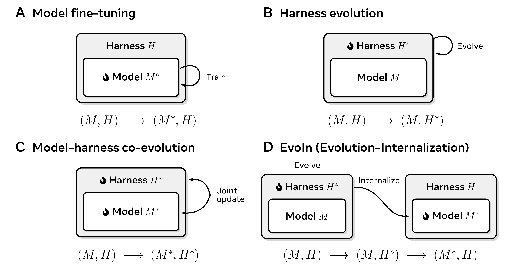
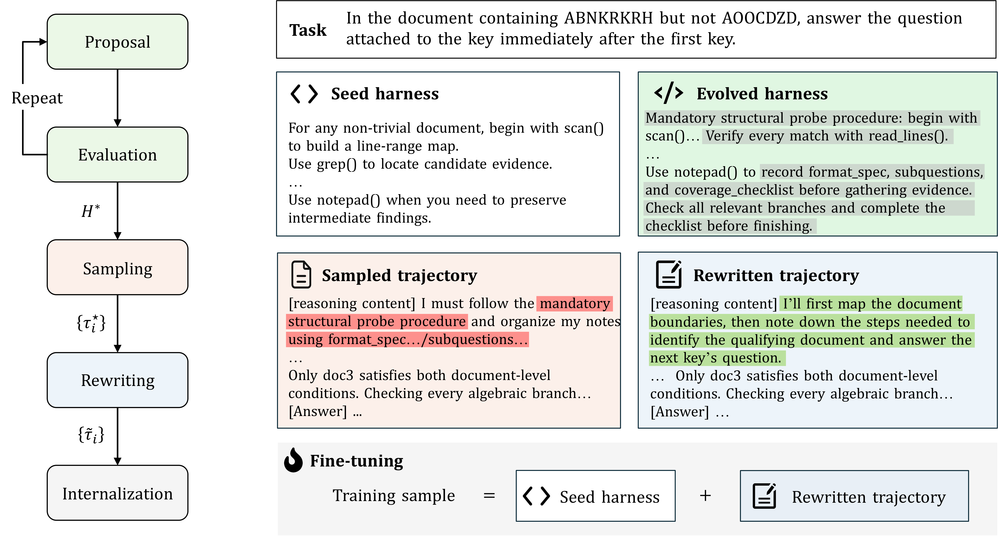

# EvoIn：通过 Harness Evolution 发现决策流程，再将其内化到模型

## 1. 基本信息与阅读结论

- **论文**：EvoIn: Bridging Evolution and Internalization for Agent Fine-Tuning。
- **作者**：Shihan Dou、Shaofan Liu、Zhonghang Lu、Jiahang Lin、Shichun Liu、Binghai Wang、Jiajie Jin、Guanting Dong、Tao Gui、Qi Zhang、Xuanjing Huang；前三位共同一作。
- **机构**：Fudan University、Renmin University of China。
- **arXiv**：2609.35290，提交日期 2026-09-28；本笔记读取日期 2026-10-08。
- **链接**：[摘要页](https://arxiv.org/abs/2609.35290) · [在线 PDF](https://arxiv.org/pdf/2609.35290) · [本地原文 PDF](arxiv_2609_evoin_bridging_evolution_and_internalization_for_agent_fine_tuning.pdf)。
- **源文件**：[evoin.tex](../arxiv_all/arxiv_2609_evoin_bridging_evolution_and_internalization_for_agent_fine_tuning_tex/evoin.tex)；原文 36 页，包含较长的 proposal、rewrite、repair、checking prompts 和实验附录。
- **主题 / 层级**：Agent / detailed（细粒度阅读）。
- **发表状态**：所读 PDF 标为 Preprint；使用 ICLR 2027 模板不能视为已经录用。
- **开放情况**：作者明确说 ID 训练数据和自建 Table-Longer 不能公开。TeX 注释中出现 GitHub 与匿名仓库地址，但被注释的文字不是已发布代码声明；本次检查 `Fanshaoliu/EvoIn` 的公开 GitHub API 返回 404，未确认可访问的官方实现。本笔记依据论文与 TeX，不是代码审计或训练复现。

**一句话理解**：把改进后的 harness 当作临时教学环境，让模型先在外部流程指导下做对任务；随后清理这些示范对特定流程名称、工具和预算的依赖，在原始 harness 下重新执行和验证，再用 SFT 把可迁移的决策方式写入模型权重。

最值得记住的三个结果：

1. 主模型 Qwen3.5-35B-A3B 在相同 seed harness 下，ID Pass 从 35.96% 到 46.83%，OOD Pass 从 18.99% 到 28.20%。
2. 直接训练未经过 Tailor 的 evolved-harness 轨迹，ID Pass 仍有 45.00%，但 OOD Pass 只有 19.67%。训练轨迹与部署环境的兼容性，是本文最有说服力的实践问题。
3. 证据也有边界：ID 测试集参与 harness 选择；Tailor 同时承担改写、重放、修复和过滤，消融没有分离这些作用；真正全由目标模型驱动的 All-Qwen 版本，OOD Pass 几乎没有增益。

本文中的“内化”是操作性定义：撤去 evolved harness 后，更新过的权重在 seed harness 上仍有收益。它不是对模型内部算法表征的直接观测，也不表示模型已经不需要工具或 runtime。

## 2. 背景：Agent 变强，究竟是哪一部分变强？

### 2.1 Agent 是模型与 harness 的组合

原文把 agent 写成 $A=(M_\theta,H_0)$。$M_\theta$ 是参数为 $\theta$ 的模型，$H_0$ 是原始、任务无关的 seed harness。Harness 指模型外部调控执行与环境交互的系统，包括 system prompt、tool schemas、工具实现、执行预算和 middleware 等。

同样拥有读文件、搜索、计算工具，两个 agent 可能使用完全不同的决策流程：一个读到局部线索就回答，另一个先确认题目范围、读取证据、计算和复核。流程也可以是条件式的：短文直接读完，长文先搜索；“找一个”与“找出所有”使用不同的覆盖策略。

因此，**拥有一个工具、正确调用这个工具、知道在什么时候以什么顺序使用工具，是不同层次的问题**。本文关注第三层，以及它能否从外部指令迁移到模型自己的行为。

### 2.2 原图 1：四种改进路径



[原始矢量图](assets/arxiv_2609_evoin_bridging_evolution_and_internalization_for_agent_fine_tuning_tex/evoin-paradigms-v11.pdf)。火焰与星号标记更新过的组件。

原文区分四条路径：

- **Model fine-tuning**：固定 harness，更新权重。任务、环境、奖励或示范通常由人类设计；流程改进隐含地发生在参数更新中。
- **Harness evolution**：固定模型，搜索 prompt、workflow、工具或代码。改进容易提出和验证，但最终仍由外部系统提供。
- **Model–harness co-evolution**：模型和 harness 同时或交替更新，追求两者组合的最好表现。高分可能来自新工具、更多预算、流程改进或对特定接口的适配，较难区分。
- **EvoIn**：先演化 harness，再把可复用决策流程内化到模型，部署时恢复 seed harness。

原文 Equation 1：

$$
(M_\theta,H_0)\xrightarrow{\text{evolution}}(M_\theta,H^\star)\xrightarrow{\text{internalization}}(M_{\theta^\star},H_0).
$$

左箭头阶段只改外部系统，模型权重不变；右箭头阶段用经过转换的示范训练模型，并恢复原始系统。最后的 $H_0$ 是整个设计的关键：推理时不再携带训练阶段搜索出的各类别专用 harness。

### 2.3 新意与接近的工作

EvoIn 与 context distillation、prompted reasoning distillation、工具轨迹 SFT 都有联系。它增加的是一个串联过程：**要学的流程先由 agent 提出、执行和筛选，然后再处理轨迹中对临时教学环境的依赖**。

这不是一种新的 RL loss，也不属于以在线 rollout、teacher token probabilities 或 KL 为核心的 on-policy distillation。本文实际进行的是离线成功轨迹构造与 full-parameter SFT。更强模型参与了 proposal、analysis、Tailor；另有强 rollout teacher 实验，但主实验的 rollout 模型和 student 是同一个 Qwen。

需要注意，作者对传统方法的分类服务于本文论证，不能据此断言所有既有 fine-tuning 方法都没有显式搜索，或所有 co-evolution 方法都不能泛化。

## 3. 总体流程与模型分工



[原始矢量图](assets/arxiv_2609_evoin_bridging_evolution_and_internalization_for_agent_fine_tuning_tex/main.pdf)。灰色是新增流程，红色是轨迹对新增流程的显式依赖，绿色是改写后保留下来的自主决策逻辑。

这五个阶段可以先压缩成一条主线：

```text
Seed harness H0 + student model Mθ
        │
        ├─ 1. Proposal：提出 harness 修改
        ├─ 2. Evaluation：运行候选并选出 H*
        ├─ 3. Sampling：在 H* 下采集成功轨迹 τ*
        ├─ 4. Tailor：把 τ* 改写、重放、检查为可在 H0 执行的轨迹
        └─ 5. Internalization：用这些轨迹做 SFT，得到 Mθ*

部署：Mθ* + H0
```

其中，前两步是按类别反复搜索，后三步在选出每类最佳 $H^\star$ 后执行一次。$H^\star$ 是临时的教学环境；最终训练和部署都回到 $H_0$。

主实验的角色可以这样区分：

| 角色 | 模型/对象 | 负责什么 |
|---|---|---|
| `student / rollout model` | Qwen3.5-35B-A3B | 执行候选 harness、生成成功轨迹，并接受最后的 SFT |
| `proposal agent` | Claude Opus 4.7 | 阅读失败与成功轨迹，提出 harness 修改方案 |
| `Tailor` | GLM-5.2 | 改写轨迹、触发 seed 重放、提出一次局部修复 |
| `Checker` | GLM-5.2 的独立检查调用 | 检查轨迹是否可执行、证据是否充分、是否值得训练 |
| `task evaluator` | Qwen/GPT-OSS judge 或本地 metric | 判断最终任务结果是否正确 |

这里的 `student`、`rollout model` 和 `target model` 指的是同一个主实验模型，只是在不同阶段承担不同工作；它们不是三个不同模型。每个 ID 类别先单独演化出自己的 $H^\star$，然后把所有类别经过 Tailor 的轨迹合并成一个 SFT corpus。部署时不再按类别加载专用 harness，而是统一使用 $H_0$。

**原文实际只做了一次完整 evolution → internalization cycle**。每类十轮 harness 搜索不等于训练后的模型又重复十轮自我改进；递归循环属于未来方向。

## 4. 原始环境：模型到底如何读取长文？

### 4.1 文档不直接塞入初始 prompt

文档通过工具暴露，agent 每轮执行一个 action，默认最多 30 turns。六类动作如下：

- `scan`：返回整篇文档的行范围结构图。
- `grep[pattern]`：返回匹配行号及简短预览。
- `read_lines[start, end]`：读取某个区间的原始行。
- `bash[command]`：运行 shell 命令，常用 Python 做算术、计数、排序。
- `notepad[action, content]`：跨轮保存或读取草稿状态。
- `complete_task[result]`：提交最终答案并结束 episode。

Seed prompt 要求断言由已读取的原文或计算支持。长工具输出会截取首尾，中间可能被截断。**请求读取某段内容，不代表模型实际看到了这段内容的全部文本。** 这个区别后来成为 Tailor 的核心检查对象。

这里的 agent 泛化主要是文档和长上下文任务中的工具化推理泛化。BrowseComp-LongContext 已被改造成给定网页集合的长上下文问题，不能当作真实开放网络浏览的完整评测；也没有 SWE-bench 式代码修改、GUI 操作或生产环境事务执行实验。

### 4.2 30 turns 与 context limit 是两种限制

30 turns 约束动作序列长度；评估的 context limit 是 180,224 tokens。SFT 的最大序列长度则是 24,576 tokens。这些参数不能相互替代，也不能把训练长度写成测试文档长度上限。

演化阶段允许增加 max_iterations，但 Tailor 必须把保留的轨迹转换到 seed 的预算内；无法安全压缩时就拒收。工具输出截断还可能使大跨度读取无法提供完整证据。

## 5. Harness Evolution：怎样发现更好的流程？

### 5.1 数据切分：候选在哪些题上比较？

23 个 ID 类别各有两组、每组 100 题：

| 数据 | 用途 | 是否进入 SFT |
|---|---|---|
| `evolution split` | 给 proposal agent 看成功/失败轨迹，并用于必要的运行验证 | 训练数据来源之一 |
| `evolution-test` / $\mathcal D_{\mathrm{dev}}$ | 比较候选 harness，选择当前最佳 $H^\star$ | 不直接进入 SFT，但后来被当作论文 ID test |

因此，论文的 ID 结果不能理解成完全独立测试集上的无偏估计：虽然 dev 题没有作为示范直接训练，但它参与了十轮候选选择。更严格的复现应再划出独立的 ID test，或使用 nested split。作者称六个 OOD benchmark 不在演化/SFT 数据来源中，所以它们更能反映跨任务迁移，但仍不能排除基座预训练污染。

### 5.2 每一轮怎样产生新 harness？

初始轮先评估 $H_0$。之后每一轮都把当前 harness、上一轮反馈和代表轨迹交给 proposal agent，由它提出三个候选。每个类别最多进行十轮，跨轮保留 $\mathcal D_{\mathrm{dev}}$ 得分最高的 $H^\star$。

```text
当前 harness + 失败/成功轨迹
          ↓
proposal agent：找失败模式、解释原因、提出三个改动
          ↓
静态检查：能否导入、schema 是否正确、配置能否加载
          ↓
单题 smoke test：完整跑通一次
          ↓
dev 集评估：保留表现最好的候选
```

proposal 需要同时填写 `failure_pattern`、`root_cause`、`predicted_fix`、`why_this_change` 和 `component_choice`。这使搜索过程可审计，但这些自然语言归因仍是提案理由，不等于已经通过因果实验验证的机制。

候选被人为限制在三个搜索轴内：

1. **retrieval_flow**：改变 scan、grep、read_lines 的顺序、粒度和覆盖方式，不大改证据纪律、不增删工具。
2. **evidence_discipline**：要求逐条证据、原文优先、完成前复核，不改检索流程结构和工具。
3. **toolset_budget**：调整启用工具和迭代预算；必要时修改工具实现或 middleware。新增工具被限制为最后手段，并要解释它增加的下游改写/SFT 成本。

这样的限制让每轮修改更容易比较，也控制了下游 Tailor 和 SFT 的复杂度。它属于“受约束的自动搜索”，不是让 agent 在完全开放的空间里自由发明任意工具。

### 5.3 候选怎样通过工程检查？

允许以完整文件形式添加或替换 `systemprompt.md`、`context_agent.yaml`、`tools/*.tool.yaml`、`tool_impl/*.py`、`middleware/*.py`。不允许越过 harness 根目录修改数据、judge、框架源码等。

静态验证会编译 Python 模块，检查工具绑定可导入且 callable、middleware 能按配置实例化，并加载整个 agent config。运行时验证用 evolution split 的一题跑通完整执行，只要求没有执行错误，不要求答案正确。验证失败者记零分，不再进入 dev 评测。

这些检查只回答“候选能否加载并跑通”，不回答它是否安全、答案是否正确或能否泛化。一题 smoke test 也不能覆盖所有执行分支。

### 5.4 “自动发现”受到哪些人为约束？

流程由 agent 生成，但搜索目标、三类轴、工具接口、禁止样例硬编码的规则和验证机制都是人工设计的。尤其 proposal prompt 明确允许增加轻量输入检查，并以“长度或结构”为例。

因此，“先检查长度再选策略”可视为 agent 在给定搜索空间内发现并细化的流程，不能描述为完全没有人类提示的自主概念发明。具体长度阈值和分支策略并未由人直接写死在 proposal prompt 中。

## 6. Procedure-Guided Sampling：收集什么样的示范？

每类选出最佳 $H^\star$ 后，让未微调的 student model 在这个环境中采集轨迹。完整轨迹记为 $\tau$，包括 reasoning、tool call、tool observation 和最终答案；$z$ 只表示其中的 reasoning trace。

采样阶段先做一个很宽松的筛选：只有 evaluator 给满分、且带有合法最终答案的轨迹，才进入 Tailor。注意，这一步只说明“题做对了”，还没有说明“这是一条适合训练的示范”。

```text
在 H* 下 rollout
      ↓
最终答案正确且格式合法？ ── 否 → 丢弃
      │ 是
      ↓
交给 Tailor 检查能否改成 H0 可执行、证据可见的训练轨迹
```

可以把质量拆成两道问题：

| 问题 | 需要满足的条件 |
|---|---|
| 任务是否做对 | evaluator 对最终答案给分 1 |
| 过程是否值得学 | 不依赖 evolved-only 能力；答案有真实可见证据；推理与 observation 一致；没有不可执行模板和无意义失败步骤 |

第一项通过不代表第二项通过，Tailor 负责处理这部分差距。论文没有报告完整 raw rollout 数、各阶段淘汰漏斗或单位成功示范成本，因此不能仅凭最终的 12,035 条数据估算采样效率。

## 7. Tailor：把外部流程变成可在 Seed 下执行的示范

### 7.1 Tailor 要解决的具体问题

在 $H^\star$ 下，模型可能学会这样的表达：

```text
“按照 Step 0 的 structural probe 流程，我必须先填写 ledger，
然后调用 evolved harness 提供的专用工具。”
```

这段轨迹在 $H^\star$ 中可能有效，但 $H_0$ 没有 Step 0、ledger 或专用工具。Tailor 的目标不是把这类步骤全部删掉，而是保留其中真正有用的决策：

```text
“先扫描文档结构，定位相关文档，再读取题目所需证据。”
```

因此，Tailor 需要同时处理 reasoning、message、tool name、arguments、notepad 内容和最终 `complete_task.result`。只改正文、不改工具参数或草稿中的模板，模型仍可能把临时环境的依赖学进权重。

### 7.2 从成功轨迹到训练轨迹

Tailor 的完整处理链如下：

```text
成功轨迹 τ*（来自 H*）
        ↓
1. Preflight sanitization：删去可证明无关且不安全的调用
        ↓
2. Seed replay：先在 H0 中真实重放，获得新的 observation
        ↓
3. Sparse rewrite：只编辑必要步骤，未列出的步骤保持不变
        ↓
4. Replay + deterministic check：参数变了就清除旧 observation，重新执行
        ↓
5. Targeted repair：最多一次，只修已定位的 blocker
        ↓
6. Independent checker：检查，不负责修复
        ↓
7. 去重、去测试重叠、长度过滤 → 得到训练轨迹 τ̃
```

这里要区分两件事：**replay 负责证明环境真的返回了某个 observation，rewrite 负责让推理和这个 observation 保持一致。** 论文用 ATIF-v1.5 保存轨迹，并用 `tool_call_id`、`source_call_id` 对齐调用与观察。主实验最后保留 12,035 条、长度不超过 24,576 tokens 的示范。

### 7.3 两道准入门槛

每条轨迹需要连续通过两道门：

| 门槛 | 检查的问题 | 典型拒收原因 |
|---|---|---|
| **Gate A：Seed reproducibility** | 只给 $H_0$ 的 prompt、工具、预算和已见 observation，轨迹能否自然执行？ | 依赖 evolved-only 工具、额外预算或命令式模板 |
| **Gate B：SFT demonstration quality** | 这条轨迹是否值得模型学习？ | 证据不可见、推理和 observation 矛盾、失败冗余未清理、最终答案覆盖不全 |

Gate A 解决“部署时能不能跑”，Gate B 解决“跑得通是否值得学”。所以“最终答案正确”仍然不够：一条依赖不存在工具、或者把截断输出当成完整证据的轨迹，仍会被拒收。

### 7.4 Evidence visibility：以序列化后的内容为准

以下情况都不算可靠答案证据：

- 被 `[truncated ...]` 隐去的文本。
- 仅凭调用参数中的行范围、total_lines 推断已读完整文档。
- `is_error=true` 的 observation，即使其中夹有部分文本。
- 没有匹配成功 observation 的调用。
- seed 要求读取原文时，只有 scan 摘要或 grep 预览。
- 与重映射前参数对应的旧 observation。
- Reference answer（gold）。

例如，原来 `read_lines` 读一个过大区间导致截断，Tailor 可以把已有调用缩窄到答案所需行，并标记 `reground_flag` 重新执行。不能编一个“看起来应当返回”的 observation。如果现有调用槽位不能暴露全部关键证据，则判为 infeasible，而非补写未执行的事实。

此外，引用 `L90` 也是事实断言，需要与真实第 90 行匹配；“文档没有提到某事”需要先有适当搜索或阅读；引用对了也不能把原文较弱的表述加强成因果、范围或机制结论。

### 7.5 Sparse edit 的具体类型

- `rephrase`：去掉外部标签、改正有可见证据支持的局部矛盾、规范输出；必须给具体替换内容。
- `tool_remap`：修改已有调用的工具名或参数，匹配 seed schema，或者缩窄读取范围。
- `reground_flag`：标记受影响的 call ID，由系统重新执行，不能由 LLM 编 observation。
- `drop`：删除不承担关键证据作用、且不破坏后续逻辑的步骤。
- `unsupported_capability`：关键能力没有 seed 等价实现时，声明无法安全转换。

同名工具也必须检查参数 schema；工具名没变不等于语义和参数兼容。多个编辑可以作用于同一个步骤，按给定次序执行。

重写前要求输出七类 `derived_diff`：未落地术语、工具映射、不支持能力、预算、输出合同、证据来源缺口、轨迹质量问题。审计 reason 和 infeasibility_reason 不进入训练文本，避免审计描述再次污染示范。

### 7.6 Gold 的边界与修复阶段的更强限制

Rewrite 模型能看到 reference answer，原文规定它仅用于检查语义保留，不能作为证据。Repair 和 checker 都看不到 gold。这个设计降低答案泄漏风险，但“prompt 禁止”不构成不存在泄漏的实验证明；尤其 rewrite 模型仍可能受到 gold 的隐性影响。

Repair 阶段只编辑已存在的 agent steps，不能新增调用、修改 call ID 或改写 observation。最终答案原则上逐字节不变，只允许修正字面换行编码或执行题目明确的小数精度要求；小数处理使用 ROUND_HALF_UP。若需要新调用或当前不可见事实，返回空编辑，交由系统拒收/重采样。

Rewrite 比 repair 的编辑范围更广，二者不能混为一谈。Checker 则完全不执行修复，而逐步检查 trace、scope、edit integrity、citation/entailment；接受时 blockers、warnings、consistency_findings 都必须为空。

### 7.7 小规模开发过程揭示了哪些难点？

Tailor 在固定十条、覆盖八类任务的轨迹上迭代开发。首版全部通过 API、JSON、schema 和 final-answer 检查，但人工检查只有一条可直接训练：模板残留于 notepad、截断被误当成完整证据、失败/冗余步骤仍存在。

后续增加 seed replay、证据检查和 checker；原文报告各轮可直接用的数量为 5、3、1、2，说明检查更严格时会暴露此前的假阳性，而不是质量必然单调提高。加入 targeted repair 后，8/10 可用，另 2 条明确要求重新采样。

这是固定小集合上的工程开发记录，不是全量数据质量达到 80% 的统计证明。独立 checker 与 rewrite 同属 GLM-5.2，也仍可能有相关偏差。

## 8. Internalization：实际优化了什么？

Tailor 完成后，训练条件被恢复为 $H_0$：模型看到的是 seed prompt、seed 工具以及重放得到的真实 observation，监督目标是改写轨迹中模型应生成的 turns。用户输入和工具 observation 本身不是模型要预测的目标。

**下面是依据原文训练描述写出的阅读性形式化，并非论文新增的 loss 公式。** 令 $\mathcal I_i$ 是第 $i$ 条示范中需要监督的 agent token 位置，$\tilde y_{i,t}$ 是该位置的示范 token，$\tilde h_{i,t}$ 包含此前的输入、动作和真实重放观察，则可理解为：

$$
\mathcal L_{\mathrm{SFT}}(\theta)=-\sum_i\sum_{t\in\mathcal I_i}\log p_\theta(\tilde y_{i,t}\mid H_0,x_i,\tilde h_{i,t}).
$$

直观上，训练让模型在 $H_0$ 的条件下学习“下一步该不该搜索、读哪一段、何时计算、何时复核”。可以把内化过程写成：

```text
H* 下的成功轨迹 τ*
        ↓ Tailor
H0 下可执行、证据可见的轨迹 τ̃
        ↓ SFT
模型参数 Mθ → Mθ*
        ↓ 部署
Mθ* + H0
```

改进来自训练数据构造和训练条件匹配，而不是一个新的梯度估计器。这里的“内化”也不表示 Bash 执行能力、文件系统、数据库或访问权限被写进了权重；这些能力仍由外部 harness 提供，模型学习的是如何使用它们的决策规律。

## 9. 评估指标、数据范围与完整主结果

### 9.1 Pass 和 Score 不是同一件事

每题只采样一条 trajectory。原文给每题分数 $s_i\in[0,1]$；Pass 只认满分，Score 保留 partial credit。将文字定义展开如下：

$$
\begin{aligned}\mathrm{Pass}&=\frac{100}{N}\sum_{i=1}^{N}\mathbf 1[s_i=1],\\\mathrm{Score}&=\frac{100}{N}\sum_{i=1}^{N}s_i.\end{aligned}
$$

二元任务上两者相同；MRCR、部分长文抽取和指令遵循任务上则不同。下表单位均为百分数；差值为百分点，不能与相对提升百分比混用。

OOD 汇总按 2,064 道题加权，不是六个 benchmark 分数的算术平均。所有评估使用固定分母，target 或 judge 缺失得分计零；直接对比的 OOD runs 没有 target/judge errors。没有多次独立重复、置信区间或显著性检验。

### 9.2 原文 Table 1：七组 ID 结果

保留原表加粗。每组内部的类别各有 100 题。

| Task group | N | Base Pass | EvoIn Pass | Δ Pass | Base Score | EvoIn Score | Δ Score |
|---|---:|---:|---:|---:|---:|---:|---:|
| Multi-document key retrieval | 300 | 57.00 | **63.33** | +6.33 | 57.00 | **63.33** | +6.33 |
| Evidence-grounded QA | 400 | 52.25 | **61.50** | +9.25 | 55.03 | **64.93** | +9.90 |
| Structured-data reasoning | 300 | 44.00 | **61.33** | +17.33 | 44.00 | **61.33** | +17.33 |
| Log and dialogue tracking | 300 | 53.00 | **75.00** | +22.00 | 55.14 | **76.78** | +21.64 |
| In-context learning | 200 | 26.00 | **39.00** | +13.00 | 26.00 | **39.00** | +13.00 |
| Document-grounded generation | 300 | 22.00 | **36.00** | +14.00 | 22.00 | **36.00** | +14.00 |
| Complex instruction following | 500 | 7.60 | **9.20** | +1.60 | 43.75 | **49.41** | +5.66 |
| All 23 categories | 2,300 | 35.96 | **46.83** | +10.87 | 44.58 | **56.40** | +11.82 |

相对 Pass 提升约 30.2%。七大组都提高，但复杂指令的完整满足率仍不足 10%，表明“能找到证据”与“能同时满足全部约束”之间还有明显差距。

### 9.3 原文 Table 5：23 个 ID 类别

以下逐项复现原表；每类 N=100。组归属与上表顺序一致。

| Category | Base Pass | EvoIn Pass | Δ Pass | Base Score | EvoIn Score | Δ Score |
|---|---:|---:|---:|---:|---:|---:|
| Multi-Doc Key Lookup | 77.00 | 83.00 | +6.00 | 77.00 | 83.00 | +6.00 |
| Needle QA | 61.00 | 55.00 | −6.00 | 61.00 | 55.00 | −6.00 |
| Cross-Doc Key Aggregation | 33.00 | 52.00 | +19.00 | 33.00 | 52.00 | +19.00 |
| Exam Reading Comprehension | 62.00 | 73.00 | +11.00 | 62.00 | 73.00 | +11.00 |
| Evidence-Located QA | 48.00 | 57.00 | +9.00 | 48.00 | 57.00 | +9.00 |
| Faithfulness Verification | 48.00 | 59.00 | +11.00 | 48.00 | 59.00 | +11.00 |
| Long-Document Extraction | 51.00 | 57.00 | +6.00 | 62.13 | 70.72 | +8.59 |
| Table QA | 32.00 | 52.00 | +20.00 | 32.00 | 52.00 | +20.00 |
| Table Statistics | 57.00 | 66.00 | +9.00 | 57.00 | 66.00 | +9.00 |
| Multi-Step Structured Reasoning | 43.00 | 66.00 | +23.00 | 43.00 | 66.00 | +23.00 |
| Event-Log State Tracking | 68.00 | 77.00 | +9.00 | 74.42 | 82.33 | +7.91 |
| Group-Chat Counting | 71.00 | 80.00 | +9.00 | 71.00 | 80.00 | +9.00 |
| Structured Chat Analysis | 20.00 | 68.00 | +48.00 | 20.00 | 68.00 | +48.00 |
| Many-Shot Classification | 32.00 | 48.00 | +16.00 | 32.00 | 48.00 | +16.00 |
| In-Context Translation | 20.00 | 30.00 | +10.00 | 20.00 | 30.00 | +10.00 |
| Document Summarization | 38.00 | 54.00 | +16.00 | 38.00 | 54.00 | +16.00 |
| Document-Grounded Writing | 9.00 | 21.00 | +12.00 | 9.00 | 21.00 | +12.00 |
| Open-Ended Document Requests | 19.00 | 33.00 | +14.00 | 19.00 | 33.00 | +14.00 |
| Constrained Single-Turn Requests | 8.00 | 10.00 | +2.00 | 54.38 | 65.92 | +11.54 |
| Multi-Turn Instruction Following | 1.00 | 5.00 | +4.00 | 55.56 | 62.90 | +7.34 |
| Long-Source Deliverables | 6.00 | 3.00 | −3.00 | 37.90 | 36.13 | −1.77 |
| Context-Restricted Assistance | 7.00 | 8.00 | +1.00 | 35.30 | 37.82 | +2.52 |
| Agent Role Tasks | 16.00 | 20.00 | +4.00 | 35.63 | 44.29 | +8.66 |
| All 23 categories | 35.96 | 46.83 | +10.87 | 44.58 | 56.40 | +11.82 |

21/23 类别的 Score 提高，但 Needle QA 和 Long-Source Deliverables 下降，不能把七组平均都提高写成每个类别都提高。Structured Chat Analysis 的 +48 很突出，也说明整体平均收益分布很不均匀。

为便于理解原文 Table 4 的任务定义，各组具体内容如下：

- 多文档 key 检索：随机 key 定位；在长干扰文本中寻找指定文档内 key 后的问题；跨文档计算 keyed expressions 并聚合。
- 证据 QA：中国高考阅读题；论文/百科/转录文本中的证据定位；文档蕴含/忠实性核验；判决书、报告、小说、分数表等长文中的完整抽取或比较。
- 结构化数据：表格过滤与排序；Markdown 表格统计；XML 表格、多表和代码语法树的多步推理。
- 日志/对话：按照事件更新实体状态；群聊计数、排名和集合查询；JSON 群聊的消息定位、发送模式与社会角色识别。
- ICL：大量示例后的任意符号标签分类；利用上下文语法和对照例子进行低资源语言翻译。
- 文档生成：满足格式/长度要求的摘要；基于文档的改写、翻译、制表或写作；方案评审、排序、演示规划等开放请求。
- 复杂指令：多约束单轮请求；多轮新增/修改约束；长来源中的表格、幻灯片或行程交付；只许依据给定上下文的多轮辅助；指定 agent 角色和格式的子任务。

### 9.4 原文 Table 2：六个 OOD Benchmark

| Benchmark | N | Base Pass | EvoIn Pass | Δ Pass | Base Score | EvoIn Score | Δ Score |
|---|---:|---:|---:|---:|---:|---:|---:|
| AA-LCR | 100 | 27.00 | **37.00** | +10.00 | 27.00 | **37.00** | +10.00 |
| BrowseComp-LongContext | 295 | 12.54 | **13.56** | +1.02 | 12.54 | **13.56** | +1.02 |
| LongBench v2 | 503 | 33.20 | **44.73** | +11.53 | 33.20 | **44.73** | +11.53 |
| MRCR | 800 | 2.00 | **8.88** | +6.88 | 32.55 | **76.31** | +43.76 |
| Oolong | 300 | 43.33 | **60.33** | +17.00 | 44.58 | **61.42** | +16.84 |
| Table-Longer | 66 | 22.73 | **42.42** | +19.69 | 22.73 | **42.42** | +19.69 |
| Average（按题数加权） | 2,064 | 18.99 | **28.20** | +9.21 | 31.02 | **54.49** | +23.47 |

任务与指标细节：AA-LCR 是跨真实世界文档推理；BrowseComp-LongContext 每题给百余网页、多数为干扰；LongBench v2 是多种长上下文多选题；MRCR 在大量相似历史请求中定位指定响应，要求随机前缀并按字符串相似度评分；Oolong 先对大量未标注短文本分类再聚合，本工作使用 validation split 的 300 题；Table-Longer 是作者不公开的自建集，只有 66 题。

整体 Pass 相对提高约 48.5%，但增加的是 **9.21 个百分点**。MRCR 的 Score 增益 43.76 很大，Pass 却仍只有 8.88%；它更接近“回答与目标更相似”，不代表大多数任务完整成功。MRCR 占 OOD 800/2,064≈38.8%，其单项 Score 增益对总 Score 增益的贡献约为 16.96 个百分点，即总增益的约 72.3%（根据表格计算，存在舍入误差）。

BrowseComp-LongContext 仅增加约三道满分题（按 N 和舍入百分比估算），没有重复采样和显著性检验时，不能给 +1.02 赋予过强统计含义。

## 10. 消融：哪些主张得到支持，哪些还没有？

### 10.1 原文 Table 3：完整组件与 rollout 对比

同一表的上下两个 block 分别比较；加粗按原表保留。

| Method | Corpus size | ID Pass | ID Score | OOD Pass | OOD Score |
|---|---:|---:|---:|---:|---:|
| Base | 0 | 35.96 | 44.58 | 18.99 | 31.02 |
| Seed-harness SFT | 12,035 | 37.83 | 47.25 | 18.36 | 43.16 |
| EvoIn w/o Tailor | 12,035 | 45.00 | 54.89 | 19.67 | 45.70 |
| EvoIn | 12,035 | **46.83** | **56.40** | **28.20** | **54.49** |
| Qwen rollout（配对子集） | 1,752 | 46.52 | 56.30 | 22.04 | 49.36 |
| GLM-5.3 rollout（配对子集） | 1,752 | **52.43** | **61.24** | **25.68** | **49.65** |

### 10.2 演化有用，但“只要更多成功轨迹”解释不了全部收益

Seed-harness SFT 使用同类别成功轨迹，按来源与类别分层确定性采样，匹配 12,035 条规模。其 ID Pass 只增 1.87，OOD Pass 反而降 0.63。说明本实验中仅用 seed 的成功轨迹再训练，不能复现 EvoIn 的大部分收益。

但此控制匹配的是示范数和类别分层，不是每题、每 token、每调用或总计算成本。它也没有完整的“Seed 成功轨迹 + 同等 Tailor 质量处理”对照。因此可支持“整个演化引导的数据流程优于该 seed-SFT 基线”，不能纯粹把差值都归给一个完全独立的流程搜索因素。

### 10.3 Tailor 对 OOD 尤为关键

去掉 Tailor：ID Pass 比完整系统低 1.83，OOD Pass 低 8.53；后者接近 Base。OOD 中耗尽 30-turn 预算的比例从 6.1% 升至 19.4%。

这与“模型学到了 evolved-only 依赖”相符。可是 w/o Tailor 同时取消了措辞重写、工具适配、真实重放、局部修复和质量筛选。严格来说，这证明的是 **Tailor 这一组合处理的重要性**，没有证明仅删除流程标签就能恢复全部 OOD 收益。

另有 37/12,035（0.31%）未改写样本因过长或无有效结束答案而被同层其他样本替换，所以该消融近似配对，但不是逐条完全相同。

### 10.4 All-Qwen：有限自我改进，尚无有力 OOD 增益

用目标模型替代 Claude proposal 和 GLM Tailor，产生 6,123 条示范。ID Pass 从 35.96 到 42.04，增 6.08，约为主系统增益的 56%；ID Score 是 51.84。OOD Pass 为 18.90，略低于 Base 的 18.99，OOD Score 为 42.41。

它表明目标模型能执行这套流水线并获得 ID 收益，但不足以证明无需更强 teacher 就能产生有效的 OOD 自我改进。Corpus 也更小，且 proposal 与 Tailor 同时替换，不能据此精确定位瓶颈来自提案能力、改写能力还是数据量。

### 10.5 更强 rollout teacher 的收益存在明显任务异质性

在同一套用 Qwen 演化的 harness 下，让 GLM-5.3 生成示范，再训练同一个 Qwen student。配对覆盖 22/23 类，共 1,752 题，经过同样 Tailor。

GLM 示范比 Qwen 示范带来 ID Pass +5.91、OOD Pass +3.64；OOD Score 只加 0.29。主文强调强示范有益，但附录显示并非每项都提高：Table-Longer Pass 从 27.27 降到 15.15，Oolong 从 43.33 降到 36.33，LongBench v2 从 36.98 到 36.78；MRCR、AA-LCR、BrowseComp 则提高。

配对 GLM 子集的 OOD Pass 25.68 仍低于完整 12,035 条 EvoIn 的 28.20，不能把强 teacher 的小规模实验写成全面超过主系统。Judge endpoint 差异也需要在复现时控制，详见附录表注。

### 10.6 Gemma：支持跨模型可用性，不能写成一致的大幅泛化

Gemma-4-31B-it 作为 rollout 和 student，得到 15,008 条训练、138 条验证示范。ID Pass 49.61→53.04（+3.43）；OOD Pass 49.08→50.10（+1.02）；OOD Score 65.56→69.61。

Gemma 使用自己的 tool parser、training stack、decoding policy 和 OOD judge version，因此不要与 Qwen 绝对分数直接横比。其 MRCR Pass 50.38→43.12（−7.26），尽管 Score 91.83→92.30；ID 的 Many-Shot Classification Score 72→56。总体均值提升不意味着每个 benchmark 都受益。

## 11. 逐步案例：策略学习与模板模仿如何区分？


原图 3 由 TeX 的 tcolorbox 排版，没有独立图片文件；此处直接裁自原文 PDF 第 8 页，未重绘。[原始矢量裁图](assets/arxiv_2609_evoin_bridging_evolution_and_internalization_for_agent_fine_tuning_tex/figure3_cases_original.pdf)。

### 11.1 Table QA：得到所有行、读对列、按规则排序

题目要求找 WS4 队 1872 年球员的二垒出场次数，降序排列、最多十条。正确结果有九人，其中一人九次、其余八人零次。

Seed 轨迹先用错 `useRegex` 参数，后来读到九行，却擅自过滤零次球员，又将 `g_3b=9` 与 `g_2b=0` 混淆，最终漏行并给出错误数值。

Evolved harness 要求记录 Question Ledger、表头和逐项来源行，读取整个 98 行表，用 bash 以主键和 tie-breaker 排序，再复核可疑行。这里的改进是覆盖、列对齐、计算和检查的组合。

必须保留附录的限定：该案例对应的一次 harness 演化比较是 seed 34/100、evolved 61/100；两者只由 evolved 解出的 32 题里，约 25 题的 seed 失败仅因答案包含解释或编号。**大量分数改善来自输出格式合规，而非新的内容推理。** 这些数据不是主结果表 seed 32% 与微调后 52% 的同一次比较，不能混用。

### 11.2 改写不是只换一句话

Multi-Doc Key Lookup 的五步轨迹寻找 KNGUKM 属于哪个文档。Tailor 改了三步：

1. 去掉 Step 0、MANDATORY、Structural probe 等标签，保留 scan。
2. 保留两次 grep：定位 key 在 L90，定位文档边界 L1/L64/L83。
3. 将一个不承担关键证据作用的 notepad 调用替换为 `read_lines(83, 91)`，实际重放后确认 doc3 边界与 key。
4. 最后一步引用新获得的原文证据，保持答案 doc3 的含义，去掉多余内部工具名和长引用。

这个例子说明“不能新增调用”不等于“所有动作永远不变”：Tailor 可以重用既有调用位置来取得 seed 下的支持，但 observation 必须真实执行获得。作者报告 5,051 条获接受轨迹有 evolved-harness references 被移除；未提供完整编辑类型的全量统计。

### 11.3 无 Tailor：复制不存在的指令，调用不存在的工具

LongBench v2 案例中，w/o Tailor 模型引用“step 0 强制的 structural probe”，随后调用 `read_file`，但 seed 没有此工具。到第 30 轮时达到上限，未提交答案。完整 EvoIn 用 seed 的 scan/grep/read_lines，在 13 次工具调用后选出正确答案 D。

在 EvoIn 成功而 w/o Tailor 失败的 321 道 OOD 题中，76 条失败轨迹含 evolved 术语或不存在工具，约 23.7%；其中 36 道来自 LongBench v2。这个统计支持失配机制，但不能解释全部 321 道差异，更不能把相关措辞当作每次失败的唯一原因。

### 11.4 先判断文档，再决定读取策略

23 类最优 harness 中有 11 类先看长度，再分流。Faithfulness Verification 的规则在第 4 轮出现，至第 7 轮细化为：约 120 行及以下先整篇读；约 120–600 行视为中等；超过 600 行视为长文。目标式问答优先多变体 grep 加局部读；枚举、去重、“找出所有”任务不论长短都需要更完整的分块覆盖，示例块长约 200 行。

另一个类别 Evidence-Located QA 的短文阈值约 300 行，因此这不是全任务共享固定常数。36 行文档案例选择整篇读取，515 行报告案例先搜 unicorn，再读相关行，算出三国共新增 6 家、占 20 家的 30%。

恢复 seed 后，在十个含短文测试题的类别、共 470 个短文例子上，EvoIn 在任何 grep 前完整读取文档的比例为 88.3%，Base 为 66.4%；其余例子相应比例为 45.1% 和 24.3%。这是流程相关行为改变的证据。

但长文/其余例子的完整阅读率也明显上升。因此仅凭这两个比例，尚不能区分精确学会“按长度适配”与更普遍的“更爱先通读”。应进一步测量条件选择准确率、截断风险、token 成本，以及这种行为对正确率的因果作用。新规则进入候选时 dev Pass 提高 1–17 点，也不构成隔离长度检查单个组件的消融。

## 12. 复现配置与缺失信息

### 12.1 原文 Table 6：Qwen SFT

| Setting | Value |
|---|---|
| Fine-tuning | Full-parameter SFT |
| Framework | Megatron-Bridge |
| Epochs | 3，报告最终 checkpoint |
| Sequence length | 24,576 tokens |
| Global / micro batch size | 8 / 1 |
| Tensor / expert parallelism | 8 / 8 |
| Precision | bfloat16 |
| Optimizer | Adam，$\beta_1=0.9$，$\beta_2=0.95$，$\epsilon=10^{-8}$ |
| Weight decay | 0.1 |
| Gradient clipping | 1.0 |
| Learning rate | cosine decay，$5\times10^{-6}$ 至 $5\times10^{-7}$ |
| Warmup | 前 3% optimizer steps |
| Optimizer steps（主模型） | 每 epoch 1,488，共 4,464 |
| Training seed | 42 |

原文报告的 12,035 条样本、global batch=8 与 1,488 steps/epoch，并不能按简单逐样本除法直接对齐。可能涉及 packing、数据加载或额外过滤，但原文没有解释；复现时应核查实际 dataset cardinality 与 dataloader，不能擅自替作者补一个原因或改数字。

### 12.2 原文 Table 7：Qwen 评估解码

| Setting | Evaluated model | Qwen3.5-35B-A3B judge | GPT-OSS-120B judge |
|---|---|---|---|
| Context limit（tokens） | 180,224 | — | — |
| Max generated tokens | 16,000 | 8,192 | 8,192 |
| Temperature | 1.0 | 0 | 0.7 |
| Top-p | 1.0 | 1.0 | 0.95 |
| Top-k | 50 | — | 50 |
| Repetition penalty | 1.05 | — | 1.05 |
| Thinking | Enabled | Disabled | Default |
| Seed | 每题 1234 | — | — |

破折号表示未显式设置，不代表参数为零。GPT-OSS 列对应 OOD judges。固定单次 seed 让主对比更可控，但不能替代多 seed 方差评估。

LongBench v2、MRCR、Oolong 用本地官方评分；AA-LCR、BrowseComp-LongContext、Table-Longer 用 GPT-OSS-120B。主文提到 ID 由两种 judge 分工，但没有在结果表逐类别给出全部 judge/rubric 配置。

### 12.3 可以重建什么，什么仍无法完全复现？

TeX 给出了五阶段算法、候选搜索规则、四类完整 prompts、工具接口概述、SFT 配置和细分实验数值。原始文件里包含的 prompt 是研究材料，不是阅读者需要执行的指令。

仍缺少或未确认公开的关键材料包括：私有 ID 原始数据及精确来源比例、Table-Longer、完整运行代码与 seed harness 配置、23 类最终 harness、全部采集轨迹及筛选日志、各类别 judge/rubric 映射、数据去重/overlap 的完整规则、采集温度与完整预算账单、训练硬件/时间、全部 admission 通过率和独立全量人工质量审计。

因此可以复现“方法结构”，却不能仅用当前公开材料承诺逐项复现论文数字。也没有充分证据证明方法降低总计算成本：部署去掉额外 harness 组件，仍可能增加模型自身思考和读取量；训练前的搜索、强模型调用、重放也有成本。

## 13. 优点、局限与对结论的分级判断

**较扎实的证据**：同一 seed harness、同一主 Qwen 配置下，训练后的模型表现更好；相近样本数的 seed-SFT 无法复制这种收益；撤去 Tailor 后 OOD 明显退化，且有不存在工具、预算耗尽的行为证据。论文把训练轨迹与部署环境的失配问题具体化了。

**值得肯定的工程点**：真正重放工具；禁止把截断文本当证据；对所有训练可见字段去模板；同名工具也校验 schema；只修必要步骤；无法证据闭合时拒收；checker 不只看最终答案。它比单纯润色思维链更接近严谨的数据生产系统。

**需要收窄的主张**：

1. ID 集参与模型外部流程选择，ID gain 有开发集复用偏差。
2. Tailor 的去依赖作用与质量修复、过滤作用尚未被拆分。
3. 测试回到同一个 $H_0$，证明不依赖 $H^\star$；没有在多个全新部署 harness 上系统测试，不宜说已经证明任意跨 harness 迁移。
4. 数据范围集中于文档/上下文推理，尚不能推广为所有 agent 场景成立。
5. All-Qwen 的 OOD Pass 无增长，当前最强结论仍依赖更强外部模型辅助。
6. 长度分流有 proposal 提示先验；格式合规解释了某些 harness gains 的大部分，不应把所有提升都归为高层推理创新。
7. 单次采样、LLM judge、部分私有数据和没有置信区间，限制数值的统计与复现强度。
8. 完整系统也有类别退化；Gemma 和强 teacher 版本的收益并不均匀。
9. 没有内部表征或因果探针证明模型学到了某种特定算法，输出行为改进与形式化“真正理解”应区分。
10. 只做一个训练循环；递归自我改进、工具经验内化、世界模型预期等仍是 discussion 中的设想。

**我的判断**：最有价值的贡献是把“临时 harness 教出来的成功轨迹，怎样才能在撤掉这个 harness 后继续有效”变成可执行、可检查的训练数据问题。主实验支持这一整套方案在所测任务中有价值，对其内部机制和广泛自主进化能力则应保持更有限的解读。

## 14. 与当前 Agent 阅读线的联系，以及可以做的实验

### 14.1 与 WEFT 的关系

前一篇 [WEFT 笔记](arxiv_2609_weft_scaling_tool_use_post_training_for_general_purpose_agents.md) 关注环境、任务、harness、evaluator 的整体改进，并用验证过的前缀 SFT 和 atomic-task RL 训练 agent。EvoIn 则更集中于 **某个 harness 下发现的决策流程，怎样迁移到固定部署 harness 中的模型**。

两者可以互补：用 WEFT 式可执行环境和评估器提高轨迹可信度，用 EvoIn 式转换处理训练时临时工具、流程和预算的依赖。不过有真实状态变化的环境中，replay 必须恢复完整初始状态并控制外部副作用，不能照搬静态文档里的简单重放。这是工程延伸建议，论文没有验证这种组合。

### 14.2 对 OpenCode、pi、tau 这类 harness 的启发

若把一个编码 harness 当作 $H_0$，可以在隔离实验中增加流程指令或实验工具，采集成功轨迹，再尝试把其中可迁移的决策习惯训练到支持微调的模型。部署时恢复原来的工具合同和 runtime。

但仅使用托管模型 API、无法更新权重时，做“搜索更好 prompt 然后部署”仍是 harness evolution，并未完成本文意义的 internalization。论文也没有直接评测这些具体 harness。

### 14.3 最值得优先补做的实验（阅读建议，非原文结果）

**第一，严格切分评估。** 每类分开 evolution-train、harness-dev、SFT-data、独立 ID-test，再保留 OOD。候选选择只能用 dev，避免十轮搜索反复优化最终测试题。

**第二，拆开 Tailor。** 使用相同任务、相近 token 预算，逐项比较：原始轨迹；仅去流程标签；仅 seed replay/工具重映射；仅质量修复过滤；完整 Tailor。再加“seed 成功轨迹 + 同样 Tailor”控制组，区分流程演化与一般高质量数据清洗。

**第三，测真正的跨 harness 迁移。** 在训练未出现的工具命名、schema、输出截断方式和预算下测试，或用多个部署 harness。把语义等价工具改名与真实新增能力分开，观察策略是否仍成立。

**第四，测条件式策略，而非只统计动作更多。** 对文档长度、证据稀疏度、任务是否要求枚举分别分桶，记录路由选择、正确率、实际可见覆盖、token、工具次数和延迟；干预“必须通读/必须搜索”以检查 learned route 是否有因果收益。

**第五，补齐失败与成本账本。** 记录每道 Tailor gate 的拒收原因、repair 成功率、gold 可见/不可见版本差异、错误工具率、预算耗尽率、每条最终示范成本。对最终数据做盲人工抽检，不能只用被用于开发的十条样本衡量质量。

**第六，分离强模型依赖。** 固定样本规模，分别只替换 proposer、analysis、rewriter、checker，而不是 All-Qwen 一次替换所有角色；再在固定总计算预算下比较，以定位当前自我改进的瓶颈。

**第七，再谈多轮内化。** 在第二个完整 cycle 中保留前一轮能力测试与独立 OOD 集，检查循环是否产生新流程、是否放大 evaluator 偏差、是否发生遗忘。不能仅依据第一轮成功就预设递归收益会持续。


## 15. 附录：所有消融的逐项原表

以下转录原文 Tables 8–9，按列拆分以便阅读；未调整数值。ID 表均为 Score，不能当作 Pass。各 ID 类别均为 100 题。主结果表里的显著加粗已保留在前文，本节原表没有最佳值加粗。

### 15.1 ID Score：主模型与组件消融

| 类别 | Qwen Base | EvoIn | Seed SFT | w/o Tailor | All-Qwen |
| --- | --- | --- | --- | --- | --- |
| Multi-Doc Key Lookup | 77.00 | 83.00 | 74.00 | 86.00 | 84.00 |
| Needle QA | 61.00 | 55.00 | 62.00 | 62.00 | 66.00 |
| Cross-Doc Key Aggregation | 33.00 | 52.00 | 35.00 | 55.00 | 43.00 |
| Exam Reading Comprehension | 62.00 | 73.00 | 60.00 | 76.00 | 60.00 |
| Evidence-Located QA | 48.00 | 57.00 | 50.00 | 54.00 | 56.00 |
| Faithfulness Verification | 48.00 | 59.00 | 56.00 | 54.00 | 55.00 |
| Long-Document Extraction | 62.13 | 70.72 | 71.06 | 69.99 | 70.49 |
| Table QA | 32.00 | 52.00 | 44.00 | 60.00 | 57.00 |
| Table Statistics | 57.00 | 66.00 | 63.00 | 68.00 | 72.00 |
| Multi-Step Structured Reasoning | 43.00 | 66.00 | 47.00 | 66.00 | 52.00 |
| Event-Log State Tracking | 74.42 | 82.33 | 78.00 | 80.33 | 81.58 |
| Group-Chat Counting | 71.00 | 80.00 | 74.00 | 74.00 | 70.00 |
| Structured Chat Analysis | 20.00 | 68.00 | 30.00 | 58.00 | 52.00 |
| Many-Shot Classification | 32.00 | 48.00 | 26.00 | 37.00 | 27.00 |
| In-Context Translation | 20.00 | 30.00 | 16.00 | 21.00 | 22.00 |
| Document Summarization | 38.00 | 54.00 | 37.00 | 45.00 | 52.00 |
| Document-Grounded Writing | 9.00 | 21.00 | 13.00 | 20.00 | 12.00 |
| Open-Ended Document Requests | 19.00 | 33.00 | 23.00 | 22.00 | 24.00 |
| Constrained Single-Turn Requests | 54.38 | 65.92 | 57.45 | 69.84 | 61.86 |
| Multi-Turn Instruction Following | 55.56 | 62.90 | 58.94 | 59.03 | 58.09 |
| Long-Source Deliverables | 37.90 | 36.13 | 32.39 | 37.23 | 34.58 |
| Context-Restricted Assistance | 35.30 | 37.82 | 37.22 | 41.74 | 38.01 |
| Agent Role Tasks | 35.63 | 44.29 | 41.61 | 46.31 | 43.64 |
| All 23 categories | 44.58 | 56.40 | 47.25 | 54.89 | 51.84 |

### 15.2 ID Score：配对 rollout 与 Gemma

Qwen/GLM rollout 列指同一个 Qwen student 在 1,752 条配对样本上训练后的结果，不是 rollout 模型自身的成绩。Gemma 两列采用独立协议，只宜在该组内部作前后比较。

| 类别 | Qwen rollout | GLM-5.3 rollout | Gemma Base | Gemma EvoIn |
| --- | --- | --- | --- | --- |
| Multi-Doc Key Lookup | 87.00 | 89.00 | 75.00 | 86.00 |
| Needle QA | 73.00 | 79.00 | 59.00 | 76.00 |
| Cross-Doc Key Aggregation | 47.00 | 70.00 | 46.00 | 53.00 |
| Exam Reading Comprehension | 69.00 | 82.00 | 72.00 | 75.00 |
| Evidence-Located QA | 58.00 | 75.00 | 55.00 | 59.00 |
| Faithfulness Verification | 58.00 | 60.00 | 61.00 | 70.00 |
| Long-Document Extraction | 73.00 | 78.38 | 78.05 | 80.30 |
| Table QA | 51.00 | 44.00 | 51.00 | 62.00 |
| Table Statistics | 69.00 | 74.00 | 78.00 | 78.00 |
| Multi-Step Structured Reasoning | 65.00 | 58.00 | 66.00 | 75.00 |
| Event-Log State Tracking | 85.50 | 85.50 | 82.00 | 83.50 |
| Group-Chat Counting | 79.00 | 78.00 | 81.00 | 82.00 |
| Structured Chat Analysis | 64.00 | 67.00 | 71.00 | 67.00 |
| Many-Shot Classification | 41.00 | 37.00 | 72.00 | 56.00 |
| In-Context Translation | 26.00 | 18.00 | 28.00 | 28.00 |
| Document Summarization | 53.00 | 70.00 | 60.00 | 64.00 |
| Document-Grounded Writing | 17.00 | 31.00 | 25.00 | 25.00 |
| Open-Ended Document Requests | 33.00 | 58.00 | 30.00 | 44.00 |
| Constrained Single-Turn Requests | 63.42 | 63.11 | 70.48 | 78.90 |
| Multi-Turn Instruction Following | 61.80 | 58.94 | 72.10 | 72.74 |
| Long-Source Deliverables | 37.65 | 40.64 | 43.39 | 44.49 |
| Context-Restricted Assistance | 42.02 | 39.96 | 47.03 | 44.33 |
| Agent Role Tasks | 41.46 | 52.08 | 34.71 | 36.70 |
| All 23 categories | 56.30 | 61.24 | 59.03 | 62.65 |

### 15.3 OOD Pass：主模型与组件消融

| Benchmark | N | Qwen Base | EvoIn | Seed SFT | w/o Tailor | All-Qwen |
| --- | --- | --- | --- | --- | --- | --- |
| AA-LCR | 100 | 27.00 | 37.00 | 30.00 | 36.00 | 34.00 |
| BrowseComp-LongContext | 295 | 12.54 | 13.56 | 11.19 | 12.20 | 15.25 |
| LongBench v2 | 503 | 33.20 | 44.73 | 25.25 | 21.87 | 36.58 |
| MRCR | 800 | 2.00 | 8.88 | 6.88 | 9.50 | 3.00 |
| Oolong | 300 | 43.33 | 60.33 | 39.33 | 42.33 | 29.33 |
| Table-Longer | 66 | 22.73 | 42.42 | 24.24 | 31.82 | 22.73 |
| Weighted average | 2,064 | 18.99 | 28.20 | 18.36 | 19.67 | 18.90 |

### 15.4 OOD Pass：配对 rollout 与 Gemma

| Benchmark | N | Qwen rollout | GLM-5.3 rollout | Gemma Base | Gemma EvoIn |
| --- | --- | --- | --- | --- | --- |
| AA-LCR | 100 | 37.00 | 49.00 | 58.00 | 64.00 |
| BrowseComp-LongContext | 295 | 12.88 | 19.32 | 22.03 | 32.88 |
| LongBench v2 | 503 | 36.98 | 36.78 | 58.05 | 61.43 |
| MRCR | 800 | 5.75 | 15.00 | 50.38 | 43.12 |
| Oolong | 300 | 43.33 | 36.33 | 55.67 | 60.67 |
| Table-Longer | 66 | 27.27 | 15.15 | 42.42 | 56.06 |
| Weighted average | 2,064 | 22.04 | 25.68 | 49.08 | 50.10 |

### 15.5 OOD Score：主模型与组件消融

| Benchmark | N | Qwen Base | EvoIn | Seed SFT | w/o Tailor | All-Qwen |
| --- | --- | --- | --- | --- | --- | --- |
| AA-LCR | 100 | 27.00 | 37.00 | 30.00 | 36.00 | 34.00 |
| BrowseComp-LongContext | 295 | 12.54 | 13.56 | 11.19 | 12.20 | 15.25 |
| LongBench v2 | 503 | 33.20 | 44.73 | 25.25 | 21.87 | 36.58 |
| MRCR | 800 | 32.55 | 76.31 | 70.14 | 75.95 | 63.34 |
| Oolong | 300 | 44.58 | 61.42 | 41.26 | 44.22 | 30.18 |
| Table-Longer | 66 | 22.73 | 42.42 | 24.24 | 31.82 | 22.73 |
| Weighted average | 2,064 | 31.02 | 54.49 | 43.16 | 45.70 | 42.41 |

### 15.6 OOD Score：配对 rollout 与 Gemma

| Benchmark | N | Qwen rollout | GLM-5.3 rollout | Gemma Base | Gemma EvoIn |
| --- | --- | --- | --- | --- | --- |
| AA-LCR | 100 | 37.00 | 49.00 | 58.00 | 64.00 |
| BrowseComp-LongContext | 295 | 12.88 | 19.32 | 22.03 | 32.88 |
| LongBench v2 | 503 | 36.98 | 36.78 | 58.05 | 61.43 |
| MRCR | 800 | 75.54 | 76.66 | 91.83 | 92.30 |
| Oolong | 300 | 45.12 | 36.80 | 58.53 | 63.77 |
| Table-Longer | 66 | 27.27 | 15.15 | 42.42 | 56.06 |
| Weighted average | 2,064 | 49.36 | 49.65 | 65.56 | 69.61 |

原表注释：Qwen-rollout 和 Gemma 列使用了由不同 endpoint 服务的同名 GPT-OSS-120B judge；正文还说明 Gemma 的 judge version 和协议有差异。因此这些扩展实验不能被理解成所有条件完全一致的跨模型排行榜。
