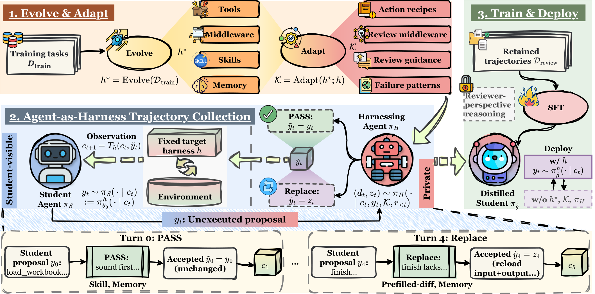

# Harness-Zero: Harness Distillation via Agent-as-Harness

## 1. 基本信息

- **标题**：Harness-Zero: Harness Distillation via Agent-as-Harness
- **作者**：Haoran Ye, Yuxing Lu, Haonan Dong, Zhaochen Su, Guojie Song
- **arXiv**：2609.24974v1（2026-09-21）
- **链接**：[abs](https://arxiv.org/abs/2609.24974) / [PDF](https://arxiv.org/pdf/2609.24974)
- **主题目录**：`agent`
- **阅读层级**：细粒度（detailed）
- **公开代码**：[metaevo-ai/harness-zero](https://github.com/metaevo-ai/harness-zero)；核对日期：2026-10-09。
- **本地 PDF**：[arxiv_2609_harness_zero_harness_distillation_via_agent_as_harness.pdf](arxiv_2609_harness_zero_harness_distillation_via_agent_as_harness.pdf)

## 2. 一句话结论

这篇工作研究“能否把一个优秀 harness 带来的行为，蒸馏进模型参数，使部署时不再需要这个专用 harness”。核心方法 **Harness-Zero** 不直接模仿专用 harness 下产生的轨迹，因为专用 harness 可能拥有不同工具和 action space；它增加一个临时的 **harnessing agent**，在学生模型每次响应执行前检查并改写响应，把专用 harness 的指导翻译成目标 harness 可执行的动作，然后用这些经过审核的轨迹做 SFT。部署时移除专用 harness、参考 harness 和 harnessing agent，只保留微调后的模型与固定目标 harness。

## 3. 背景：harness 的收益为何难以部署

Agent 的能力由模型和 harness 共同决定。harness 负责工具、上下文、记忆、middleware、状态检查和与环境的交互。一个针对 Spreadsheet、AppWorld 或化学逆合成优化出的 harness，往往只在相应领域、模型和工具条件下有效。

因此有两个不理想的选择：所有任务共用一个 harness，会丢失领域特定收益；维护许多专用 harness，则需要路由、额外上下文、工具调用和编排成本。更根本的问题是，harness 的收益仍然停留在外部代码中，模型本身没有学会这些行为。

本文提出的目标是：将 $h^\star$（演化得到的专用 harness）诱导的行为迁移到模型参数，使模型在固定目标 harness $h$ 下也能执行这些行为。

## 4. 方法：Harness-Zero



### 4.1 三个 harness / agent

- $h$：**目标 harness**，部署时固定保留。本文把它实现为 mini-SWE-agent 风格的最小系统提示词，加一个 `execute` Bash 工具。
- $h^\star$：**演化的学生侧 harness**，通过训练任务上的 meta-harness 搜索得到，包含工具、技能、memory 和 middleware。
- $\mathcal K$：**私有 reference harness**，由 $h^\star$ 相对于 $h$ 改写而来，指导 harnessing agent，不直接操作任务环境。其 review middleware 自动检查 proposal，但不会私下替学生完成环境操作。

### 4.2 阶段一：演化与适配

先在训练任务上优化学生侧 harness：

$$
h^\star=\operatorname{Evolve}(\mathcal D_{\mathrm{train}}),\qquad \mathcal K=\operatorname{Adapt}(h^\star;h)
$$

适配不是简单复制文件，而是改变“受众”和“执行位置”：

- $h^\star$ 的工具，变为 harnessing agent 构造学生原生动作的规格说明；
- 学生侧 middleware 的阻断规则，变为私有 review warning；
- skill 和 memory，变为诊断标准、干预条件与修正建议；
- 必要时生成附加到 harnessing agent system prompt 的领域说明。

例如，$h^\star$ 禁止危险动作，$\mathcal K$ 不直接拦截动作，而是提醒 harnessing agent 在学生提出此动作时检查并改写。

### 4.3 阶段二：Agent-as-Harness

**Code-as-Harness** 直接让基础学生在 $h^\star$ 下行动：

$$
y_t\sim\pi_{\theta_0}^{h^\star}(\cdot\mid c_t),\qquad c_{t+1}=T_{h^\star}(c_t,y_t)
$$

它的问题是，$h^\star$ 可能暴露学生在 $h$ 中没有的工具，直接收集的轨迹不能在部署时复现。

**Agent-as-Harness** 可以先直观地理解成“学生先写答案，旁边的教练决定这一步是否可以执行”。学生始终在目标 harness $h$ 提供的环境中工作；harnessing agent 不直接接管任务，而是在学生每次响应即将执行的瞬间进行检查。它只有两种选择：原样放行，或把下一步改写成一条仍然符合 $h$ 规则的完整响应。

令 $c_t$ 表示第 $t$ 步时学生能看到的全部信息，例如任务描述、此前已经执行的命令和环境返回结果；$y_t$ 是学生刚刚提出但尚未执行的响应；$d_t$ 是 harnessing agent 的决定；$z_t$ 是它准备好的替代响应：

$$
\begin{aligned}
y_t &\sim \pi_S(\cdot\mid c_t)=\pi_{\theta_0}^{h}(\cdot\mid c_t),\\
(d_t,z_t)&\sim\pi_H(\cdot\mid c_t,y_t,\mathcal K,r_{<t}),\\
\tilde y_t&=\begin{cases}y_t,&d_t=\mathrm{PASS},\\z_t,&d_t=\mathrm{REPLACE},\end{cases}\\
c_{t+1}&=T_h(c_t,\tilde y_t).
\end{aligned}
$$

这四行可以按实际执行顺序阅读：

1. **学生先提出动作。** $y_t$ 是基础学生 $\pi_S$ 在当前上下文 $c_t$ 下生成的响应。这里的 $\pi_S$ 仍然是原始模型 $\pi_{\theta_0}$，只是在目标 harness $h$ 下运行。
2. **教练检查动作。** harnessing agent $\pi_H$ 同时看到学生当前上下文、尚未执行的 $y_t$、参考规则 $\mathcal K$，以及自己之前的审查记录 $r_{<t}$，据此决定 PASS 还是 REPLACE，并在需要时产生 $z_t$。
3. **确定真正执行的动作。** PASS 时，真正执行的是学生原来的 $y_t$；REPLACE 时，丢弃 $y_t$，执行教练给出的 $z_t$。统一记作 $\tilde y_t$。
4. **环境返回下一步上下文。** $\tilde y_t$ 必须通过目标 harness $h$ 执行，环境返回的结果与历史一起形成 $c_{t+1}$，供学生继续工作。

$r_{<t}$ 是 harnessing agent 的私有历史，包括之前的审查记录和读取 $\mathcal K$ 的记录。学生确实生成过 proposal $y_t$，但如果它被 REPLACE，就不会作为“已执行动作”进入下一步上下文；学生只会看到真正执行的 $\tilde y_t$ 产生的环境结果，也看不到教练的决定和理由。

### 两条干预约束

1. **最小修改**：合理的 $y_t$ 原样通过；只有在缺少关键检查、重复失败或准备过早结束时，才替换下一步。
2. **动作空间一致**：替代响应 $z_t$ 必须能由目标 harness $h$ 执行，并且只能依据学生已经看到的信息生成。教练不能读取隐藏答案、verifier 反馈或学生 sandbox 的私有状态。

例如，学生准备提交一个未验证的 Excel 文件。教练不能替学生读取或修改文件，而是把“提交”替换为一条检查命令；学生看到检查结果后，再自行修复。

同理，如果 $h^\star$ 提供 `smiles_check`，而目标 harness $h$ 只有 Bash `execute`，教练就不能直接调用这个专用工具，而要生成一条通过 Bash/Python 调用 RDKit 的命令。命令执行结果回到学生上下文，学生据此选择或修改候选。

因此，传递的是“何时检查、检查什么、如何根据结果继续”的行为模式，而不是源 harness 的私有工具本身。

#### 4.3.1 用预填单元格看清“转译”过程

下面把论文的 Excel 例子拆成三个角色，观察一个源 harness 规则如何变成学生可以执行的动作。

**任务约束**

```text
根据已有示例填写答案区域。
原来已经填好的示例单元格是规格的一部分，不能被覆盖。
```

**A. 源 harness $h^\star$：直接拦截完成动作**

```text
学生准备结束
    -> prefilled_guard 读取 input.xlsx 和 output.xlsx
    -> 比较答案区域中的原有非公式单元格
    -> 若发现被修改：拒绝完成
    -> 否则：允许结束
```

这里的 `prefilled_guard` 是学生侧 middleware，可以直接参与学生的执行流程。

**B. 目标 harness $h$：只有一个 execute 工具**

目标 harness 没有 `prefilled_guard`，也没有一个可以让教练私下读取学生文件的接口。因此不能把上面的 middleware 原封不动搬过来。适配后的 $\mathcal K$ 把它拆成两部分：

```text
review 条件：学生准备结束，但轨迹中没有输入-输出比较
        -> 提醒 harnessing agent 进行 REPLACE

action recipe：生成一条学生可执行的 execute 命令
        -> 创建并运行 openpyxl 比较脚本
        -> 输出 PASS 或被修改的单元格坐标
```

**C. 真正执行的轨迹**

```text
学生 proposal："任务完成，提交 output.xlsx"
        |
        | 触发 review 条件
        v
harnessing agent 的 replacement：
"先运行 prefilled_diff.py，比较 input.xlsx 和 output.xlsx"
        |
        v
目标 harness h 执行命令，返回：FAIL: changed cells = ['A2']
        |
        v
学生看到 FAIL，恢复 A2 后继续完成任务
```

**这一步蒸馏的是什么？** 不是把 `openpyxl` 的实现或文件比较算法写进模型参数，而是让模型学会一种可迁移的程序性行为：**结束前主动检查，并根据检查结果修复**。USPTO 中也一样：模型学习何时使用 RDKit、如何验证候选，而不是把 RDKit 本身复制进权重。

#### 4.3.2 Review 协议：教练每一步具体看到什么

可以把 review 协议看成一个“输入 proposal，输出 PASS 或完整 replacement”的小接口。

**1. 教练可读取的内容**

```text
/components/index.json       # 组件目录
/components/<relevant-file>  # 按需读取的规则、失败模式和 action recipe

教练还可以看到：
- 学生当前可见上下文 c_t
- 尚未执行的 proposal y_t
- 自己此前的 review 历史 r_<t>
```

参考 harness 以只读方式挂载在 harnessing agent 自己的 `/components` 工作区。review middleware 自动把触发条件、证据和提示附加到教练的私有 update 中；学生只接收真正执行后的环境结果。

**2. 一次 review update 的内容**

```text
Student update:
  new_events: 上轮接受的响应产生的环境观察
  proposal:   当前尚未执行的 reasoning / content / tool_call
  guidance:   若某条 review middleware 被触发，附上证据和提示

首个 update 还包含：student system prompt + task instruction
```

一条 student trial 对应一个持续的 review session。教练保留之前的判断和已读组件，因此能结合整条轨迹调整干预，而不是每一步都从零开始。

**3. 教练的输出格式**

```json
{
  "decision": "PASS" | "REPLACE",
  "replacement": null | {
    "reasoning": "学生视角的完整推理",
    "content": "可见文本",
    "tool_call": {"name": "execute", "command": "..."}
  },
  "components_used": ["组件 ID"],
  "reason": "不超过 500 字符的私有理由"
}
```

格式约束是：PASS 不能附带 replacement；REPLACE 必须提供完整 replacement；replacement 最多包含一个非空的 `execute` 调用，或者是一个不调用工具的非空最终答案。格式不合法时，系统最多让教练重试三次；仍没有合法决定，这条 trial 才会失败。

**每一步都会检查，但不代表每一步都会改写。** 教练在 Spreadsheet 和 AppWorld 中使用过 5、3、1 次 replacement 上限，在 USPTO 中固定最多 5 次；这个预算按整条轨迹计算。系统鼓励教练只在真正需要时替换，避免把学生的所有动作都改成教师风格。论文没有完整列出不同预算分别产生了多少条最终轨迹，因此不能从这里推算精确的数据量。

**4. PASS / REPLACE 的判断标准**

| 决定 | 什么时候用 | 后续行为 |
|---|---|---|
| `PASS` | 响应合理；只是风格不同、略有低效，或错误可以让学生通过观察结果自行恢复 | 原样执行 $y_t$ |
| `REPLACE` | 遗漏关键要求、准备过早结束、重复失败、缺少必要检查，或违反了可迁移的 harness 规则 | 用最小的完整响应 $z_t$ 替换，再交还控制权 |

教练的目标是让学生完成主要工作，而不是把所有动作改成教师风格。它可以放过无害低效和合法替代路线；需要替换时，只修正下一步，执行后立即把控制权交还学生。

**5. Replacement 预算**

```text
每条完整 trial 共享一个 replacement 预算：
  Spreadsheet / AppWorld：实验中使用过 5、3、1 次上限
  USPTO：最多 5 次

预算用完后，即使后续 proposal 不理想，也不能继续替换。
```

因此，“每一步都会审查”与“每一步都会改写”是两件不同的事。

### 4.4 阶段三：从 reviewed trajectories 做 SFT

保留学生原样响应和 harnessing agent 的替代响应，对目标 harness 下的接受轨迹做监督微调。若替代响应中混入“审查者视角”（如“你的 proposal 有问题”），则从 loss 中 mask 掉这些 reasoning token。

$$
\hat\theta=\arg\min_\theta -\sum_{\tau\in\mathcal D_{\mathrm{review}}}\sum_{t=1}^{T_\tau}\log\pi_\theta^h(\tilde y_t\mid c_t)
$$

部署时：

$$
y_t\sim\pi_{\hat\theta}^{h}(\cdot\mid c_t),\qquad c_{t+1}=T_h(c_t,y_t)
$$

最终系统只剩 $(\pi_{\hat\theta},h)$，不再需要 $h^\star$、$\mathcal K$ 或 harnessing agent。

这里 loss 的求和同时覆盖 PASS 的学生响应与 REPLACE 的改写响应，不是只训练改写步。数学式是 response-level 简写；实际构造 SFT 数据时，需要区分接受响应、上下文和被标记的 reviewer-perspective reasoning。后者是 mask 对应 reasoning span，不是删除所有 reasoning，也不是删除所有改写响应。

## 5. 实验设置

### 5.1 任务与划分

| 领域 | 训练 / 演化 | 测试 | 指标 |
|---|---|---|---|
| SpreadsheetBench Verified | 300 | 100 | pass@1 |
| AppWorld | 147 个训练任务 | 168 个 `test_normal` 任务，组成 56 个三任务场景 | SGC |
| USPTO Retrosynthesis | 500（十类反应平衡） | 100 | pass@1 |

所有任务在 Harbor 中运行。目标 harness 是固定的 mini-SWE-agent 风格环境，只有一个 `execute` 工具；每次调用启动新 shell，工作目录和环境变量不持久，但文件系统状态持久。

此外 sandbox 提供可经 Bash 调用的 `agent "<task>"`，支持同基础模型的一层委托、至多 4 个并发子 agent，子 agent 不能继续委托。因此“只有 Bash”指模型 API 只暴露一个工具，不意味着系统无法运行 Python、库、API helper 或委托 CLI。论文说演化 harness 不依赖子 agent，实际委托很少。AppWorld 的 SGC 是场景级目标完成指标，不可把三领域平均误称为同一批独立题目的总准确率。

训练无参数更新的对比使用 GPT-5.6 Sol 与 DeepSeek-V4-Pro。蒸馏使用 Qwen3.5-9B 学生、GPT-5.6 Sol harnessing agent，harness 演化由 Kimi K3/Kimi Code 完成。每个领域分别训练，最终保留 487 条 Spreadsheet 轨迹、282 条 AppWorld 轨迹和 500 条 USPTO 轨迹。

LoRA SFT 配置：rank 32、$\alpha=32$、batch size 8、序列长度 65,536、训练 2 epochs、学习率峰值 $2\times10^{-4}$、5% warmup 后衰减至 $10^{-6}$、seed 42。超过序列长度的样例丢弃。

### 5.2 数据过滤与隐私约束

SpreadsheetBench 和 AppWorld 只保留 verifier reward 为 1 且无执行异常的 trial；USPTO 为保证每个条件使用同一批 500 题，保留全部 trial。

每条训练轨迹只能包含学生可见文本。过滤掉以下泄漏：reference harness 的绝对 `/components/` 路径、保存未执行 proposal 的候选文件路径、review submission tool 名称、记录决策组件的 metadata key、内部 review middleware 名称。对于 `replace` 响应，还会 mask 任何以 reviewer 口吻讨论 proposal、draft、student response、review decision 的 reasoning。

## 6. 实验一：Agent-as-Harness 与 Code-as-Harness

四种设置：

- `mini-SWE-agent (h)`：学生直接在目标 harness 下运行；
- `meta-harness (h*)`：code-as-harness，直接挂载演化 harness；
- `w/o evolved (h, ∅)`：agent-as-harness，但 reference harness 为空；
- `w/ evolved (h, K)`：agent-as-harness，使用适配后的 $\mathcal K$。

同一个底层模型同时扮演 student 和 harnessing agent，因此收益不是来自更强的监督模型。

| Benchmark / Model | mini-SWE-agent | meta-harness | Agent-as-Harness 无指导 | Agent-as-Harness 有指导 |
|---|---:|---:|---:|---:|
| Spreadsheet / DeepSeek-V4-Pro | 76.0 | 77.0 | 78.0 | **86.0** |
| Spreadsheet / GPT-5.6 Sol | 83.0 | 84.0 | 83.0 | **88.0** |
| AppWorld / DeepSeek-V4-Pro | 75.0 | **91.1** | 76.8 | 89.3 |
| AppWorld / GPT-5.6 Sol | **96.4** | 94.6 | 94.6 | **96.4** |
| USPTO / DeepSeek-V4-Pro | 31.0 | 56.0 | 30.0 | **60.0** |
| USPTO / GPT-5.6 Sol | 50.0 | 66.0 | 53.0 | **67.0** |
| **平均** | 68.6 | 78.1 | 69.2 | **81.1** |

有演化指导时，agent-as-harness 平均 81.1%，高于 code-as-harness 的 78.1% 和裸目标 harness 的 68.6%。空 reference 只有 69.2%，说明“review 这个动作”本身解释不了主要收益，指导内容是关键。

但这不是所有模型都成立。附录在更弱模型上发现：USPTO 的 agent-as-harness 相对 code-as-harness 为 GPT-5.6 Sol +1、DeepSeek-V4-Pro +4、DeepSeek-V4-Flash -1、Qwen3.6-35B-A3B -12 个百分点。最弱模型下 harnessing agent 替换 66% 的响应，却造成净伤害，说明 review agent 需要足够推理能力。

## 7. 实验二：蒸馏后移除专用 harness

| 设置 | Spreadsheet | AppWorld | USPTO | 平均 |
|---|---:|---:|---:|---:|
| Base + $h$ | 31.0 | 26.8 | 12.0 | 23.3 |
| Base + $h^\star$ | 39.0 | 48.2 | **38.0** | 41.7 |
| Base + DeepAgents | 35.0 | 19.6 | 7.0 | 20.5 |
| Base + Claude Code | 31.0 | 10.7 | 6.0 | 15.9 |
| **Harness-Zero + $h$** | **44.0** | **58.9** | 30.0 | **44.3** |

部署时移除 $h^\star$ 后，Harness-Zero 将平均成功率从 23.3% 提高到 44.3%，绝对提升 21.0 个百分点，超过 base + $h^\star$ 的 41.7%。但在 USPTO 上，蒸馏模型只有 30.0%，仍低于保留专用 harness 时的 38.0%。这说明模型比较容易学会“先检查、再验证、最后提交”这类操作流程，却不能仅靠这些训练轨迹完全学会化学知识、RDKit 工具和候选反应物生成方法；这些能力仍然依赖专用 harness。

**最重要的口径：三个领域分别做 LoRA SFT，44.3% 是三个领域模型各自测试成绩的宏平均。本文尚未证明把三类 harness 合并蒸馏到同一个通用 checkpoint 后仍可得到该结果。** 23.3→44.3 的相对提升按表中舍入值计算约 90.1%，但这是小模型和三项指定任务上的结论，不能泛化为任意 agent 的能力翻倍。

作者的解释是：Spreadsheet 和 AppWorld 的 harness 主要编码检查、修改、验证等重复程序；USPTO 的 harness 还提供化学先验、反应模板和 RDKit 工具，这些内容需要更多预训练、中训覆盖或更多轨迹。

## 8. 实验三：不同蒸馏信号的消融

在 USPTO 上，所有条件从 Qwen3.5-9B 开始，使用同一 500 题收集集和两 epoch 训练。

| 轨迹来源 | 收集成功率 | 蒸馏后 test pass@1（$h$） |
|---|---:|---:|
| Base（未训练） | — | 12.0 |
| Teacher rollout（GPT-5.6 Sol under $h$） | 52.0 | 12.0 |
| Teacher under $h^\star$ | 62.0 | 3.0 |
| Student under $h^\star$ | 39.4 | 12.0 |
| Review with empty $\mathcal K$ | 44.2 | 11.0 |
| Review with oracle answer | **98.6** | 15.0 |
| **Harness-Zero（$\mathcal K$）** | 59.4 | **30.0** |

关键结论：收集成功率不是蒸馏价值的代理指标。oracle answer 能把收集成功率提高到 98.6%，但蒸馏后只有 15%；$\mathcal K$ 不包含答案，收集成功率更低，却带来 30%。原因是 $\mathcal K$ 传递可复用的程序性行为，而答案访问鼓励不可泛化的捷径。

直接模仿 $h^\star$ 下轨迹还会产生 action-space mismatch：学生学会调用部署时不存在的 harness 工具，许多 trial 因耗尽步数而失败。Harness-Zero 强制每次替代都在 $h$ 的动作空间中，因此轨迹天然可部署。

## 9. 行为级内化分析

作者从 $h^\star$ 的 memory、skill、tool 和 middleware 中提炼确定性轨迹 detector，只保留在至少 10 个任务上出现、且 base model 只在 $h^\star$ 下表现出来的模式。最终得到 SpreadsheetBench 18 个、USPTO 6 个、AppWorld 4 个，共 28 个 harness-exclusive patterns。

平均 recovery 为 **82.3%**。注意这是条件化的行为恢复率：支持集中的 base+$h$ 按构造为 0%，base+$h^\star$ 为 100%，所以它衡量的是蒸馏新增行为是否出现，不是总体任务成功率。分析方法和计算方式见文末的[“行为级内化分析详解”](#行为级内化分析详解)。

原表全部 28 个模式如下，分母是各模式自己的支持任务数：

| 领域 | 来源 | 行为 | 恢复 |
|---|---|---|---:|
| Spreadsheet | Memory | Edit existing workbook | 31/34 (91%) |
| Spreadsheet | Memory | Assert workbook structure | 20/27 (74%) |
| Spreadsheet | Memory | Avoid fragile coordinates | 19/19 (100%) |
| Spreadsheet | Memory | Save requested workbook | 14/14 (100%) |
| Spreadsheet | Skill | Inspect before editing | 32/32 (100%) |
| Spreadsheet | Skill | Inspect target/examples | 14/18 (78%) |
| Spreadsheet | Skill | Use solution.py | 53/76 (70%) |
| Spreadsheet | Skill | Execute final script | 52/75 (69%) |
| Spreadsheet | Skill | Read cached formulas | 28/43 (65%) |
| Spreadsheet | Skill | Normalize matching keys | 6/10 (60%) |
| Spreadsheet | Skill | Use closed target ranges | 30/32 (94%) |
| Spreadsheet | Skill | Reload saved workbook | 17/17 (100%) |
| Spreadsheet | Middleware | Protect pre-filled cells | 24/26 (92%) |
| Spreadsheet | Middleware | Write computed literals | 19/21 (90%) |
| Spreadsheet | Middleware | Populate answer range | 28/30 (93%) |
| Spreadsheet | Middleware | Scan range after save | 20/24 (83%) |
| Spreadsheet | Middleware | Check output existence | 16/16 (100%) |
| Spreadsheet | Middleware | Stop after delivery | 21/28 (75%) |
| USPTO | Skill | Parse product with RDKit first | 23/23 (100%) |
| USPTO | Skill | Enumerate candidate sets | 59/88 (67%) |
| USPTO | Tool | Validate with RDKit | 60/60 (100%) |
| USPTO | Tool | Canonicalize SMILES | 73/73 (100%) |
| USPTO | Tool | Check heavy-atom coverage | 40/54 (74%) |
| USPTO | Middleware | Validate the final answer | 45/47 (96%) |
| AppWorld | Skill | Retrieve complete pages | 21/53 (40%) |
| AppWorld | Skill | Read back mutations | 6/12 (50%) |
| AppWorld | Middleware | Avoid repeated failed calls | 22/31 (71%) |
| AppWorld | Middleware | Choose action vs. answer | 24/33 (73%) |

82.3% 是逐模式恢复率的平均，而非所有分子之和除以所有分母。不同模式可覆盖同一任务，不能把这些分母当成独立样本加总。18/28 的模式来自 Spreadsheet，因此这个指标也不是三个领域等权平均。AppWorld 的分页和写后回读恢复仅 40%/50%，说明高总平均不能掩盖某些执行习惯仍未学稳。

行为提取是基于规则 detector，不能等同于模型真正学到了可解释的独立概念；它证明了轨迹层面的行为一致性。

## 10. Harness 演化出的具体组件

### SpreadsheetBench

- memory：输入 workbook 原地编辑、保护预填单元格、写计算后的 literal、使用 Excel 坐标、独立重算验证；
- skill：编辑前检查、`data_only=True` 读取缓存公式、规范化匹配 key、限制目标范围；
- middleware：空响应检查、输出文件检查、预填单元格保护、answer-range 健康检查、turn budget。

### AppWorld

- `appworld-workflow`：严格 API 参数、逐 app 认证、完整 pagination、验证 mutation、明确 action / answer 完成；
- `bootstrap_instruction`：在 system prompt 中加载工作流助手；
- `failure_recovery_instruction`：失败后给出针对性恢复步骤；
- `context_guard`：限制工具观察进入历史或下一轮请求的大小；
- `submit_gate`：任务未完成时提醒学生不要提交。

### USPTO Retrosynthesis

- memory：RDKit canonical SMILES、先写后改答案、重写后再验证、重原子覆盖检查和反应类型过滤；
- skill：枚举命名反应的候选断键并机械筛选；
- tool：`propose_retrosynthesis`、`smiles_check`、`verify_answer`；
- middleware：答案文件存在性和完整性检查。

## 11. 代价、局限与风险

1. **推理开销**：当前每个学生 proposal 都要额外 review，至少两次模型调用；USPTO 中有指导 agent-as-harness 平均 237.2 秒/试验，而 mini-SWE-agent 为 100.1 秒，约 2.4 倍。
2. **对 harnessing agent 能力敏感**：弱模型可能过度替换且有害；论文没有给出通用的干预阈值学习机制。
3. **蒸馏数据依赖 review 质量**：错误替代、reviewer 口吻泄漏和过滤规则都会影响 SFT。
4. **领域知识迁移有限**：USPTO 结果表明，工具调用和化学先验并不能仅靠少量 reviewed trajectories 完全内化。
5. **单次运行与模型供应商依赖**：任务成功率主要是单次运行 pass@1；API 模型、默认解码参数和 Harbor 环境会影响结果。
6. **模式恢复存在选择偏差**：只分析 $h^\star$ 独有且至少 10 个支持任务的模式，不能代表所有 harness 行为。
7. **部署 harness 仍然必需**：论文不是把 agent 变成完全无 harness；目标 harness $h$ 仍在部署，只移除专用 $h^\star$、$\mathcal K$ 和 harnessing agent。

8. **动作空间有表达边界**：作者明确说 context management 等机制未必能直接表达为学生响应。如果源工具依赖目标环境不存在的库、权限或服务，单靠转译也不能凭空补齐。引言中“无论两个 harness 如何不同”应结合这一限制理解。
9. **训练证据的范围**：替代蒸馏信号消融只在 USPTO 做，缺少全领域重复、干预预算曲线、mask 规则消融和完整成本匹配。不能据此断言普通 teacher SFT 在所有 agent 任务上无效。
10. **演化的回归检查**：三轮中已成功的训练任务退出后续评估，后续修改可能让旧任务回退；这是读者对流程的风险分析，论文没有报告全量训练回归轨迹。

前沿模型的 agent-as-harness 对比虽让 student/reviewer 使用同一基础模型，排除了“监督模型更强”这一因素，但没有排除额外推理计算量。空参考条件提供了有价值的 review 控制，仍不能替代与更多采样、重试或自我检查的完整计算预算匹配。

## 12. 复现要点

- 每个领域独立演化一个 $h^\star$，三轮失败任务驱动的 swarm analysis；
- 用固定目标 harness 收集 reviewed trajectories，不能直接使用 $h^\star$ 下的轨迹；
- 严格过滤 reference harness 路径、review tool 名称和 reviewer-perspective reasoning；
- 用 LoRA SFT、seed 42、序列长 65,536，分别训练三个领域；
- 评估时必须移除 $h^\star$、$\mathcal K$ 和 harnessing agent，只保留 $h$；
- 同时报告 collection success 和 deployment test pass@1，因为前者不能预测蒸馏价值；
- 在弱模型上单独评估 review 是否过度干预，并记录每步 latency / token cost。

### 12.1 公开仓库核对与入口

已核对 [官方 GitHub](https://github.com/metaevo-ai/harness-zero) 的根目录及 README，包含 `src/harness_zero/`、`harness_bank/`、`data/`、`tests/`、`.agents/skills/` 和 `envs/appworld/`。论文源代码附录中的演化 skill 是研究对象，不是本次阅读任务的执行指令；本次没有启动其 swarm 或运行模型训练。

作者列出三个独立 checkpoint：[Spreadsheet](https://huggingface.co/metaevo-ai/ahd-9b-ssb)、[AppWorld](https://huggingface.co/metaevo-ai/ahd-9b-appworld)、[USPTO](https://huggingface.co/metaevo-ai/ahd-9b-uspto)。这里核验的是 README 所列链接，未下载权重或复测模型。

仓库要求 Python 3.12–3.13、Docker/Harbor；`uv sync` 安装 rollout/eval，`uv sync --group tinker` 加训练依赖。主要 CLI 为 `harness-zero run-rollout`、`build-sft`、`train-sft`。AppWorld 必须使用单独的 agent/environment，不能直接把通用 rollout 命令用于全部任务。

**复现陷阱：** README 的通用 quickstart 用 `build-sft --reward-threshold 1.0`，但论文 USPTO 主实验和消融保留所有 500 个 trial。照搬“只收成功轨迹”的演示命令不能复现 USPTO 的数据选择；应按领域确认过滤配置。基础模型经 OpenRouter、微调模型本地 A100 服务，解码使用供应商默认设置；严格复现应额外对齐采样参数和推理服务差异。

### 12.2 值得复现的最小实验（读者建议）

先选择一个行为可检测的任务，如“写文件后校验最终写入”，用同一目标 harness 比较基础学生、学生挂载源 harness、reviewed-trajectory SFT 三组。明确记录每个支持任务的行为是否出现、任务是否通过、调用/token/时间成本，而非只看总成功率。

然后分别移除 action-space 翻译、最小干预、reviewer reasoning mask，检查性能差异；把 teacher-only 与 reviewed 数据的 token 数也对齐。进一步测试选择性 review、混合三个领域训练以及“源工具不可用”的迁移边界。这些是后续建议，论文没有完成全部实验。

## 13. 与 RL、agent harness 和前一篇 Meta-Harness 的关系

这篇工作不是 RL：它用 harness evolution 产生指导，再对 reviewed trajectories 做 SFT；没有 PPO/GRPO 的在线权重更新。它与 Meta-Harness 的关系是上下游：Meta-Harness 负责搜索更好的外部 harness，Harness-Zero 进一步尝试把搜索所得行为蒸馏进模型。前者优化代码，后者优化参数。

“Agent-as-Harness”也不是把 harness 变成一个普通 tool agent，而是让一个临时 agent 在学生响应边界执行 review / replacement，把不兼容的 source-harness 行为转译到 target-harness action space。部署时这个临时 agent 被移除。

与通常的 on-policy distillation 相比，这里也在学生当前状态上收集监督，但轨迹是“学生 proposal + 教师干预”共同诱导的分布，不能严格称为未经改动的学生 on-policy rollout。它使用离散接受响应的 SFT，而非 teacher/student token 分布的 KL 或 policy-gradient 目标；也没有展示多轮“学生更新→重新收集→再更新”的闭环。每次 REPLACE 实际留下同状态的 rejected/preferred 配对，但当前 SFT 没利用这个偏好信号，作者把 preference learning 列为未来方向。

相对于上一篇 Meta-Harness，最值得关注的研究变化是：把外部系统开发的经验变成可积累的模型训练数据。不过“更好模型继续造更好 harness，再回流权重”的递归自我改进，以及多领域统一蒸馏，仍是本文愿景，不能当作已完成的实验结果。

## 14. 行为级内化分析详解

### 15.1 这部分实验想回答什么

前面的任务成功率只能回答“模型最后有没有做对”。行为级内化分析继续追问：

> 移除专用 harness 后，模型是否还会主动执行原来由专用 harness 诱导的具体步骤？

例如，模型最终成功保存了 Excel 文件，并不能说明它是否检查过原有示例、是否重新读取过保存结果。作者因此把 harness 的规则拆成可观察的行为，再逐条检查这些行为有没有转移到模型中。

### 15.2 三组轨迹如何对照

作者比较同一测试任务上的三种部署：

```text
① Base + h
   基础模型使用最小目标 harness

② Base + h*
   基础模型直接使用演化出的专用 harness

③ Harness-Zero + h
   蒸馏后的模型仍只使用最小目标 harness
```

先寻找这样的任务：

```text
Base + h*：出现某个行为
Base + h ：没有出现该行为
```

这类任务说明该行为确实是 $h^\star$ 带来的，而不是基础模型本来就会做。然后检查第三组中蒸馏模型是否重新表现出该行为。

### 15.3 行为检测器是什么

作者把 $h^\star$ 中的 memory、skill、tool 和 middleware 规则，转写成作用于轨迹的二值检测器。检测器只判断行为是否出现，不判断模型的内部想法。

例如：

```text
行为：保存 workbook 后重新读取

检测：
1. 轨迹中出现保存输出文件的动作；
2. 保存之后又打开或读取同一个输出文件；
3. 两步都满足，则判定行为出现。
```

工具不一致时，检测器允许功能等价的动作。例如 USPTO 的 `smiles_check` 只在 $h^\star$ 中存在，因此：

```text
h* 轨迹：调用 smiles_check
h  轨迹：用 Bash / Python / RDKit 完成等价检查
```

两者都算“验证分子结构”这一行为。这样测量的是行为本身，而不是某个特定工具名。

### 15.4 支持任务与恢复率

每种行为只保留至少有 10 个支持任务的检测器。一个行为的支持任务，是指基础模型满足：

```text
在 h* 下出现该行为
在 h  下没有该行为
```

在这些支持任务上，恢复率定义为：

$$
\mathrm{Recovery}(b)=
\frac{\#\{\text{support tasks where distilled model shows }b\}}
{\#\{\text{support tasks for }b\}}
$$

例如“保护预填单元格”是 $24/26$，恢复率为 92%。这表示在 26 个原本只有 $h^\star$ 能诱导该行为的任务中，蒸馏模型有 24 个任务也做到了。

### 15.5 论文报告的行为范围

```text
SpreadsheetBench：18 种
USPTO：6 种
AppWorld：4 种
总计：28 种
平均恢复率：82.3%
```

典型行为包括：

| 领域 | 行为例子 | 恢复率 |
|---|---|---:|
| SpreadsheetBench | 编辑前检查 workbook | 32/32（100%） |
| SpreadsheetBench | 保护预填单元格 | 24/26（92%） |
| SpreadsheetBench | 保存后重新读取 | 17/17（100%） |
| USPTO | 先用 RDKit 解析产品 | 23/23（100%） |
| USPTO | 枚举候选反应物集合 | 59/88（67%） |
| AppWorld | 完整处理分页 | 21/53（40%） |
| AppWorld | 避免重复失败调用 | 22/31（71%） |

### 15.6 这个指标能说明什么，不能说明什么

它能说明：蒸馏模型在轨迹层面重新表现出了许多原本由 $h^\star$ 诱导的具体行为，因此 44.3% 的总体提升不是完全依赖偶然答案。

它不能直接说明：

- 模型内部形成了一个可解释的“行为概念”；
- 这些行为在未选入支持集的任务上也一定有效；
- 82.3% 是总体任务准确率；
- 28 个行为彼此独立，或者三个领域贡献相同；
- 模型已经完全替代了专用 harness。

原因是：行为由人工设计的规则检测器判断，且只分析 $h^\star$ 独有、支持任务数至少为 10 的模式。AppWorld 的分页恢复率只有 40%，也说明平均 82.3% 不能代表每一种行为都学得稳定。
