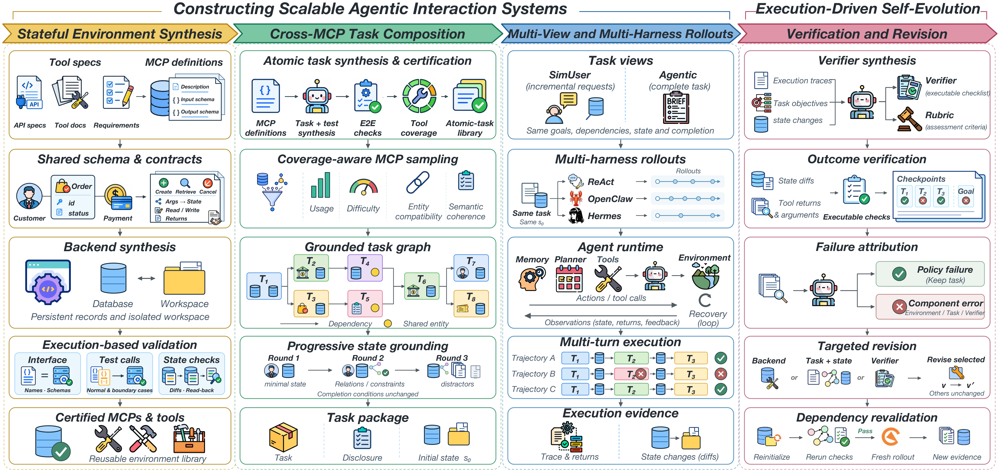
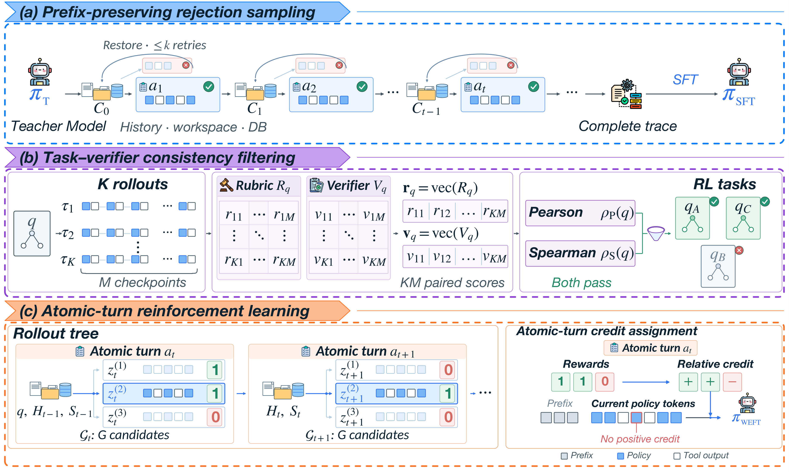

# WEFT：Scaling Tool-Use Post-Training for General-Purpose Agents — 细粒度阅读

## 1. 基本信息与核心判断

- **论文**：WEFT: Scaling Tool-Use Post-Training for General-Purpose Agents。
- **WEFT**：Whole-system Evolution For Tool-use Post-training。
- **版本**：arXiv:2609.36887v1，2026-09-29 提交；阅读日期：2026-10-08。
- **作者**：Bo Mao、Hang He、Linting Wang、Lizhi Lin、Maosen Zhou、Guanming Liu、Jinxiu Liu、Tianyu Huai、Chaoyun Zhang、Bingxuan Li、Kepeng Lei、Guanting Dong、Zhou Shao、Rui Zheng、Hang Yan、Jie Zhou、Chengcheng Wan、Tao Gui、Liang He、Xipeng Qiu。
- **机构**：华东师范大学、复旦大学、上海创智学院、中国人民大学、Shanghai Qiji Zhifeng Co., Ltd。
- **资料**：[摘要](https://arxiv.org/abs/2609.36887v1) · [在线 PDF](https://arxiv.org/pdf/2609.36887v1) · [本地 PDF](arxiv_2609_weft_scaling_tool_use_post_training_for_general_purpose_agents.pdf) · [TeX 入口](../arxiv_all/arxiv_2609_weft_scaling_tool_use_post_training_for_general_purpose_agents_tex/weft-arxiv.tex)。
- **状态**：arXiv preprint；源码使用 NeurIPS preprint 样式，不据此推断会议接收。
- **主题 / 层级**：Agent / detailed；全文 23 页，覆盖主文及附录方法、训练、评价和 MegaMCP 实验。
- **实现核验范围**：所读 TeX 没有提供明确的 WEFT 代码或模型发布链接。本文工程分析依据论文及原图，不声称已审计或运行作者实现。

**一句话理解**：训练 agent 的失败数据，既用于更新策略，也用于检查“环境、任务、harness、评估器”哪里出了问题；在经过验证的任务图和可恢复状态上，保留成功进度收集 SFT 数据，并用 atomic-turn 结果给 RL 分配局部 credit。

**最值得关注的三个技术点**：

1. 从“生成更多可执行环境”扩展到“构建并修复完整交互系统”，尽量从源头减少错误监督。
2. 将 atomic task 作为可验证、可回滚、可分组比较的单位，连接任务构建、拒绝采样和 RL credit assignment。
3. MegaMCP 将可复用服务进程与每条 rollout 的可变状态分开，使同状态 branching、恢复和大规模并发更可行。

**结论边界**：8B/14B 在所评估的 matched-size environment-scaling baselines 上有明确收益；35B 模型不是所有主指标都更强，原表显示它低于 Qwen3.5-35B-A3B 的三个 aggregate scores。MegaMCP 节省上传和进程内存，但在预热本地服务的 1,000-task 对照中延迟更高。

## 2. 背景：为什么“环境能跑”不等于“监督可靠”

### 2.1 交互系统的四个组件

Environment 实现工具、持久数据库和文件状态；task 指定目标、输入、依赖与初始状态；agent harness 管理 prompt、memory、planning loop、工具调用与错误恢复；evaluator 判断任务是否完成。

某条轨迹得到 0 分，可能是 agent 选错对象，也可能是工具返回成功却没有持久化、任务引用的对象不存在、verifier 不接受有效的替代路径。将所有失败直接归给 policy，会惩罚正确行为或鼓励错误行为。

原图以“更新客户记录并发送确认”为例：错误可能在 agent、environment、task、verifier。轨迹和状态证据决定是继续 policy learning，还是修复组件后重跑。

### 2.2 本文扩展哪些 scaling 维度

Environment breadth 扩展 MCP、工具和业务领域；task complexity 扩展跨 MCP、跨实体和长依赖链；interaction diversity 扩展信息披露形式、模拟用户和执行 harness。

仅增加 environment 数量，没有保证可实现的 task、正确 reward 或多样交互。WEFT 将这三种扩展与 execution-driven revision 配合：既扩大训练分布，也修复产生数据的系统。

### 2.3 Self-evolution 在这里改什么

它不只让模型反思答案，也不只更新模型参数。执行证据先用于 attribution，组件错误被定向路由到 backend、task graph/initial state 或 verifier；修订后需要 revalidation 和 fresh rollout。

有效任务上的单纯 policy failure 保留任务，不应靠降低要求将其改成通过。不同版本可以修复有缺陷的 task/state，但同一版本内各 views/harnesses 保持同一目标、依赖、初始状态和 completion conditions。

## 3. 总框架：从工具说明到可训练 workflow

左到右四个部分：stateful environment synthesis、cross-MCP task composition、multi-view/multi-harness rollouts、verification and revision。图中的 task package 同时携带任务、披露方式、初始数据库和 workspace。

### 3.1 状态环境合成：共享实体先于独立 API 拼接

从公共 tool documentation 和 business requirements 生成 MCP definitions，包含 tool description、input/output schemas。系统区分 database state 与 workspace state，工具可操作一种或两种。

Environment synthesis agent 读取完整 tool set，推断共享 entities、read/write dependencies 与 state transitions。先建立共享 database schema，检查类型与 relational constraints，再写 execution contracts：argument-to-state mapping、reads、writes、returns。Schema、MCP definitions 和 contracts 一起指导 FastAPI backend generation；文件操作则绑定到隔离 workspace。

这一步的意义是保证同一客户、订单、文件在不同工具之间有一致语义。逐个生成“看起来返回正确 JSON”的独立 endpoint，容易出现 read/write 不一致。

### 3.2 可执行验证看哪些证据

先检查实际接口与 MCP tool names/argument schemas 是否一致，再生成 normal/boundary calls。Query 对照状态核验；update 同时检查 database/workspace diff 和后续 read-back。

结构错误触发 schema 修订，映射错误触发 contract 修订，runtime/state-access 错误触发 backend 修订。通过 revalidation 的 backend 才成为独立可执行 MCP server。

这些测试证明当前检查覆盖的运行一致性，不等于自动认证真实业务服务的所有语义或外部副作用。

## 4. Atomic task 构建与跨 MCP 任务组合

### 4.1 Atomic task 不是一次 tool call

Atomic task 是单 MCP 内最小的独立执行和验证单位，实现一个 intent，可包含有界的多个 tool calls。记录 intent、required inputs、ordered tool chain、completion conditions，以及 E2E test。

“Atomic”是本系统选择的任务粒度，不等于数据库 transaction，也不等于一个 assistant message。后文 atomic-task turn 可能含多个 assistant tool-call turns。

### 4.2 三种 certification checks

**E2E execution validation**：每个任务从独立初始化状态执行真实工具调用；returns 与 persistent state 同时满足 conditions 才通过。通过集合保留，失败的 tests/responses/state diagnostics 进入修复反馈。

**Tool-chain orthogonality**：令 $\ell_i$ 是 task $i$ 的有序 tool-name sequence。两个 chain 满足以下任一条件，被视为冗余：

$$
\ell_i\preceq\ell_j\quad\text{或}\quad\ell_j\preceq\ell_i.
$$

$\preceq$ 是保持顺序的 subsequence，不要求连续，包含相等。如 $(u_1,u_3)\preceq(u_1,u_2,u_3)$。严格被包含的 chain 对应任务被移除；相同 chain 保留更早的任务。仅共享某些工具不构成冗余。

**Tool coverage**：在 orthogonality filtering 后，计算保留任务 chain 覆盖的 distinct tools 比例。设 MCP tools 为 $T$，task $a$ 的工具集合为 $T_a$：

$$
c=\frac{\left|\bigcup_{a\in A}T_a\right|}{|T|}.
$$

未覆盖工具指导继续生成，目标 coverage 为 $\eta$。这是 declared chains 的工具覆盖，不是所有参数、业务条件或运行分支覆盖。

**阅读判断**：按工具序列判冗余是一种实用 heuristic。同 chain 不同参数可能承担不同业务能力；较短 chain 也可能代表独立 intent。论文没有证明这个规则不会丢掉有价值的语义多样性。

### 4.3 增量构建算法

Algorithm 1 的过程为：生成候选 → 从独立状态 E2E 验证 → 累积通过集合 → orthogonality filtering → coverage 统计 → 用失败、冗余和 uncovered tools 继续修订/生成。

初始 validation 也计入 round budget $R$。达到 target coverage、耗尽 budget 或没有新候选时停止，返回任务库与实际 attained coverage，保存 tasks、tests 和 validation reports。不能把“target coverage”当作所有 MCP 都已达到的实测值。

### 4.4 Coverage-aware MCP sampling

五个 difficulty profiles：Simple、Standard、Moderate、Complex、Expert。每档控制 atomic-task count、MCP count、domain breadth 范围以及 corpus quota。

Largest-remainder allocation 将 profile proportions 转为整数配额。在约束范围内根据 atomic-task capacity 与 historical usage 优先覆盖欠采样领域/MCP；candidate combinations 按 shared entities、complementary operations、functional redundancy 排序。

组合需要候选余量。设选择的 MCP 集合为 $M$，目标 atomic tasks 数为 $k$，MCP $m$ 容量为 $c_m$：

$$
\sum_{m\in M}c_m\geq\lceil\rho k\rceil,\qquad\rho>1.
$$

Semantic evaluation model 再检查能否形成 coherent shared objective。接受组合后更新 usage，再抽 atomic-task set；拒绝则在同 profile 内重采样。容量充足不等于语义可组合，所以两个检查都需要。

### 4.5 Grounded DAG：依赖和实体绑定要可执行

Composition agent 将选中 atomic tasks 连接为 DAG：节点含 intent、input、outcome；边表示信息与状态依赖；entity bindings 对齐不同 MCP 的同一业务对象。

图必须区分用户已给的信息与需要通过工具检索的信息。Deterministic checks 检查节点来自 selected tasks、bindings 无冲突、inputs 来自 initial state 或 upstream outcomes。稳定 topological order 用于披露与执行。

原文不是任意把几个任务文本拼到一起：要证明前置状态和输出能够支持后续节点。

### 4.6 Progressive state grounding

初始状态分三轮构造：

1. Entity initialization：建立目标实体与 minimal executable state。
2. Relation completion：补齐跨工具 relations 与 constraints。
3. Context enrichment：加入历史记录和 distractors。

每轮保持 entity correspondence 和 completion conditions；通过 schema/task-reachability checks 后，形成可 reset 的 initial snapshot。

**阅读推论**：Distractors 可以迫使模型真正检索和选择，但它们必须与任务可达性相容。Grounding checks 若漏掉跨 MCP 关系，容易生成“局部工具都能跑、整体任务做不了”的样本。

## 5. Multi-view 与 multi-harness：固定任务如何产生不同经验

### 5.1 两种 task view

Agentic mode 一次给完整 brief，模型自主规划。SimUser mode 由模拟用户按依赖顺序提出 requests，并采样 personas；一个 atomic-task turn 可执行多个 tools，模型最后不含 tool calls 的 final reply 结束该 turn，再披露下一请求。

另外独立调节 vague、partial、full 三种 disclosure explicitness。两个 view 都保留用户已知 inputs 与 upstream information；不能把缺失必要信息制造成不可完成的任务。

同一版本的 task objective、DAG、initial state、completion checks 和 MCP interfaces 保持一致，因此区别主要在信息交付与交互过程。

### 5.2 Harness 不只是换 prompt

同一 task 路由到 ReAct、OpenClaw、Hermes，保留各自 prompts、memory、planning loop、tool protocol、error recovery。ReAct 支持两种 views；OpenClaw/Hermes 使用 Agentic mode。

不同 harness 可能改变观察序列、可用历史、工具错误恢复和推理步数，从而产生不同训练分布。WEFT 把它们作为数据多样性的来源，最终仍按 benchmark-native harness 评价。

这项实验支持 harness diversity 有用，但固定 task set 不自动代表固定 accepted trajectories、token count 或总计算预算；原文未给出这些配比的完整控制细节。

## 6. Execution-driven self-evolution：验证、归因、定向修订

### 6.1 由 execution evidence 生成 verifier

验证 atomic completion 使用两类材料：database/workspace state changes 和 tool returns。给定 completion conditions 与由 semantic evaluation model 接受的 reference execution，verifier-generating agent 生成 deterministic checks 和对应 rubric。

Checks 先在 reference evidence 上测试，再按反馈修订；之后 rollout 不要求重复 reference 的 exact tool sequence，允许其他满足 conditions 的路径。

设 trajectory $\tau$ 有 $K$ 个 checkpoints，覆盖 atomic tasks 和 overall objective；每 checkpoint 全部条件满足得 1，否则为 0：

$$
R(\tau)=\frac{1}{K}\sum_{k=1}^{K}r_k(\tau),\qquad r_k(\tau)\in\{0,1\}.
$$

这是 trajectory monitoring/evaluation score；后文 RL 的 local advantage 使用当前 atomic task 的 binary reward，两个概念不能互换。

### 6.2 Attribution agent 输入与决策

Attribution agent 检查 task graphs、traces、checkpoint outcomes 和 state evidence。跨 view/harness 的失败模式辅助定位，rubric-based 与 executable score 的 disagreement 指向 verifier 问题。

路由原则：

| 判断 | 被修订对象 | 后续动作 |
|---|---|---|
| 有效任务上的 policy failure | 任务保持不变 | 用作 policy learning |
| environment/tool implementation 问题 | backend | 重建环境、重验证 |
| task 或 state 问题 | task graph、initial state | 检查可达性与 entity bindings |
| evaluation 问题 | verifier | 用 evidence 检查修订后的规则 |

Evolution agent 使用当前版本和支持证据，仅修改选定组件。依赖 revalidation 后，fresh rollouts 再评估修复并发现新问题，形成多轮闭环。

### 6.3 为什么必须 fresh rollout

仅让原 verifier 接受旧 trace，可能只是降低了评分标准；fresh rollout 才能检查新 backend/state/verifier 在新的执行中是否一致。跨版本证据需要绑定组件版本，避免 reward 在旧状态和新规则之间错配。

**证据限制**：论文提供整体 self-evolution 的 downstream gains 与 tool-error reduction，没有提供 attribution accuracy、分类型人工审计或每种组件修订的独立消融。因此支持“系统修订总体有效”，未单独证明 attribution agent 对所有错误分类都准确。

## 7. Prefix-preserving rejection sampling：回滚失败局部，保留成功进度

### 7.1 完整轨迹拒绝采样浪费在哪里

20 个 atomic-task turns 的 workflow，前 19 个已经成功，最后一个失败。End-to-end rejection sampling 会丢掉整条尝试，再从 root 开始；成功前缀和对应 state changes 都要重新获得。

WEFT 在每个 atomic-task boundary 验证：成功则保留 trace、history、database、workspace；失败则丢弃失败片段，恢复 pre-turn history 和 state，只重采样该 atomic task。

所有任务完成后，拼接保留的成功 segments，构成 complete SFT trajectory。Teacher 为 Kimi K3；主配置最多 3 次 additional retries，即包含首次最多 4 attempts。

### 7.2 History 与 state 必须一起恢复

只删除聊天记录但保留失败写入，会让下次 attempt 从错误状态开始；只恢复数据库但保留 history，又会使模型相信已完成被回滚的操作。还需要恢复 workspace、跨 MCP 相关状态和 session lifecycle。

例如失败尝试已创建了工单，下次重新创建前必须恢复工单库，否则 duplicated records 会污染 reward。上述例子为阅读解释，不是作者新实验。

### 7.3 一个效率直觉及其假设

以下为阅读推导，不是论文公式。若每个独立 atomic task 单次成功率为 $p$，有 $n$ 个任务，整条首次成功率为 $p^n$。允许每节点最多 $k+1$ attempts、正确恢复状态且忽略路径相关性时，局部采样的整条可接受概率为：

$$
P_{\mathrm{local}}=\left[1-(1-p)^{k+1}\right]^n.
$$

它说明为什么长 workflow 保留 verified progress 有吸引力，但真实 $p$ 会随前缀、状态、task难度和teacher改变；局部 retries 与全轨迹 retries 的算力预算也不同。论文没有据此给出统一 token-cost 公式或可保证的加速倍数。

### 7.4 训练数据分布的边界

保留的是通过验证的片段，失败尝试被丢弃。因此 SFT 更偏成功轨迹；不能声称 rejected attempts 本身也被训练。Atomic task 内部的有效 recovery 可能仍留在通过片段中，另一个 selective masking 机制则用于 RL。

局部 checkpoint 必须足以保证后续可继续，否则“通过局部 verifier”的前缀可能损坏 global goal。原文把 overall objective 也列入 verification，但没有详细展开局部成功与所有全局不变量的完备关系。

## 8. RL：同历史、同状态下的 atomic-turn group-relative credit

### 8.1 RL task/verifier consistency filtering

独立生成 5,000 candidate task–verifier pairs。每 task 用 Nex-N2-mini 生成 16 pilot rollouts，分别由 rubric-guided LLM judge 和 executable verifier 评分；Pearson 与 Spearman 两项相关性都需达到 selection criteria。

筛选得到 1,954 tasks，8B/14B 共同使用；保留比例约 39.08%。训练 RL 时 reward 只来自 executable verifier，LLM judge 不在每个训练 action 上直接打分。

原图将 pilot rollout × checkpoint scores 展平，计算两组 paired scores 的相关性。源码未给具体 correlation thresholds、常量分数相关性如何处理、judge 的完整模型/prompt。不能擅自补成 Pearson 大于 0.8 等配置。

相关性一致也不代表独立真值正确：两个 scorer 可能共享同一错误 completion definition；correlation 对某些绝对分数偏差也不敏感。最好另做 known-success、known-failure 和 adversarial state 测试。

### 8.2 候选从同一 starting point 生成

按 task DAG 的固定 topological order，每个 atomic task 对应一个 atomic-task turn。第 $t$ 个 turn，冻结 rollout policy 从同一 history $H_{t-1}$ 和相同隔离状态 $S_{t-1}$ 独立采样 $G$ 个 segments。

每 segment 可含多个 tool calls；当前 atomic-task verifier 给 binary reward $r_t^{(i)}$。若有成功 candidates，均匀选一条 passing segment 给下一 turn 提供 history/state；若全失败，在 failed segments 中选取。所有 candidates 都可为本地训练提供信息，不只是被选作 continuation 的那条。

这构成具有同状态 sibling comparisons 的 rollout tree，但 advantage 不使用 branch terminal return。Continuation 偏向成功前缀，也会改变后续 training-state distribution。

### 8.3 Local advantage 与有效 loss tokens

$$
\bar r_t=\frac{1}{G}\sum_{i=1}^{G}r_t^{(i)},\qquad A_t^{(i)}=\frac{r_t^{(i)}-\bar r_t}{\operatorname{sd}(\mathbf{r}_t)+\epsilon}.
$$

Clipped GRPO 将这些系数分配到当前 atomic-task turn 的 policy tokens，不给 prefix tokens 直接 loss。跨 groups 使用 global token-mean aggregation。

它解决的局部问题是：“在相同有效前置条件下，哪个片段完成了当前目标”。Trajectory-level baseline 则用完整 trajectory mean checkpoint reward 得到一个 advantage，并分配给所有 turns，容易让后期失败影响早期正确操作。

**阅读推论**：这里没有未来价值函数。某个当前成功 action 若影响未来可行性，local binary reward 可能无法完整反映长期价值；它依赖 task graph 和 completion checks 的质量。

### 8.4 一个奖励组的例子

以下是阅读例子。三 candidates 奖励为 $(1,1,0)$，组均值为 $2/3$。若采用 population SD，标准差为 $\sqrt{2}/3$，忽略 epsilon，advantages 为：

$$
\left(A_t^{(1)},A_t^{(2)},A_t^{(3)}\right)=\left(\frac{1}{\sqrt{2}},\frac{1}{\sqrt{2}},-\sqrt{2}\right).
$$

这个例子仅解释 group-relative credit；原文记为 `sd`，未明确 unbiased convention，不把例子的 population SD 假设当作作者已给出的实现细节。

### 8.5 Selective positive-credit masking：成功不奖励所有行为

Deterministic checks 标记 no-progress repetition、malformed tool-call/reasoning structures 和 interface violations。即使 segment 最终成功，里面有这些模式的 assistant turn 也不获得 positive credit。

对于被标记 assistant turn 的 model-generated tokens：

$$
\widetilde A_t^{(i)}=\min\left(A_t^{(i)},0\right).
$$

Negative advantage 仍保留；原 reward 不改，后续未被标记的 recovery turns 保留原 advantage，KL 不随这个 positive-credit mask 移除。

这里需区分 atomic-task turn 与其内部 assistant turns：一个任务片段可能成功，但只有异常 assistant 子回合被抹去正 credit，不是整个成功 segment 一刀切。

### 8.6 TITO、TIS 与 dynamic sampling 的细节

TITO（token-in/token-out）保存 sampled token IDs 与 rollout log probabilities，learner 不将整段轨迹重 tokenize。Prompts、tool observations、inserted templates、model-specific boundary replacements 不进入 training loss。

Token-level truncated importance sampling（TIS）使用 training-backend old-policy probability 与 rollout-policy probability 的比值。保留 $[0.5,2.0]$ 内的 weights，区间外 tokens 被 mask，**不是把 weight clip 到端点**。TIS mask 同样用于 KL，loss denominator 仍是原 valid-token count。

不要把 TIS acceptance interval 与 PPO ratio clipping interval $[0.80,1.28]$ 混为一谈：前者处理 rollout/training backend 的概率匹配，后者属于 PPO/GRPO 更新 surrogate。

Main method 说等 reward group 有零 advantages，只剩 regularization；实际附录配置开启 dynamic sampling，丢弃 incomplete 或 constant-reward groups，以新 group 补齐 batch。所以不能说最终训练 batch 保留了所有 uniform groups。Entropy coefficient 在实际配置中为 0，reference KL 仍非零。

Infrastructure failures 最多两次 physical attempts，用于恢复基础设施错误；低 reward 本身不触发这种物理 retry。SFT 拒绝重采样、RL candidate sampling、infrastructure retry 是三种不同机制。

### 8.7 配置原表

| 配置 | 8B / 14B 的设定 |
|---|---|
| Optimizer | Adam |
| Learning rate / schedule | $10^{-6}$ / constant |
| Adam moments | $\beta_1=0.9$，$\beta_2=0.98$ |
| Weight decay / gradient clipping | 0.1 / 1.0 |
| Training precision | BF16 |
| PPO lower / upper clipping | 0.20 / 0.28，即 ratio $[0.80,1.28]$ |
| Reference KL | K2 estimator，coefficient $10^{-3}$ |
| Reward-side KL / entropy coefficient | 0 / 0 |
| Loss aggregation | Global token mean |
| Sampling temperature | 1.0 |
| Top-p / top-k | 1.0 / disabled |
| Maximum context | 131,072 tokens，无额外固定 per-turn generation cap |
| Maximum assistant turns | 100 |
| Token interface | TITO |
| TIS mode | Token-level weighting + out-of-range masking |
| TIS interval | $[0.5,2.0]$，无 batch weight normalization |
| Dynamic sampling | complete groups，reward SD $>10^{-6}$ |
| Infrastructure retry | 每 logical rollout 最多两次 physical attempts |

Reference policy 固定在各模型的 RL initialization checkpoint。14B reward-reporting 每 step 采样 16 tasks，每 task 从 final rollout layer 重建 16 条完整 root-to-leaf trajectories，共 256 条用于报告；这不是“每 step 只有 256 个本地训练 segments”，也不直接证明每层 $G$ 的统一值。

SFT 的 LR、epochs、mixture proportions、训练 token总量、详细计算预算，以及各实验 training seeds/uncertainty 未完整提供。RL group size、具体更新 cadence 和全量 resolved config 也需进一步实现材料核验。源码没写的值不从常见默认值补齐。

## 9. MegaMCP：共享服务不共享可变状态

### 9.1 要解决的部署问题

每 rollout 的 sandbox 都部署一份 MCP source、initialized databases 和服务进程，会重复上传、加载依赖并占用内存。模型生成期间，工具服务多数时间空闲，工具调用间隔 median 超过 10 秒。

MegaMCP 将 reusable tool services 放在 agent sandboxes 之外，让 compatible sessions 分享 worker processes；每 rollout 仍有 private database 与 workspace，并能从 snapshots 恢复。

### 9.2 Registry 与 process sharing

Registry 保存 content-addressed MCP metadata/source/tool definitions 和递增版本。Static analysis 筛查 process-global side effects，按 load class 限制一进程中实例数；不适合共享的 servers 使用更强 isolation tier。

Prefork master 预加载 web/database dependencies，再创建 workers。Worker 将 MCP servers 导入独立 modules，request 绑定到发起 session 的 private DB。

这种 sharing 的前提是服务不会通过全局可变变量串扰。Static analysis 是筛查机制，不构成任意 Python server 的严格隔离证明。

### 9.3 Session group 与私有状态

一个 task 的多个 constituent MCPs 形成统一 lifecycle group，每个 MCP 有 private session。初始数据库从 immutable snapshot copy-on-write clone；mutable workspace 在 runs 间隔离。Pause/resume 同时管理 MCP sessions 与 sandboxes。

Agent 只能通过 tools 访问 server-side state；internal DB files、server workspace paths、credentials 隐藏，每 session 使用单独 access token。图中共享的是服务代码和运行时，不是各候选写入后的业务数据。

### 9.4 Offload、checkpoint 与恢复

冷却窗口后，idle session group 的 runtime 可 offload，保留 session/credentials/workspace，下一调用 reload；更长 idle 的 groups checkpoint 后从 local disk evict。

Mutating calls 后通过 debounced asynchronous checkpoints 将 consistent snapshots 持久化到 object storage，以 immutable generation-fenced keys 保存。Resumption/crash recovery 加载 latest persisted snapshot，不从头重放全部 tool calls。

Worker 监测 disk/memory pressure，不健康时停止 placements 并迁移 sessions；generation fencing 防止失去 ownership 的旧 worker 继续写入；reaper 幂等完成中断 shutdown。

**重要区别**：局部 sampling/retries 必须使用对应 turn-start snapshot；crash recovery 使用 latest persisted snapshot。Async debounce 不保证每个最近的 mutation 都已持久化；论文没有报告零数据丢失窗口或 exactly-once 外部服务副作用保证。

### 9.5 Verification evidence 与权限边界

Serving layer 保留 immutable initial DB、group-wide freeze 后的 final DB 和完整 tool-call ledger（arguments/results/outcomes）。Verifier 在 serving layer 执行，agent 无法读取或改写其代码与 privileged state。

它防止通过直接编辑 verifier internals 来改 reward，但不意味着排除了所有基于工具行为或任务规范漏洞的 reward hacking。Tool error rates/crash statistics 绑定 MCP definitions，反馈到 revalidation 或更强隔离。

## 10. 数据规模与评价设置

| 资源 | 数量 / 统计 |
|---|---:|
| Executable MCPs | 8,172 |
| Tools | 64,755 |
| Certified atomic tasks | 41,695 |
| Composed tasks / SFT task pool | 11,884 |
| Median atomic-task turns / composed task | 20 |
| RL candidate task–verifier pairs | 5,000 |
| RL retained tasks | 1,954 |

Software & DevOps 最大，占 MCPs 22.6%；多数 tasks 跨多个 MCP，超过一半跨领域。原图 difficulty mix 为 Simple 27%、Standard 36%、Moderate 15%、Complex 10%、Expert 12%。这是 construction-time profile，不是根据实测 agent success rate 得出的 difficulty 校准。

Student 从 Qwen3-8B、Qwen3-14B、Qwen3.5-35B-A3B 的 base models 做 post-training。8B/14B 的 SFT→RL 路径有明确表格；35B 的主要证据是 data-construction/multi-harness 实验，原文未提供其对应的 atomic-turn RL 增益表，不把小模型 RL 配置无条件推广到 35B。

主比较和 RL study：BFCL V4、$\tau^2$-Bench、Claw-Eval；data-construction ablations：Toolathlon-Verified、AutomationBench、Claw-Eval。按各 benchmark native harness 与官方 aggregate metric 评价。这些 score 不是统一的一个 pass@k 定义。

**Baseline 来源限制**：Qwen3.5-35B-A3B 的 BFCL/$\tau^2$ 数字来自 official model card；Claw-Eval 数字来自 Qwen3.6-35B-A3B model card 的对应比较列；$\tau^2$ airline 使用 Claude Opus 4.5 system card 所述 fixes。因此大模型表不全是本文同一运行栈下独立重测，评价设置差异应保留。

## 11. 完整主结果：小模型收益与大模型退化

原 Table 1 共 13 个 score columns，下文拆成 BFCL 与交互 benchmark 两组，数值和缺失项保留。**粗体**和 <u>下划线</u> 按原表分别标 best/second-best，排名是原表整个参数组，不是只按相同大小两模型比较。Avg 为 benchmark 原 aggregate，不擅自改成子项简单平均。

### 11.1 7B–32B：BFCL V4 全部子项

| Method | WebSearch | Memory | Multi-T. | No live | Live | Relev. | Irrelev. | Avg. |
|---|---:|---:|---:|---:|---:|---:|---:|---:|
| TOUCAN-7B | 21.0 | 18.5 | 17.8 | 81.0 | 73.9 | <u>81.3</u> | 78.6 | 36.6 |
| Qwen3-8B | 7.0 | 17.6 | 35.4 | <u>90.2</u> | 80.9 | <u>81.3</u> | 77.2 | 40.4 |
| Simulator-8B | 17.5 | 6.0 | 4.1 | 47.6 | 44.6 | 31.3 | **87.3** | 23.9 |
| EnvScaler-8B | 23.0 | 21.9 | 47.1 | 88.5 | <u>82.2</u> | **93.8** | 74.6 | 47.6 |
| AWM-8B | 9.5 | 15.7 | 34.9 | <u>90.2</u> | 80.5 | **93.8** | 73.9 | 40.0 |
| ScaleEnv-8B | — | — | — | — | — | — | — | — |
| EnvACE-8B | 12.25 | 24.03 | 45.29 | 87.59 | 81.20 | — | 83.19 | 46.04 |
| Agent-World-8B | 47.0 | 21.7 | 44.5 | 83.3 | 79.6 | **93.8** | 80.2 | 51.4 |
| Agent-World-14B | <u>53.0</u> | 23.9 | **53.9** | 82.3 | 79.3 | **93.8** | 81.0 | <u>55.8</u> |
| Qwen3-14B | 4.0 | 19.8 | 36.9 | 90.0 | **82.4** | <u>81.3</u> | 79.4 | 41.0 |
| AWM-14B | 10.0 | 19.8 | 37.6 | <u>90.2</u> | 81.5 | 75.0 | 79.4 | 42.4 |
| Qwen3-32B | 26.0 | 15.7 | 43.3 | **90.3** | 82.0 | <u>81.3</u> | 82.4 | 46.7 |
| **WEFT-8B** | 49.5 | <u>33.12</u> | 47.75 | 77.9 | 69.5 | 81.25 | 66.88 | 52.28 |
| **WEFT-14B** | **68.00** | **49.25** | <u>52.38</u> | 79.02 | 66.69 | 62.5 | <u>84.75</u> | **62.21** |

### 11.2 7B–32B：$\tau^2$-Bench 与 Claw-Eval

| Method | Retail | Telecom | Airline | $\tau^2$ Avg. | Claw-Eval Avg. |
|---|---:|---:|---:|---:|---:|
| TOUCAN-7B | 22.8 | 10.5 | 20.0 | 17.7 | — |
| Qwen3-8B | 34.0 | 18.0 | 26.5 | 26.2 | 25.6 |
| Simulator-8B | 32.2 | 29.2 | 34.0 | 31.8 | — |
| EnvScaler-8B | 49.6 | 32.7 | 31.5 | 37.9 | 22.6 |
| AWM-8B | 41.23 | 23.47 | 38.50 | 34.4 | 22.6 |
| ScaleEnv-8B | 50.9 | 27.2 | 37.5 | 38.5 | — |
| EnvACE-8B | 48.9 | 17.3 | 44.0 | 36.7 | — |
| Agent-World-8B | 72.8 | 50.9 | 40.0 | 61.8 | 30.5 |
| Agent-World-14B | <u>74.5</u> | 56.1 | **52.0** | <u>65.4</u> | 31.5 |
| Qwen3-14B | 55.3 | 14.9 | 27.0 | 32.4 | 24.7 |
| AWM-14B | 63.6 | 17.8 | 31.5 | 39.0 | 26.1 |
| Qwen3-32B | 59.5 | 27.2 | <u>48.0</u> | 44.9 | — |
| **WEFT-8B** | 71.93 | <u>72.81</u> | 42.0 | 62.25 | <u>35.78</u> |
| **WEFT-14B** | **74.56** | **76.32** | **52.0** | **67.63** | **43.77** |

WEFT-14B 相对 Agent-World-14B 三个 aggregate 分别 +6.41/+2.23/+12.27 pp；8B 分别 +0.88/+0.45/+5.28 pp。重点收益在 Memory、Telecom，14B WebSearch 也 +15 pp。

但 BFCL Live、No live、Relevance 等并非全部改善。例如 14B Live=66.69，低于 Agent-World-14B=79.3；Relevance=62.5，低于 93.8。Aggregate 上升掩盖了能力间取舍，不应写成“所有工具使用能力提升”。

### 11.3 35B–685B：BFCL V4

| Method | WebSearch | Memory | Multi-T. | No live | Live | Relev. | Irrelev. | Avg. |
|---|---:|---:|---:|---:|---:|---:|---:|---:|
| nex-n2-mini-35b | **72.50** | 39.14 | **62.12** | <u>72.02</u> | 61.44 | 56.25 | **96.30** | <u>63.94</u> |
| Qwen3.5-35B-A3B | — | — | — | — | — | — | — | **67.3** |
| Qwen3-235B-A22B | 54.0 | 23.9 | 45.4 | 37.4 | <u>68.9</u> | **87.5** | 81.7 | 47.9 |
| DeepSeek-V3.2-685B | <u>69.5</u> | <u>54.2</u> | 37.4 | 34.9 | 53.7 | 37.5 | <u>93.2</u> | 54.1 |
| **WEFT-35B-A3B** | 55.0 | **66.02** | <u>54.62</u> | **73.5** | **71.21** | <u>68.75</u> | 83.39 | 63.4 |

### 11.4 35B–685B：$\tau^2$-Bench 与 Claw-Eval

| Method | Retail | Telecom | Airline | $\tau^2$ Avg. | Claw-Eval Avg. |
|---|---:|---:|---:|---:|---:|
| nex-n2-mini-35b | <u>74.56</u> | 73.68 | **68.00** | 72.08 | **69.75** |
| Qwen3.5-35B-A3B | — | — | — | **81.2** | <u>65.4</u> |
| Qwen3-235B-A22B | 71.9 | 58.0 | 45.6 | 58.5 | — |
| DeepSeek-V3.2-685B | **81.1** | **96.2** | 63.8 | <u>80.3</u> | — |
| **WEFT-35B-A3B** | 71.93 | <u>85.09</u> | <u>66.0</u> | 74.34 | 64.0 |

35B 的 Memory=66.02 是组内最高，Telecom=85.09 为第二，但三个 aggregate 均低于表列 Qwen3.5：BFCL 63.4 vs 67.3、$\tau^2$ 74.34 vs 81.2、Claw 64.0 vs 65.4。差值分别 −3.90、−6.86、−1.40 pp。

这些是对原表数字的比较；baseline 部分来自外部 model cards，因此不能据此断言已在严格同设置下证明 catastrophic forgetting。它明确限制“WEFT 对所有模型与所有 benchmark 都提升”的叙述。

## 12. 消融：interaction diversity、self-evolution、sampling 与 RL

### 12.1 Task views 与 harness scaling 原表

固定 task set，WEFT-35B-A3B 下的数据配置比较；右半是 cumulative harness mixture，不是各 harness 单独评价成绩：

| Benchmark | Agentic | SimUser | Both | ReAct | + OpenClaw | + Hermes |
|---|---:|---:|---:|---:|---:|---:|
| Toolathlon-Verified | 27.78 | 19.44 | **32.41** | 32.41 | 39.51 | **45.99** |
| AutomationBench | 10.50 | 4.67 | **13.67** | 13.67 | 22.00 | **26.50** |
| Claw-Eval | 59.55 | 57.51 | **61.29** | 61.29 | 63.58 | **64.00** |

SimUser 单独更弱，但 Both 相对 Agentic 平均 +3.18 pp，说明弱 view 的数据也可能具有互补价值。固定 view mixture 添加 OpenClaw/Hermes，三项相对 ReAct 分别 +13.58/+12.83/+2.71 pp，均值 +9.71 pp。

不能将它理解为“测试时换 Hermes 自动提升 13 pp”；这些是训练数据配置变化，评价用 benchmark-native harness。

### 12.2 Self-evolution rounds

Task set 和 rollout budget 固定，从 initial construction $r=0$ 到三轮演化。Selected teacher trajectories 的 tool-error rate 从 1.76% 降到 0.96%，绝对 −0.80 pp、相对下降 45.5%。统计包含之后被 teacher 恢复的错误 calls。

三轮相对初始构建的 Toolathlon/Automation/Claw gains 为 +5.25/+4.33/+3.65 pp。Automation/Claw 大部分收益在前两轮，Toolathlon 第三轮继续提升。

这是被选中 trajectories 内的 tool errors，不是所有 raw calls 的平均，也不是最终 task failure rate。图没有逐轮绝对 downstream scores 的完整表，不从像素补造数值。

### 12.3 Prefix-preserving vs end-to-end sampling

固定 task pool、verifier、accepted-trace count，比较 $k\in\{1,2,3\}$ additional retries。Prefix-preserving 对每 atomic-task turn 重试，end-to-end 对整个 trajectory 重试；两个 retry units 不同，不自动等于固定 token compute。

图明确标注 $k=3$ 的数值：

| Benchmark | Prefix-preserving | End-to-end | 差值 |
|---|---:|---:|---:|
| Toolathlon-Verified | 45.99 | 44.14 | +1.85 pp |
| AutomationBench | 26.50 | 24.33 | +2.17 pp |
| Claw-Eval | 64.00 | 63.91 | +0.09 pp |

Accepted examples 数量固定，所以结果支持产生的 SFT data 更有训练价值，不是单纯样本数量更多。没有详细 wall-time/token-efficiency 表，不能用这张 score 图声称训练成本减少某固定比例。

### 12.4 RL credit-assignment 原表

固定 SFT initialization、task pool、reward verification 和 positive-credit masking，只比较 trajectory-level 与 atomic-turn credit：

| Training configuration | 8B BFCL | 8B $\tau^2$ | 8B Claw | 14B BFCL | 14B $\tau^2$ | 14B Claw |
|---|---:|---:|---:|---:|---:|---:|
| SFT | 52.02 | 59.73 | 31.19 | 59.69 | 64.04 | 35.23 |
| + trajectory-level GRPO | 52.25 | 56.56 | 34.92 | 60.47 | 63.20 | 41.64 |
| + atomic-turn GRPO | **52.28** | **62.25** | **35.78** | **62.21** | **67.63** | **43.77** |

Trajectory-level RL 使 $\tau^2$ 相对 SFT 退化 3.17/0.84 pp；atomic-turn 相对 trajectory-level 在 $\tau^2$ 提升 5.69/4.43 pp。Atomic-turn 对 SFT 六个 aggregate 都改善，Claw gains 最大，为 +4.59/+8.54 pp。

8B BFCL 的 local-vs-global 差仅 0.03 pp，原文未给多 seeds variance；不能把这个微小数字当作统计显著证据。总体最清楚的对比是避免 $\tau^2$ regression 和增强 Claw。

Positive-credit masking 在两个 RL variants 中固定，表格没有独立证明该 masking 的增益；verifier consistency filtering 也缺少清楚的去除消融。

### 12.5 Training reward curve 不是 local loss reward 曲线

Mean trajectory reward 总体增加，entropy 下降。Reporting 从最后 rollout layer 的 leaves 回溯到 root，重建完整 trajectories，以各 binary checkpoints 的平均作为 reward，再 task内平均、跨 task平均。

Shared successful prefixes 会被多个 leaves 共用，因此这些 trajectories 不是完全独立样本。曲线用于完整 workflow completion 监控；训练 advantage 仍只来自当前 atomic task 的 binary outcome。

## 13. MegaMCP 实验：省资源与低延迟是不同结论

### 13.1 对照与 timing boundaries

Local baseline 在 E2B sandboxes 内部署 source、initialized DB、server processes；MegaMCP 共享服务但隔离 sessions。使用 identical task traces、同工具接口、初始状态、planned calls 和 cleanup。

100-task cold workload：400 sessions、3,791 planned calls，两边都计 sandbox creation/provisioning。1,000-task workload：4,000 sessions、39,864 planned calls，最多 1,000 calls in flight；local servers **prewarmed**，MegaMCP **仍计 session provisioning**。

后者不是 matched cold-start 对照；预热边界不同需明确，不能将其延迟差直接解释成服务 intrinsic throughput 差。

### 13.2 上传数据原表，单位 MiB

| Workload | Path | Query | MCP source | Initdb | Workload data | Runner | Total | Workload reduction |
|---|---|---:|---:|---:|---:|---:|---:|---:|
| 100 cold | Local | 0.315 | 45.908 | 25.195 | 71.418 | 2.865 | 74.282 | — |
| 100 cold | MegaMCP | 0.315 | 0 | 0 | 0.315 | 2.893 | 3.208 | 99.559% |
| 1,000 warmed | Local | 3.123 | 484.494 | 255.641 | 743.259 | 30.283 | 773.542 | — |
| 1,000 warmed | MegaMCP | 3.123 | 0 | 0 | 3.123 | 31.717 | 34.841 | 99.580% |

1,000 tasks 的 total upload 下降 95.496%，100 tasks 下降 95.682%。表中约 99.6% 是 workload data reduction，不含 runner；两种 denominator 不可混用。

它计传到 agent sandbox 的数据，不是整个系统所有 object-storage、RPC 或 checkpoint 网络流量。共享服务省掉重复 source/initdb delivery，仍需传 query、执行 requests 和保存 snapshots。

### 13.3 Latency 原表，单位秒

这里 TTFT 指 **time to first tool call**，不是模型推理 time to first token。

| Workload | Path | TTFT p50 | TTFT p95 | E2E p50 | E2E p95 | Wall time |
|---|---|---:|---:|---:|---:|---:|
| 100 cold | Local | 10.455 | 14.460 | 24.271 | 79.673 | 332.469 |
| 100 cold | MegaMCP | 4.794 | 6.198 | 18.609 | 71.006 | 321.383 |
| 1,000 warmed | Local | 0.009 | 0.016 | 15.097 | 107.217 | 501.220 |
| 1,000 warmed | MegaMCP | 39.281 | 69.983 | 74.056 | 175.964 | 587.394 |

Matched cold-start 下，median TTFT −54.1%、median E2E −23.3%、total wall time −3.3%。因此“首调用快了一半”不意味着整体执行时间也减半。

1,000-task 中 MegaMCP TTFT/E2E/wall time 都更高，仍完成全部 lifecycles。该实验揭示省传输、省部署资源之后，concurrent session provisioning 仍有成本。

### 13.4 Historical runs 原表

| Stage | Serving | Wall s | TTFT p50 s |
|---|---|---:|---:|
| Cold baseline | Local | 859.7 | 348.9 |
| Early cold | MegaMCP | 278.5 | 22.7 |
| Stabilized cold | MegaMCP | 548.1 | 22.2 |
| Cold repeat | Local | 968.9 | 428.6 |
| Cold repeat | MegaMCP | 550.3 | 17.4 |
| First warmed | Local | 500.7 | 1.278 |
| First warmed | MegaMCP | 625.9 | 39.7 |
| Final warmed | Local | 501.2 | 0.009 |
| Final warmed | MegaMCP | 587.4 | 39.3 |

主图的 1,000-task cold-repeat bars 使用 428.6/17.4 s，来自这些 historical records；不能与 primary warmed 表的 0.009/39.281 s 混成同条件数据。Primary comparisons 以第 13.3 节表及其 timing boundaries 为准。

### 13.5 Resident memory 原表

| Configuration | Processes | Relative memory | Reduction |
|---|---:|---:|---:|
| 52 server instances | 8 | 22.4% | 77.6% |
| 50 sessions | 1 | 4.3% | 95.7% |

50-session one-process configuration 占 110 MiB。每行分别相对 one-process-per-session baseline，不代表整个训练系统 RAM 降低 95.7%，更不是 learner GPU HBM 降低。

论文没有系统给出 crash injection、cross-session leakage、snapshot一致性或migration recovery success rate 的量化测试。MegaMCP 的 reliability 机制详细，但 resource/latency 表不能替代 correctness audit。

## 14. 与既有 agent 工作、harness 和训练调度的关系

### 14.1 Environment scaling 与系统 scaling

EnvScaler、ScaleEnv、AWM、Agent-World 等扩展环境和任务。WEFT 强调各组件组合后的可靠性，并用跨 MCP DAG、multi-view/harness 和 execution revision 扩展训练经验。原文不证明既有方法完全没有验证或修复，贡献在整体组合与实验。

### 14.2 与 HERA 的联系

[HERA 笔记](arxiv_2610_hera_harness_environment_co_evolution_for_reliable_agentic_abstention.md)也讨论 harness/environment 的联合改进。WEFT 在这里主要服务于通用 tool-use post-training 的数据质量、task可达性和reward可信性；不同目标需要分别看 evaluation protocol，不能仅因都用“co-evolution”就视为同一方法。

### 14.3 与细粒度 credit assignment 的联系

GiGPO 使用跨 trajectory recurring states 分组；PivotRL 在 demonstrations 的中间位置采样 continuation；BPO 比较 snapshot branching 后的 sibling terminal returns。WEFT 使用 identical current history/state 下的候选 atomic tasks，以 **当前任务 binary completion** 分组。

相同状态控制前置条件，local verifier控制reward粒度；代价是依赖可分解的任务图与可靠局部验证。不能仅凭名字“turn-level”把不同方法的 state distribution 和目标视为等价。

### 14.4 与 ThunderSyncRL 是不同层面

[ThunderSyncRL 笔记](arxiv_2610_thundersyncrl_lossless_acceleration_of_agentic_reinforcement_learning.md)改变梯度工作的释放时序，维持其特定同步目标；WEFT 改变生成系统、candidate selection、credit granularity 和 clipped RL 配置。

WEFT 有 dynamic sampling、TIS masking、PPO clipping、reference KL；不能直接把 ThunderSyncRL 的两统计量 GRPO 公式套入后宣称更新等价。若组合，需要先明确同一 policy snapshot、group membership、mask、normalization 和额外项的 dependencies。

### 14.5 MegaMCP 与 agent harness 的分工

ReAct/OpenClaw/Hermes 是 interaction runtime 的数据来源；MegaMCP 是共享 tool-serving 与 state-management 层。它不会替代 harness 的 planning/memory，也不会替代训练 optimizer。

因此“支持多个 harness”和“隔离多条 rollout 状态”是两项不同能力。实现接入时要分别对齐 tool protocol、state snapshot、turn boundary 和 loss-token serialization。

## 15. 优点、局限与复现检查

### 15.1 有价值的贡献

**执行经验有双重用途。** 使用 traces/state 不仅筛选训练样本，还定位数据生成系统的错误，减少给 policy 的错误奖惩。

**Atomic task 贯穿整条 pipeline。** 可验证单位同时服务于任务组成、SFT局部重试、RL sibling comparisons 与状态恢复，各模块依赖较一致。

**保留了负结果和条件。** Trajectory-level RL 在 $\tau^2$ 退化、35B aggregate 非最优、warm local 的延迟优势都能从原文表中看到。

**Serving 状态设计具体。** Sessions、copy-on-write、generation fencing、group freeze、tool ledger 使“同状态重试”具备工程落点。

### 15.2 最主要的证据限制

1. 缺完整训练预算、seeds、uncertainty 与 resolved configs，不能判定所有小幅 gains 的稳定性。
2. Harness mixture task set 固定，但数据量/token/compute controls 未充分披露，不能完全排除训练规模变化。
3. 35B 部分 baseline 来源和 airline setup 有差异，限制 strict matched-evaluation 结论。
4. Verifier/attribution 依赖 LLM，缺 correlation thresholds、人工真值误判率与 adversarial verifier audit。
5. Atomic-turn local reward 不完整描述后续价值；任务图/局部checks错误会直接影响优化目标。
6. Dynamic sampling 丢弃同reward/incomplete groups，改变训练分布；可能偏向已有 mixed-success 状态。
7. Prefix sampling 需要真正可恢复的state；真实支付、外部邮件等不可回滚副作用不自动适用。
8. MegaMCP resource gains 不等于所有 workloads 更快，异步持久化也不等于零恢复窗口。
9. Environment真实度、跨model generalization、benchmark contamination和长期retention缺更系统验证。
10. 所读材料未提供可核验的完整开源实现与资产下载入口，复现仍需更多材料。

### 15.3 实现应保存哪些可审计记录

- MCP definition/schema/contract/backend版本和 validation reports。
- Task DAG、entity bindings、initial state hash、各 checkpoint conditions与verifier/rubric版本。
- View/harness、完整history、sampled token IDs、rollout logprobs、policy版本。
- Turn-start snapshot、每 candidate 的私有state、reward与被选continuation。
- Positive-credit flags、TIS mask、原valid-token denominator和dynamic rejection reason。
- Self-evolution attribution evidence、修改组件diff、dependency checks和fresh-rollout结果。
- Resource timing boundaries、warm/cold状态、server session provisioning与所有网络流量分类。

这些记录使“分数提高了”可以追溯到 policy、数据、评估规则或部署条件的变化。

## 16. 可落地研究方向

**先做小规模真实状态闭环。** 选少量 MCP 和3–5个atomic-task workflows，分别注入 backend、initial-state、verifier错误，人工标记归因真值，检查修订是否修复且不放宽目标。

**同状态 branching 的正确性测试。** 对同一snapshot fork多个candidates，验证DB/workspace隔离、失败rollback、tool ledger一致、generation fencing和crash recovery；先验证执行正确再跑RL。

**Matched-budget harness diversity。** 固定accepted trajectories、policy tokens和teacher compute，在ReAct-only、mixed views、mixed harnesses间比较，明确收益来自数据结构还是数据量。

**局部与长期credit结合。** 保留atomic completion，同时增加global consistency checks或未来return校正，检查当前成功但破坏下游的情况；与纯local reward比较。

**Verifier一致性之外的审计。** 构造多条有效替代路径、known failure states和只满足表面returns的伪成功；同时测false positive/negative，不只报告correlation。

**能力保留实验。** 尤其对35B，使用同一native harness与generation settings测基础模型和WEFT，加入BFCL live/relevance、通用推理等retention curves，区分专业化收益与退化。

**Serving的完整成本账单。** 同时做matched-cold与matched-warm，报告sandbox upload、RPC、snapshot transfer、resident RAM、session provisioning和end-to-end rollout time，避免将一项资源减小等同于全面加速。

以上为阅读后的研究建议，论文未宣称已完成这些实验。

## 17. 原图、表与源码索引

所有9张重要图均嵌入正文，使用作者原始PDF转换的PNG；未重绘框架。原件保留在assets，方便放大检查。

| 图 | 本地原件 | 对应章节 |
|---|---|---|
| Motivation example | [PDF](assets/arxiv_2609_weft_scaling_tool_use_post_training_for_general_purpose_agents_tex/weft_motivation_task_example_cropped.pdf) | 2 |
| Framework | [PDF](assets/arxiv_2609_weft_scaling_tool_use_post_training_for_general_purpose_agents_tex/WEFT_main_figure_title_spacing_fixed_cropped.pdf) | 3 |
| SFT / filtering / atomic RL | [PDF](assets/arxiv_2609_weft_scaling_tool_use_post_training_for_general_purpose_agents_tex/WEFT_training_credit_restored.pdf) | 7–8 |
| MegaMCP | [PDF](assets/arxiv_2609_weft_scaling_tool_use_post_training_for_general_purpose_agents_tex/MegaMCP_single_slide_ellipsis_fixed_v8.pdf) | 9 |
| Corpus | [PDF](assets/arxiv_2609_weft_scaling_tool_use_post_training_for_general_purpose_agents_tex/candidate_environment_task_corpus.pdf) | 10 |
| Self-evolution | [PDF](assets/arxiv_2609_weft_scaling_tool_use_post_training_for_general_purpose_agents_tex/self_evolution_changes_compact.pdf) | 12.2 |
| Rejection sampling | [PDF](assets/arxiv_2609_weft_scaling_tool_use_post_training_for_general_purpose_agents_tex/rejection_sampling_compact.pdf) | 12.3 |
| RL curves | [PDF](assets/arxiv_2609_weft_scaling_tool_use_post_training_for_general_purpose_agents_tex/rl_learning_weft_14b_wrap.pdf) | 12.5 |
| Serving summary | [PDF](assets/arxiv_2609_weft_scaling_tool_use_post_training_for_general_purpose_agents_tex/megamcp_serving_summary_compact.pdf) | 13 |

源码：[Method](../arxiv_all/arxiv_2609_weft_scaling_tool_use_post_training_for_general_purpose_agents_tex/4-method.tex) · [Experiments](../arxiv_all/arxiv_2609_weft_scaling_tool_use_post_training_for_general_purpose_agents_tex/6-implementation.tex) · [Main table](../arxiv_all/arxiv_2609_weft_scaling_tool_use_post_training_for_general_purpose_agents_tex/7-table.tex) · [Appendix](../arxiv_all/arxiv_2609_weft_scaling_tool_use_post_training_for_general_purpose_agents_tex/appendix.tex) · [MegaMCP appendix](../arxiv_all/arxiv_2609_weft_scaling_tool_use_post_training_for_general_purpose_agents_tex/appendix-megamcp-benchmark.tex)。

覆盖说明：主文动机、相关工作、环境/任务/harness构建、验证归因、SFT/RL、MegaMCP、主结果与消融，以及附录atomic certification算法、训练配置、evaluation来源、reward reconstruction、全部serving表均已整理。本文为细粒度分析，不是逐段全文翻译；阅读例子、推导假设和研究建议均已标明。
