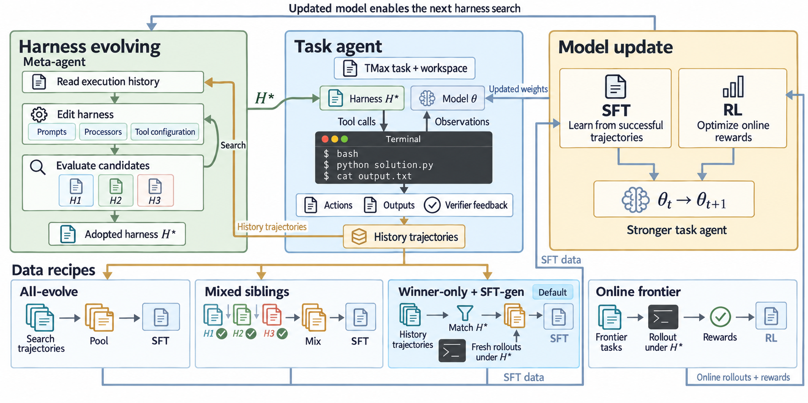
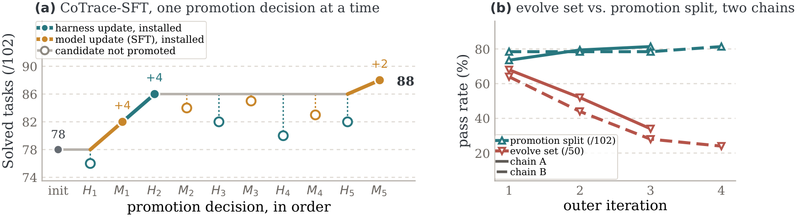
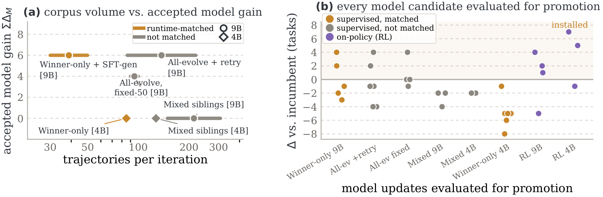
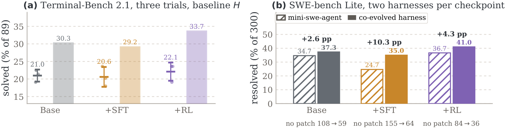

# CoTrace：通过 Harness-Model 协同进化训练 Terminal Agent 的数据配方

> 论文：CoTrace: Data Recipes for Training Terminal Agents with Harness-Model Co-Evolution  
> 作者：Jixuan Chen 等  
> arXiv：2610.10426v1（2026-10-07）  
> 主题：Terminal Agent、Agent RL、Harness Search、Trajectory Provenance、Co-evolution

原文：[PDF](./arxiv_2610_cotrace_data_recipes_for_training_terminal_agents_with_harness_model_co_evolution.pdf)  
TeX 源码：../arxiv_all/arxiv_2610_cotrace_data_recipes_for_training_terminal_agents_with_harness_model_co_evolution_tex

## 一句话结论

CoTrace 将 terminal agent 看成模型 policy 与执行 harness 的联合系统，核心不是单独寻找更好的 prompt、工具或模型，而是维护一条有 provenance 的数据生产管线：失败轨迹路由给 harness 搜索，匹配当前 adopted harness 的成功轨迹用于模型训练，候选组件通过固定另一组件的 promotion split 接受，任务在成功并完成轨迹收集后才从 evolve set 中退出，并持续补充 frontier tasks。

在作者的设置中，9B 模型从 78 提升到 90，CoTrace-SFT 为 88，CoTrace-RL 为 90；4B 模型的 CoTrace-RL 从 67 提升到 79。迁移实验同时显示，checkpoint 的收益高度依赖协同进化时使用的 runtime：模型与 harness 应作为联合部署系统评估。

## 1. 问题与动机

Terminal agent 的最终行为由两部分共同决定：

1. 模型如何规划、调用工具、解释观察并完成任务；
2. harness 如何渲染 prompt、绑定工具、处理观察、限制步数、执行验证以及提交结果。

因此同一 checkpoint 在不同 harness 上可能得到完全不同的结果。传统训练数据管线把轨迹当成脱离运行时的文本，容易把某个 harness 的特定行为、提示格式或工具绑定误写成模型能力。CoTrace 试图回答四个问题：

- 哪些失败应该交给 harness search，哪些成功应该交给 policy training？
- 如何保证训练轨迹与被训练模型实际运行的 harness 相匹配？
- 如何判断一个新 harness 或新模型确实改善了系统，而不是只改变了任务分布？
- 协同进化时如何防止已解决任务过度采样，并持续引入新的前沿任务？

## 2. 联合优化视角

作者把模型参数 theta 与 harness H 放在同一个目标中：

$$
\max_{\theta,H} J(\theta,H)=\mathbb{E}_{x,\tau}[v_x(\tau)]
$$

其中 x 是任务，tau 是在 harness 上运行模型得到的轨迹，v_x 是任务是否完成或更细粒度的验证得分。训练采用交替优化：

$$
H_{t+1}\approx\arg\max_H J(\theta_t,H),\qquad
\theta_{t+1}\approx\arg\max_\theta J(\theta,H_{t+1})
$$

这里的关键工程假设是：模型更新和 harness 更新都必须经过可回滚的 promotion 流程，而不是把一次搜索中出现的所有轨迹直接汇总训练。

## 3. CoTrace 数据平面

### 3.1 Route：按失败原因分流

每条轨迹都保存 provenance fingerprint phi(tau)，至少包含：

- prompt template；
- tool binding；
- observation processors；
- 运行时与任务实例信息；
- 轨迹结果、失败类型和验证证据。

路由规则是：

- 失败轨迹进入 harness search，用于提出 failure cluster、因果机制和 patch；
- verified successes 进入 policy training；
- 与当前 adopted harness fingerprint 不匹配的轨迹不能直接作为 CoTrace-SFT 的标准样本；
- 在线 RL 始终在当前 adopted harness 上重新 rollout。

这一步解决的是数据归因问题：一条成功轨迹究竟体现模型学会了能力，还是体现旧 harness 替模型完成了部分工作。

### 3.2 Ratchet：组件级 promotion

CoTrace 分别 promotion harness 和 model。评估 candidate 时固定另一个组件，并使用 promotion split。对某个 candidate 定义：

$$
w=\text{新解决任务数},\qquad \ell=\text{新破坏任务数}
$$

接受条件为：

$$
w>\ell
$$

若 w 与 ell 相等，只有在 tie 中没有 clean regression 时才考虑接受。被接受的 candidate 成为新的 adopted component；失败 candidate 被回滚，轨迹保留其 fingerprint，但不会自动进入当前模型训练集。

### 3.3 Refresh：持续更新 frontier

任务只有同时满足 solved 与 harvested 才从 evolve set 中退出。随后从 reservoir 补充新 frontier tasks。这个规则避免了“模型偶然解决一次就把任务删掉”的问题，也避免数据收集滞后导致 evolve set 过早变小。

## 4. Harness 搜索

HarnessX 使用 typed config 描述 harness。候选通过 tournament 5+5 产生并筛选，检查包括：

- structural checks：配置和 patch 是否结构合法；
- impact checks：是否真的影响目标 failure cluster；
- probe checks：是否能在小规模 probe 上复现预期行为；
- admissibility checks：是否违反工具、步数和运行时约束。

每个候选必须提交：

- failure cluster；
- causal mechanism；
- exact patch；
- affected task set；
- rollback condition。

在 216 个 changeset 中，add processor 占 61%，prompt rewrite 占 20%，remove processor 占 13%，empty/no-op 占 25%（统计口径允许候选同时带有类别）；没有候选新增工具。最终被接受的改动主要是：

- loop/repeat breaker：53%；
- step budget 与 self-verify：26%；
- verifier dependency guard：21%；
- new tool：0%。

这说明在作者的任务集合中，收益更多来自执行控制、循环抑制和验证防护，而不是增加工具数量。

## 5. 数据配方

作者比较了几种容易混淆的配方：

| 配方 | 轨迹来源 | 运行时约束 | 作用 |
|---|---|---|---|
| All-evolve | 汇总 harness search 的成功 | 可能来自多个候选 harness | 高吞吐，但 provenance 混杂 |
| Mixed siblings | 混合所有候选 harness 的成功 | siblings 混合 | 检验简单混合是否有效 |
| CoTrace-SFT | adopted harness fingerprint 匹配轨迹，加 fresh top-up | 与当前 adopted harness 对齐 | 降低 runtime mismatch |
| CoTrace-RL | 当前 adopted harness 下在线 rollout | 严格匹配 | 直接优化联合系统 |

CoTrace-SFT 同时包含 provenance 匹配、prompt conditioning、freshness、per-task cap 和 history cap 等变化，因此不能把它解释为单一 fingerprint ablation。另一方面，sequential all-evolve baseline 也能带来 model gain，所以实验不能推出“所有 unmatched data 都有害”。

## 6. 主要结果

### 6.1 总体提升

| Setting | Init | Evolved | Delta | Delta_H | Delta_M | GPU-h/iter |
|---|---:|---:|---:|---:|---:|---:|
| 9B Harness only | 77 | 81 | +4 | +4 | — | 25 |
| 9B Mixed siblings | 77 | 86 | +9 | +9 | 0 | 54 |
| 9B CoTrace-SFT | 78 | 88 | +10 | +4 | +6 | 47 |
| 9B CoTrace-RL | 78 | 90 | +12 | +5 | +7 | 62 |
| 4B Harness only | 65 | 66 | +1 | +1 | — | 64 |
| 4B CoTrace-SFT | 65 | 69 | +4 | +4 | 0 | 43 |
| 4B CoTrace-RL | 67 | 79 | +12 | 0 | +12 | 100 |

Delta_H 表示 harness 侧贡献，Delta_M 表示 model 侧贡献。9B 上 SFT 与 RL 都能产生模型增益；4B 上主要增益来自 RL，说明在线交互对小模型尤其重要。

### 6.2 每轮轨迹与 promotion

| 方法 | trajectories/iter | model updates accepted | 观测 |
|---|---:|---:|---|
| Mixed siblings | 149–308 | 0/3 | 数据很多，但 provenance 混杂 |
| CoTrace-SFT | 30–50 | 2/5 | 样本更少，模型增益为 +6 |
| CoTrace-RL | 2,304 episodes/stage | 9B 为 3/4 | 在线 rollout 能继续提供新行为 |

作者的解释是：更多轨迹并不等于更好的训练信号。对于 policy 更新，样本是否来自当前采用的 runtime、是否覆盖 frontier、是否有清晰的任务归因更重要。

## 7. RL 实现细节

CoTrace-RL 使用 DPPO：

- binary outcome reward；
- centered group-relative advantage；
- zero-variance groups 丢弃，并进行 active refill；
- binary TV trust region delta=0.1；
- reference KL beta=0.01；
- 每个 prompt 采样 8 条；
- 每步 4 个 unique prompts；
- 2-step asynchronous pipeline；
- response 上限 16,384；
- 每个 agent 最多 40 steps；
- 每个 stage 2,304 episodes；
- 100 个 training tasks，20% frontier exploration；
- 6 learners、2 个 vLLM replicas；
- 8×H200，7 小时上限。

作者记录了一个很有代表性的工程故障：RL 初始 reward 全为 0，原因包括 reset 丢失 instance rendering、user turn 使用 raw taxonomy text 而不是 task template、system override 覆盖 submission action，以及 working directory 错误。修正 prompt schema 和 directory 后 reward 才恢复非零。这说明 terminal agent RL 对环境契约极其敏感，奖励为零未必意味着 policy 没有学习能力。

## 8. 跨 runtime 与 OOD transfer

### 8.1 Terminal-Bench 2.1

在 baseline harness 上：

| Checkpoint | pass@1 | pass@3 |
|---|---:|---:|
| Base | 21.0 ± 1.5 | 30.3 |
| +SFT | 18.3 ± 2.5 | 29.2 |
| +RL | 22.1 ± 2.3 | 33.7 |

SFT checkpoint 在 baseline harness 上下降，而 RL 略有提升，说明离线轨迹训练可能把运行时特定行为写入模型。

### 8.2 SWE-bench Lite

| Checkpoint | mini-swe-agent | co-evolved pair | no-patch |
|---|---:|---:|---:|
| Base | 104/300 = 34.7% | 112/300 = 37.3% | 108→59 |
| +SFT | 74/300 = 24.7% | 105/300 = 35.0% | 155→64 |
| +RL | 110/300 = 36.7% | 123/300 = 41.0% | 84→36 |

最清楚的信号是：+SFT 在 mini-swe-agent 上下降，但在 co-evolved pair 上接近 base；+RL 在 co-evolved pair 上达到 41.0%。因此 checkpoint gain 依赖 runtime，模型与 harness 应作为联合部署单元评估。

需要注意：SWE-bench 的 co-evolved harness 调整了 step budget（120→250），这会影响比较；不能把 co-evolved pair 的结果直接解释成完全 runtime-independent 的 policy skill。

## 9. 轨迹、可视化与目录

论文图像资源位于：

图中反复出现的结构是：失败轨迹聚类推动 harness patch，adopted harness 产生匹配轨迹，policy 更新再改变后续 failure distribution；因此数据集不是静态 corpus，而是协同进化过程的状态。

## 10. 与 RSR 的关系

此前整理的 RSR（arXiv:2610.02826）是一次性的 harness-to-model trajectory rewriting：从多个 harness 的成功轨迹构造 runbook，再让通用 harness fresh execution，最后进行 SFT。

CoTrace 更像持续运行的数据平面和控制协议：

- RSR 的重点是把多运行时经验重写成可迁移 runbook；
- CoTrace 显式记录 provenance、adopted runtime、promotion 和 refresh；
- RSR 主要是一次性 SFT 配方；
- CoTrace 同时支持 SFT 与当前 runtime 上的 online RL；
- RSR 的核心对象是 trajectory rewriting，CoTrace 的核心对象是 model-harness pair 的联合状态。

两者可以组合：RSR 可作为 CoTrace 中的跨 harness 经验压缩器，而 CoTrace 的 promotion 与 refresh 机制可用于约束 RSR 生成的数据何时真正进入训练。

## 11. 细粒度评价

### 11.1 最有价值的贡献

第一，作者把“模型能力”和“运行时能力”放进同一个可评估对象中，避免只看 checkpoint 的离线提升。第二，provenance fingerprint 让训练数据具备运行时来源，能够解释为什么同样文本在不同 harness 上效果不同。第三，promotion split、rollback 和 refresh 将一个容易失控的联合搜索过程变成可审计的迭代协议。第四，RL 细节足够具体，尤其是 zero-variance group、active refill 和环境契约修复，对复现实验很关键。

### 11.2 需要谨慎解读的地方

- promotion split 只有 102 tasks，单次 eval 噪声约为 ±2 tasks，最坏可到 5 tasks；
- 每条 co-evolution chain 多为单次运行，方差估计有限；
- 实验主要覆盖 Qwen3.5 的两个规模和 Tmax；
- SFT 与 RL 的 compute 并不匹配；
- SFT recipe 同时改变多个因素，不能归因到单一 fingerprint；
- 不能把 88/90 当成独立 test set 的无偏泛化结果；
- 后期 curriculum 存在 saturation；
- harness search 使用 proprietary meta-agent，完全复现需要额外实现；
- SWE-bench 的 step budget 调整会影响 OOD 比较。

### 11.3 我对方法的判断

CoTrace 最重要的不是“某个 SFT 或 RL 配方比另一个高多少”，而是给 terminal agent 提供了一个数据治理框架：每条轨迹都要回答来自哪个 runtime、为什么进入训练、另一个组件是否固定、候选是否造成 regression，以及任务是否已经被充分 harvest。对于正在做 coding agent 或 terminal agent RL 的研究者，这些 bookkeeping 和 promotion 规则往往比换一个更复杂的 loss 更直接地决定实验是否可信。

## 12. 可复现实验清单

1. 保存每条 trajectory 的 prompt、tool binding、observation processor、working directory、step budget 和 verifier 版本。
2. 将失败轨迹和成功轨迹分流，禁止把未解释的失败直接混入 policy SFT。
3. 在 promotion split 上固定另一组件，并同时记录 w、ell、clean tie 和 rollback condition。
4. 每个任务同时记录 solved 与 harvested 状态，只有二者都满足才从 evolve set 移除。
5. RL 首先验证 reset、task template、submission action 和 working directory，再诊断 reward shaping。
6. 评估至少包含 baseline harness、adopted co-evolved harness 和 no-patch 条件。
7. 报告单次结果的任务数、方差、compute、harness 版本和 checkpoint-harness 配对关系。

## 参考

- Chen et al., *CoTrace: Data Recipes for Training Terminal Agents with Harness-Model Co-Evolution*, arXiv:2610.10426v1.
- RSR, arXiv:2610.02826.
