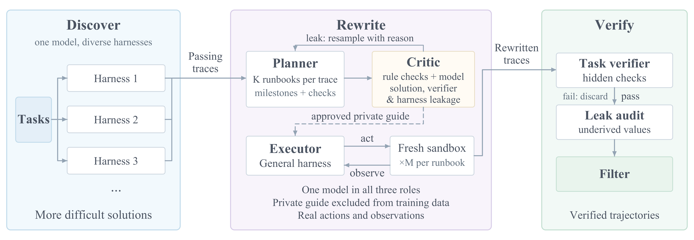
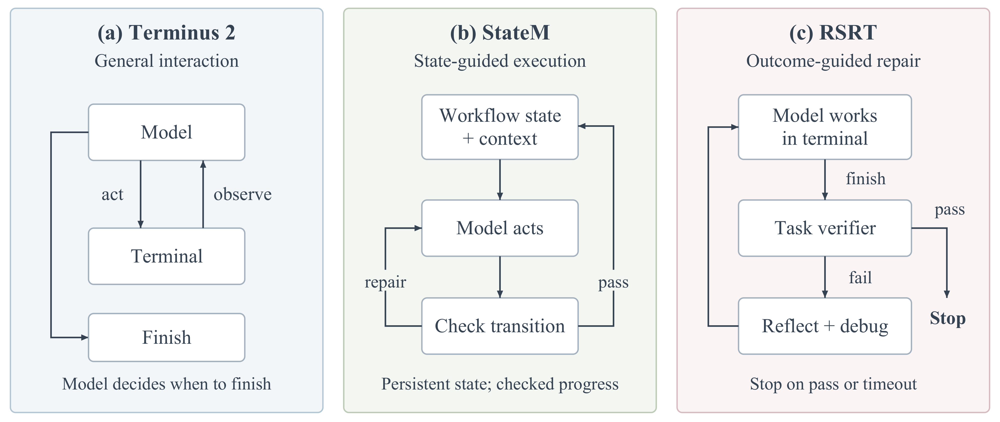

# Scaling Trajectories for Complex Tasks through Recursive Self-Rewrite：细粒度阅读

## 1. 基本信息与阅读范围

- **方法简称**：Recursive Self-Rewrite（RSR）。
- **arXiv**：[2610.02826](https://arxiv.org/abs/2610.02826)，本次读取 **2026-10-02 提交的 v1**；阅读与公开资料核查日期：2026-10-09。
- **作者**：Zongxia Li、Yucheng Shi、Zhongzhi Li、Junyao Yang、Ruhan Wang、Chengsong Huang、Fuxiao Liu、Haitao Mi、Jordan Boyd-Graber、LeoweiLiang。
- **机构**：Tencent HY LLM Frontier、University of Maryland 等。
- **主题目录 / 阅读层级**：Agent / detailed。
- **本地 PDF**：[原论文，16 页](arxiv_2610_scaling_trajectories_for_complex_tasks_through_recursive_self_rewrite.pdf)。
- **本地源码**：[TeX 目录](../arxiv_all/arxiv_2610_scaling_trajectories_for_complex_tasks_through_recursive_self_rewrite_tex)。
- **官方模型**：[IntelligenceLab/RSR-27B](https://huggingface.co/IntelligenceLab/RSR-27B)。
- **公开轨迹示例**：[RSR-27B-trajectories](https://huggingface.co/spaces/IntelligenceLab/RSR-27B-trajectories)。

本文覆盖正文、全部六张结果/分析表、六幅核心原图和公开模型卡。源码中的 appendix 只引入一个内容被注释的任务清单文件，**没有可供补读的实质性附录**。源码中被注释掉的分析、审计统计和草稿段落不作为论文正式实验结果。

**版本边界很重要**：论文将主方法和训练对比描述为轨迹重写后的 SFT；但本次核查的官方模型卡明确说，发布权重又进行了额外 RL，且细节待公布。因此，下文分别讨论“论文方法与表中结果”和“当前可下载的模型”，不默认它们是同一训练阶段的 checkpoint。

## 2. 核心结论与研究定位

RSR 研究的问题是：**同一个模型在强执行框架帮助下做成了任务，怎样把这次成功变成它在普通执行框架下也能学会的能力？**

作者先固定 Qwen-3.8-27B，用三种不同 harness 收集成功经验；再让同一模型分别担任 planner、critic 和 executor，把成功轨迹提炼为经过泄漏检查的 runbook，在全新的环境里通过统一的 Terminus 2 接口重新完成任务。最后，用真实重执行产生、通过验证和审计的公开交互记录做 SFT，并混入原始 Terminus 2 成功轨迹；私有 runbook 不进入训练记录，也不在部署时提供。

其贡献可以分为两层：

1. **扩大经验来源**：不同 harness 促成不同的成功，提供单个框架当前采样中没有发现的解题经验。
2. **改变经验的训练形式**：不只清洗原日志，而是利用成功经验引导一次真实的新执行，把外部控制转化为模型在目标接口下能够模仿的动作。

这是一种**由可执行环境验证的数据合成与自蒸馏方案**。论文主方法没有提出 PPO/GRPO 新目标，也没有训练一个策略梯度意义上的 value critic。这里的 critic 是检查 runbook 是否泄漏答案、verifier 信息或框架专属依赖的语言模型角色。

最有价值的思想是：**成功轨迹记录的是“模型 + harness”的联合行为；让轨迹成功的外部干预，不会因为把干预消息删掉就自动变成模型能力。**

## 3. 背景：为什么直接训练成功轨迹仍可能出问题

### 3.1 Harness 到底贡献了什么

Harness 是模型与环境之间的执行系统，决定如何组织上下文、调用工具、维持状态、要求检查、触发重试，以及何时停止。例如，同一个模型本来认为任务完成了，外部框架却根据验证失败继续追问，才促成后续修复；另一框架要求逐项核对需求，帮助模型发现遗漏的依赖版本。

这些成功不是凭空出现的：模型本身具备生成相关动作的能力，但是否执行这些动作，受到框架的提示、状态管理和反馈支持影响。

### 3.2 删除外部消息不等于去除依赖

设一段源轨迹中出现“模型宣布完成 → 外部反馈失败 → 模型继续修复”。删除外部反馈后，剩下的修复动作可能缺少可从公开历史解释的触发原因。模型如果照单学习，可能模仿继续执行的形式，却没有学到何时有必要继续、何时应停止。

StateM 的情况也类似：原轨迹可能包含状态转换、contract 检查和专用命令。目标 harness 没有这些接口，原记录即使通过简单文本清洗，也不一定成为目标环境中的合理示范。

这造成三个分布差异：

- **接口差异**：原来的命令、状态和工具在目标框架里不可用。
- **观察差异**：原来的外部提醒或验证反馈在部署时不会出现。
- **行为差异**：成功依赖外部推动，但目标模型需要自主决定检查、修复和停止。

### 3.3 本文的解决策略

先把成功经验提炼成程序性知识，再借助这些知识，在目标框架里重新做题。重执行得到的观察来自真实环境，命令属于目标接口，成功也由实际运行验证。

需要保留一个细节：重执行时仍有**私有 runbook 指导**。所以这里首先解决的是接口与执行记录的兼容性；是否彻底消除了对特权信息的依赖，还需要 runbook 审计、轨迹审计和无指导的下游评测来检验。

## 4. 总体框架与“递归”的准确含义

原图 1 展示三阶段流程：Discover 收集多框架成功轨迹；Rewrite 通过 planner–critic 循环生成合格 runbook，再由 executor 在 fresh sandbox 中执行；Verify 通过隐藏任务检查和泄漏审计筛选训练数据。

首页概念图明确画出 planner 和 critic 在最多 $N$ 次迭代内修订 runbook。图中 draft 1/2/3 和命令只是示意，**论文没有给出实际递归重试上限 $N$ 的数值**。

“Recursive”主要指这一数据生成内部循环：critic 拒绝候选并给出原因，planner 据此重写，直到通过或耗尽预算。论文没有展示“训练模型 → 新模型再发现经验 → 再训练”连续多个代际的自主递归提升曲线；相关工作部分还明确说本文不假设这种自主递归周期。

## 5. 三种 discovery harness 的机制

### 5.1 Terminus 2：通用终端交互

模型发出终端命令，看到输出，自行决定下一步或结束。它同时充当 discovery baseline、重写执行的目标接口，以及训练后推理使用的通用框架。

“通用”并不意味着没有 harness。工具协议、终端输出和交互组织仍由 Terminus 2 提供；本文希望去掉的是额外的专门控制和私有指导。

### 5.2 StateM：显式工作流状态与检查

StateM 使用持久状态、阶段局部上下文和受检查的状态转换，帮助模型维持进度、满足中间条件，并从失败或中断中恢复。

它可能把需求拆成可检查的 contract，避免模型过早进入下一阶段。不过，这些状态管理命令也会进入源轨迹，因此需要在重写时转成目标接口中的可执行行为。

### 5.3 RSRT：基于验证结果继续反思

**RSRT = Recursive Self-Reflect Terminus，是一种 discovery harness；RSR = Recursive Self-Rewrite，是整篇方法。两者不能混用。**

RSRT 在 Terminus 2 上加入以下逻辑：

1. 模型宣布任务完成。
2. 框架运行任务 verifier。
3. 通过则停止；失败且仍有时间，则只告知“失败”，要求模型回顾、排错、继续。
4. 保留当前对话和 sandbox 状态，重复上述过程，直到成功或超时。

文中说明 discovery 协议允许每任务最多 180 分钟，但没有完整列出所有 harness、重写和评测阶段的时间/token 预算对齐方式。

虽然 RSRT 不暴露 verifier 内部实现和参考解，**二元成功/失败本身仍是额外反馈**，可能比部署时模型能够获得的信息更强。本文的一个目标，正是将这种支持下发现的行为转化为无此特殊控制时可用的示范。

RSRT 的“继续”复用已有环境；RSR 的“重写执行”则从干净环境重新开始。这两个 reset 语义对理解方法至关重要。

## 6. 轨迹重写：逐环节拆解

### 6.1 Planner 的输入与输出

源轨迹先做 compact：保留任务说明、模型动作和环境观察，删除 harness 专有的控制消息。Planner 从中提炼 runbook，覆盖：

- 要达到的最终状态；
- 关键里程碑和执行步骤；
- 可用接口与检查方法；
- 失败后的恢复策略；
- 常见陷阱。

Runbook 可以说明怎么解决问题，但不应直接给出最终交付物、完整答案或精确补丁。概念图特意把 “the exact patch” 划掉，说明作者想传递程序性经验，而不是答案文件。

论文使用每条成功源轨迹 $K=4$ 个候选 runbook。不同候选应提供经验重述的多样性，不过没有给出可复用的完整 planner prompt、runbook schema 或多样性约束。

### 6.2 Critic：先规则检查，再模型审查

第一层是确定性检查，包括 schema 验证、已知 artifact 清理，以及拒绝不受支持的工具引用。

第二层使用同一个基础模型作 critic。**它看到的是公开任务说明和候选 runbook**，据此判断是否存在：

- verifier 信息泄漏；
- 直接答案、最终交付物或无法合理推导的解法信息；
- 依赖源 harness 的专有工具和控制方式。

不合格候选返回 planner，带上原因递归修订。

这种设计能阻止一部分明显的“把答案写在计划里”，但它不是形式化的信息流证明。仅凭任务说明和 runbook，critic 未必能准确判断某个具体数值究竟可由环境推导，还是来自隐藏答案。三个角色使用同一模型，也可能共享盲点。论文未给出最终 runbook 审计的完整召回率、误报率或独立人工校验。

### 6.3 Executor：在全新 sandbox 中重新完成任务

每个通过筛选的 runbook 指导 $M=4$ 次 fresh execution，使用 Terminus 2，温度为 $0.7$。因此一条源轨迹在所有候选都通过时，最多产生 $K\times M=16$ 次重执行尝试；这不是保证得到 16 条合格训练轨迹。

私有 runbook 在生成时可见，但不写入最终公开训练记录。Executor 必须与当前环境交互，实际运行命令并读取实际结果。因此，论文的 rewrite 不是把旧日志润色成更漂亮的文本，也不是机械重放全部原命令。

然而，fresh sandbox 只保证重新执行；它不保证独立发现。新轨迹依然受成功经验指导，这是方法有意采用的“练习式”数据生成。

### 6.4 两个不同的接受门槛

**任务验证**：结果是否通过 hidden verifier，证明这次执行在该任务判定规则下成功。

**轨迹质量/泄漏审计**：模型检查记录中是否出现无法由公开任务或环境导出的值，并丢弃可疑示范。

二者不能合并：一个执行可以通过 verifier，却仍因为私有答案迁移而不适合作训练数据。原案例图的 caption 也明确强调，verifier success 不等于 quality-audit acceptance。

### 6.5 最终训练与部署

训练时保留任务说明、环境观察和模型响应，移除私有 runbook 与 critic 对话。论文说 RSR 训练混合中还加入 **766 条原始 Terminus 2 成功轨迹**，这些轨迹不进行上述重写；重点重写的是 StateM 与 RSRT 来源。

部署时只使用训练后的模型和通用 Terminus 2，没有源 harness，也没有任务专属的私有 runbook。若模型学到了检查、修复和继续执行，它需要自行选择这些动作。

下面的公式是**阅读者对信息条件的抽象，不是论文提供的正式损失实现**：

$$
\begin{aligned} \text{生成阶段：}\quad & a_t\sim p_{\theta_0}(a_t\mid h_t^{\mathrm{public}},b),\\ \text{训练/部署目标：}\quad & p_\theta(a_t\mid h_t^{\mathrm{public}}). \end{aligned}
$$

其中 $b$ 是私有 runbook，$h_t^{\mathrm{public}}$ 是公开交互历史。若按常见 assistant-token SFT 实现，可以写成以下示意目标：

$$
\mathcal L_{\mathrm{SFT}}(\theta)=-\sum_{\tau\in\mathcal D_{\mathrm{accepted}}}\sum_{t\in\mathcal A(\tau)}\log p_\theta(a_t\mid h_t^{\mathrm{public}}).
$$

$\mathcal A(\tau)$ 表示被监督的模型输出 token。**论文没有公开实际 loss mask、token 归一化或训练配置**，不能把这条示意公式当成作者确认的实现细节。

这一抽象揭示了剩余风险：生成策略受 $b$ 条件化，但学生不见 $b$。如果关键动作只能由 $b$ 解释，删除 runbook 仍可能留下不充分的训练上下文。泄漏筛选和下游无指导测试是缓解措施，不是数学保证。

## 7. 训练数据与规模：分清任务、轨迹和采样预算

### 7.1 任务来源

数据由自建 SWR 和修改后的 RST 任务构成：

- **SWR**：约 2.5K 终端任务，涵盖软件使用、生物、化学、物理、硬件、运维和安全等约 50 个领域；覆盖分析使用 2,509 个任务。
- **RST**：420 个经过筛选、修改并提高难度的任务。
- 覆盖表的明确分母是 **2,929 个任务**，即 2,509 + 420。

论文还使用“87 个细粒度标签”和“88 个任务类型”：前者由 35 个 RST 类别与 52 个 SWR 工具家族构成，不能和广义的 50+ 个学科/应用领域混为一个口径。正文把覆盖 60 个 task types 写成了 60 domains，笔记按上下文理解为任务类型。

### 7.2 Discovery 的原始统计：原表 2

| Harness | Rollouts | Passing | Success rate | Tasks solved |
|---|---:|---:|---:|---:|
| Terminus 2 | 5,405 | 766 | 14.2% | 565 |
| RSRT | 3,777 | 599 | 15.9% | 512 |
| StateM | 5,416 | 636 | 11.7% | 461 |
| Pooled | 14,598 | 2,001 | 13.7% | 759 |

来源：原表 2，PDF 第 6 页。Passing 是成功轨迹数量；Tasks solved 是至少有一次成功的去重任务数，合并行取任务并集。不同 harness 的 sandbox/任务错误导致有效 rollout 数不同。

因此：

- 2,001 条成功轨迹不等于 2,001 道不同任务。
- Terminus 2 解决的任务最多，但 RSRT 的单次 rollout 通过比例最高。
- Terminus 2 尝试次数比 RSRT 多，不能只凭 565 对 512 就断言前者单位计算预算更强。

### 7.3 Rewrite 的报告规模与未闭合口径

论文第 3.4 节报告：

- 12,893 次 rewrite rollout；
- 覆盖 975 个 unique tasks；
- 11,094 条 passing rewrites，约占 86%。

11,094 / 12,893 约为 86.0%，这组比例内部吻合。摘要用 2,001 → 11,094 表达扩容，名义约为 5.54 倍，但它**不能直接解释为同一个封闭任务池的逐项扩增率**，原因有三点：

1. **975 个重写任务大于 discovery 表中的 759 个已解决任务**。如果重写只针对该表的成功源任务，去重任务数不应增加到 975；这提示可能采用了额外批次、扩展池或另一统计快照，但正式正文没有给出对齐映射。
2. 主文明确重点重写 StateM 和 RSRT 成功轨迹，同时额外加入 766 条直接 Terminus 2 成功轨迹。若 11,094 条都进入最终训练，再加 766 条，则算术上是 **11,860 条**；这只是条件性计算，不能当成作者公开确认的最终去重 SFT 样本数。
3. 正文方法要求通过 verifier 和质量筛选，但规模段主要报告 passing rewrites，没有完整的“生成 → 验证通过 → 审计通过 → 去重 → 最终训练”流水账。

这些问题不否定重写方案，但会影响精确复现、训练数据公平性和扩容收益归因。复现前需要作者提供 source task ID、source trajectory ID、runbook ID、rewrite ID 与接受状态的对应清单。

## 8. 多 harness 是否确实发现了互补经验

### 8.1 任务覆盖：原表 1

| Harness | RST (420) Solved | RST Unique | SWR (2,509) Solved | SWR Unique | Pooled (2,929) Solved | Pooled Unique |
|---|---:|---:|---:|---:|---:|---:|
| Terminus 2 | 94 (22.4%) | 8 | 471 (18.8%) | 121 | 565 (19.3%) | 129 |
| RSRT | 108 (25.7%) | 14 | 404 (16.1%) | 77 | 512 (17.5%) | 91 |
| StateM | 95 (22.6%) | 10 | 366 (14.6%) | 58 | 461 (15.7%) | 68 |
| Terminus 2 ∪ RSRT | 119 (28.3%) | 34 | 572 (22.8%) | 264 | 691 (23.6%) | 298 |
| Terminus 2 ∪ StateM | 115 (27.4%) | 21 | 553 (22.0%) | 226 | 668 (22.8%) | 247 |
| RSRT ∪ StateM | 121 (28.8%) | 35 | 509 (20.3%) | 159 | 630 (21.5%) | 194 |
| **All three** | **129 (30.7%)** | **+21** | **630 (25.1%)** | **+159** | **759 (25.9%)** | **+194** |

来源：原表 1，PDF 第 6 页。单 harness 行的 Unique 指只有该 harness 解决的任务；两者并集行可理解为该组合解决而第三种未解决的任务。最后一行“+”改为相对该数据子集最强单 harness 的新增数量，不与前几行的排他计数混用。

总并集 759 道，相比最强单框架的 565 道，增加 194 道，即相对增加 34.3%；**不是准确率增加 34.3 个百分点**。对应任务覆盖率从 19.3% 到 25.9%，约增加 6.6 个百分点。

在 759 道已解任务中：

- 288 道只有一个框架解决：129 + 91 + 68；
- 163 道恰好由两个框架解决；
- 308 道三者都解决。

这为“当前记录中的成功经验具有互补性”提供了直接任务级证据。

### 8.2 等 rollout 次数子集解决了什么，又没解决什么

作者进一步选出 1,247 道每框架 rollout 次数相同的任务：420 道 RST 每种框架一次，827 道 SWR 每种两次，因此每框架各 2,074 次 rollout。

Terminus 2、RSRT、StateM 分别解决 249、285、227 道；并集为 352 道，相对 RSRT 增加 67 道，即 23.5%。各自仍有 30、56、21 道排他成功。

这排除了“某个单框架只是每题多采样”的一部分干扰，但**并集仍动用了单框架三倍的总尝试数**，时间和 token 成本也未对齐。严格证明 harness 多样性优于纯采样增加，需要比较：

- 三种 harness 各采样一次；
- 一种 harness 在同样总预算下采样三次。

本文没有完成这一等总计算预算的因果对照，因此不宜把 34.3% 或 23.5% 全部归因于 harness 设计差异。

### 8.3 领域差异

图中可见，RSRT 在 RST scripting & automation 上达到 35.7%，StateM 在 software development & debugging 上达到 26.2%；Terminus 2 在版本控制和多个科学领域更强。SWR media & signal processing 的最好单框架为 13.1%，并集升到 22.3%；earth & geospatial 从最好 12.2% 升到 19.8%。

另一方面，SWR documents & web 三者都是 51.5%，并集没有增加。多框架互补性是任务依赖的，不是所有领域都受益。

### 8.4 源轨迹执行风格：原表 3

| 指标 | Terminus 2 | RSRT | StateM |
|---|---:|---:|---:|
| Passing trajectories | 766 | 599 | 636 |
| Turns (mean) | 19.4 | 23.2 | 24.0 |
| Turns (median) | 17.0 | 18.0 | 24.0 |
| Commands per turn | 2.10 | 1.96 | 2.37 |
| Completion claims per trajectory | 1.72 | 2.20 | 1.11 |
| Passes after rejection (%) | 0.0 | 4.5 | 0.0 |
| Exploration (%) | 55.5 | 50.6 | 35.3 |
| Python execution (%) | 21.8 | 22.1 | 12.6 |
| State management (%) | 0.0 | 0.0 | 29.6 |
| File writing (%) | 9.0 | 8.6 | 5.7 |
| Testing and verification (%) | 5.0 | 5.1 | 4.0 |

来源：原表 3，PDF 第 9 页。动作类别由规则分类器分配，比例以命令数量计；展示的类别不是完整分布，不要求加总为 100%。

StateM 的 29.6% state-management 命令说明外部工作流在记录中占有明显份额。RSRT 有 4.5% 的成功轨迹经历“宣布完成被拒绝后最终成功”，支持 continuation 能恢复一部分任务。

但持续运行也会付出成本：作者每框架抽取 200 条失败轨迹，RSRT 的平均长度为 67.1 turns，Terminus 2 和 StateM 为 22.8 和 23.4。它既可能救回任务，也可能在失败路径上投入更多执行。

## 9. Rewrite 案例与轨迹多样性

### 9.1 两个案例说明了什么

**Markdown inline parsing**：RSRT 源轨迹花费较多轮次处理环境、兼容性和 parser 选择。Runbook 让新执行更早使用可兼容 parser，再进行输出重构与验证。12 次 rewrite 中 7 次通过，58.3%；成功重写的中位长度为 32 turns，比源轨迹的 64 turns 减少 50%。

**OpenFOAM PitzDaily**：StateM 源轨迹混合分析、实现和结构化检查。重写后仍会观察输出、修复实现和验证，但不需要原来的状态转换命令。8 次重写中 7 次通过，87.5%；成功重写中位长度 29 turns，源轨迹 38 turns。图中展示的某一条成功轨迹是 28 turns，和总体中位数 29 不冲突。

这两个案例支持“经验能够迁移成目标接口中的新执行”，但不能推出所有重写更短、所有任务更快，或 runbook 保证成功。原图中的 command-not-found、NameError 等只是过程片段，作者没有证明它们就是最终失败原因。

### 9.2 命令相似度：原表 4

| Similarity metric | Markdown：Same Runbook | Markdown：Different Runbook | OpenFOAM：Same Runbook | OpenFOAM：Different Runbook |
|---|---:|---:|---:|---:|
| Pairs compared | 18 | 48 | 12 | 16 |
| Exact command overlap (Jaccard) | 19.1 | 12.1 | 12.6 | 10.4 |
| Command order (normalized LCS) | 24.6 | 15.7 | 18.2 | 14.7 |
| Tool-set overlap (Jaccard) | 66.9 | 52.9 | 83.3 | 84.4 |
| Tool-transition overlap (Jaccard) | 34.0 | 18.9 | 28.4 | 28.5 |
| Action-sequence similarity (edit) | 53.6 | 42.0 | 61.0 | 63.1 |
| Exact overlap, omit first two turns | 12.5 | 6.2 | 7.2 | 4.7 |

来源：原表 4，PDF 第 10 页。除 pair 数外，数值为 0–100 分制的平均成对相似度，包括成功和失败的 rewrites。Markdown 为 3 个 runbook、12 条执行；OpenFOAM 为 2 个 runbook、8 条执行。

命令 fingerprint 对 shell 空白做归一化，但保留脚本体差异。原文使用的两个序列指标为：

$$
S_{\mathrm{order}}=\frac{2L}{n_i+n_j},\qquad S_{\mathrm{action}}=1-\frac{d}{\max(n_i,n_j)}.
$$

$L$ 是命令 fingerprint 序列的最长公共子序列长度；$d$ 是启发式动作标签序列的单位代价 Levenshtein 距离。表中以百分制展示。

同一个 runbook 下的 exact overlap 和命令顺序更相似，去掉前两轮后仍成立，说明 runbook 确实影响执行选择。可是 OpenFOAM 的动作序列相似度反而在跨 runbook 时略高（63.1 对 61.0）。因此不能笼统说“更多 runbook 一定带来更多语义策略多样性”。

这些相似度衡量执行结构，不是解决方案语义等价性；成对样本还共享原始轨迹，不能当作完全独立观测。只有两个任务的分析，也不足以代表全部 11K 重写数据。

## 10. 下游训练结果

### 10.1 三组对比的定义

- **Base**：原始 Qwen-3.8-27B。
- **Direct SFT**：直接用 discovery 成功轨迹训练；已经去除了 harness 专属插入内容，但没有 runbook 重构和 fresh re-execution。
- **RSR**：用通过检查的 rewritten trajectories，加上 766 条直接 Terminus 2 成功轨迹训练。

Direct SFT 不是完全未清洗的日志基线。RSR 也不是只改变某一个训练超参数：它同时改变数据生成、过滤、规模和分布，因此主表检验的是整个流程。

### 10.2 主结果：完整保留原表 5

| Benchmark | Metric | Base | Direct SFT | RSR |
|---|---|---:|---:|---:|
| TB 2 | Pass@3 | 57.0% (51/89) | 53.4% (48/89) | **74.2%** (66/89) |
| TB 3 | Pass@3 | 0.0% (0/74) | 5.4% (4/74) | **9.5%** (7/74) |
| TB 4 | Pass@3 | 1.5% (1/66) | 4.5% (3/66) | **9.1%** (6/66) |
| TBH (ours) | Pass@3 | 39.0% (39/100) | 56.0% (56/100) | **63%** (63/100) |
| SWR100 (ours) | Pass@3 | 3.0% (3/100) | 3.0% (3/100) | **6.0%** (6/100) |
| TB 2 | Mean (3 runs) | 51.7% | 43.8% | **70.1%** |
| TB 3 | Mean (3 runs) | 0.0% | 1.4% | **6.8%** |
| TB 4 | Mean (3 runs) | 0.0% | 3.2% | **6.1%** |
| TBH (ours) | Mean (3 runs) | 31.0% | 42.5% | **54.0%** |
| SWR100 (ours) | Mean (3 runs) | 3.0% | 3.0% | **5.0%** |
| LHTB (ours) | Process reward | 0.21 (0/46) | 0.25 (0/46) | **0.29** (0/46) |

来源：原表 5，PDF 第 11 页。原文称 pass@3 表示三次内至少一次成功，Mean 表示三次单次成功率的平均；括号里的 pass@3 成功任务数是由百分比和任务总数四舍五入**推算**的，不能当成独立原始计数。LHTB 的 0/46 则是作者报告的完成任务数。

### 10.3 哪些结果值得关注

**相对 Base**，RSR 在 TB2 的 pass@3 从 57.0% 到 74.2%，增加 17.2 个百分点；TBH 从 39.0% 到 63.0%，增加 24.0 个百分点。按作者报告，三次平均成功率也有明显提升，因此不只是通过多试几次提高并集覆盖。

**相对 Direct SFT**，TB2/TB3/TB4/TBH/SWR100 的 pass@3 分别提高 20.8/4.1/4.6/7.0/3.0 个百分点；Mean 分别提高 26.3/5.4/2.9/11.5/2.0 个百分点。主表支持 RSR 整体方案优于这版直接模仿数据。

**Direct SFT 并非全面失败**：它提升了 TBH、TB3 和 TB4，但 TB2 下滑，SWR100 不变。作者检查了三条 Direct-SFT checkpoint 轨迹，看到循环和 dead-end 行为；这提供案例解释，却没有足够的样本量证明“全部退化都由原始长轨迹导致”。

**难任务能力仍有限**：RSR 的 TB3/TB4/SWR100 pass@3 分别只有 9.5%/9.1%/6.0%。在 LHTB，process reward 从 0.21 增至 0.29，但三组都 **0/46 完整完成**；它说明部分进展提高，不代表已解决这些长时程任务。

### 10.4 主表存在需要澄清的指标一致性问题

若 pass@3 和 Mean 确实来自**同一批任务的同三次二元成功记录**，令第 $r$ 次的成功指示为 $s_{i,r}$，则有：

$$
\begin{aligned} P_3&=\frac{1}{n}\sum_{i=1}^{n}\max_{r\in\{1,2,3\}}s_{i,r},\\ \overline P&=\frac{1}{3n}\sum_{i=1}^{n}\sum_{r=1}^{3}s_{i,r},\\ \overline P&\le P_3\le\min(1,3\overline P). \end{aligned}
$$

这是阅读者用于核查的计数恒等关系，不是论文的新公式。根据该关系：

- **TB4 Base**：pass@3 为 1.5%，但 Mean 为 0.0%。若 66 道中至少有一道成功，三次平均成功率最低约为 $1/(3\times66)=0.505\%$，不能四舍五入成 0.0%。
- **TB3 Direct SFT**：pass@3 为 5.4%，Mean 为 1.4%；后者三倍仅 4.2%，低于 5.4%。即使考虑一位小数的普通舍入，也无法符合上述同批运行定义。
- **TB2 推算计数**：例如 51/89 约为 57.3%，并不精确等于 57.0%；原文已说明括号计数是推算值，因此不能用它们反向“纠正”百分比。

我同时核对了 TeX 和 PDF，确认前两项数值确实存在于原表，并非转写错误。可能原因是评测集合、运行批次或聚合方式不同，也可能是表格录入问题；**目前没有依据确定哪一项应改成什么值**。本文保留原数，复现时应要求逐任务三次运行结果，而不是自行修正。

这些问题主要限制对准确效应量和统计显著性的解读。论文没有报告置信区间或多次独立训练种子，尤其 TB3、TB4、SWR100 的成功任务数很少，不能把小幅差异直接当作稳定显著收益。

## 11. 不训练，仅更换 harness 的对照

### 11.1 原表 6

| Harness | TB2 (89) | TBH (100) | TB3 (74) |
|---|---:|---:|---:|
| Terminus 2 | 51.7 (46) | 33.0 (33) | 0.0 (0) |
| Recursive Self-Reflect Terminus | 55.1 (49) | **66.0** (66) | **4.1** (3) |
| StateM | **58.4** (52) | 46.0 (46) | 1.3 (1) |
| Union of all three | **68.5** (61) | **70.0** (70) | **4.3** (3) |

来源：原表 6，PDF 第 12 页。每框架在每个 benchmark 上运行一次，模型权重相同；表格数值为原文报告的百分比和任务计数。Union 是把三种框架的已解任务取并集，不是某个单次部署 agent 的表现。

**原表另一处口径问题**：TB3 中 RSRT 和 Union 都写“3 道”，但百分比分别为 4.1 和 4.3；对于同一个分母 74 不可能同时成立。源码注释也保留了关于 TB3 分母 70/74 和聚合方式待澄清的信息。这里不代作者选择分母，原数照录。

### 11.2 如何理解这个对照

StateM 在 TB2 最强，RSRT 在 TBH 最强，说明框架适配具有任务差异。TBH 上 Base + RSRT 的单次报告结果 66.0%，甚至高于训练后 RSR + 通用框架在主表中的 63.0% pass@3；由于运行预算和协议未充分对齐，**这不能直接用来排列二者优劣**。

它至少提醒我们：论文的目标不是证明“小框架 + 训练”在所有指标上超过“强框架 + 原模型”，而是考察从特殊执行支持中发现的经验，能否提高普通接口下的模型表现。

表 6 的标题称它为 harness ablation，但它并没有消融 RSR 内部的 planner、critic、递归重试、fresh execution 或过滤器。

## 12. 方法优势、证据边界与失效机制

### 12.1 主要优势

1. **把 harness 当成数据发现工具**：不同控制策略不仅改善推理，也能扩展可训练的成功经验。
2. **真实重执行确保目标接口兼容**：训练中的动作和观察来自实际终端，而非纯文本臆造的结果。
3. **同一模型完成所有生成角色**：不依赖另一个更强闭源教师去给完整解，降低不同模型能力差异造成的一类模仿问题；但任务构造、verifier 和成功经验仍提供外部信息。
4. **把功能成功和数据质量分开**：runbook 审核与终端任务验证不是同一检查，设计方向合理。
5. **评测覆盖多类终端难题**：除了 TB2，还报告更难任务与长时程过程进展，避免只看一个相对容易的榜单。

### 12.2 尚未隔离的贡献

RSR 同时引入更多尝试、多个 runbook、目标框架重执行、质量过滤和更大的训练集。没有等样本数/等训练 token/等发现预算的对照，就不能确定主要收益来自哪项。

尤其需要对比：把 Direct SFT 数据规模扩到相同程度；不使用 runbook 的 fresh execution；只使用一个 runbook；去掉 critic；不递归只筛选；保留相同任务但不同轨迹数。论文当前没有提供这些组件级实验。

### 12.3 Privileged information 的残留

私有 runbook 即使不含完整补丁，也可能直接告诉 executor 正确软件、算法、关键参数或中间结论。这些信息有时属于合理程序知识，有时接近任务答案，边界并不总是清楚。

如果删去 runbook 后，公开记录第一步就出现无法解释的精确动作，学生会被要求模仿一个缺少前提的决策。可以通过给每个具体事实标记公开出处、保留必要的环境探索，以及在任务变体上复测来降低风险；本文没有提供这些机制的完整实现证据。

### 12.4 同一模型审查自己的盲点

同模型兼任 planner 和 critic 可能产生相关错误；critic 的“通过”并不代表独立验证。最关键的隐藏答案泄漏，应辅以可追踪的证据来源或人工抽查。

这里没有观察到足够材料来断言训练数据实际泄漏。能够确认的是：**论文设计了防泄漏流程，但公开信息不足以量化其可靠性**。

### 12.5 任务与模板的泛化边界

SWR、TBH、LHTB、SWR100 中多项由作者自建，部分任务属于重构软件 demo 输出。模型可能学到真实工具使用，也可能学到这类生成任务的共同结构。主文未充分公开训练/评测 task ID、模板族、软件家族及其去重关系。

因此，需要区分同模板新参数、同软件新任务、跨软件迁移和完全独立 benchmark。共享来源不等于已经发生数据污染，但在缺少 split manifest 时，也不能默认所有泛化结论都经过严格去重验证。

### 12.6 递归和成本的边界

论文没有多轮“模型更新后再发现”的 scaling 曲线，也没有完整的数据生成 token、GPU 小时、sandbox 小时或端到端训练成本。RSRT 最长可持续 180 分钟，且失败轨迹更长；$K\times M=16$ 的重执行同样需要真实环境成本。

模型规模较小、SFT 优化简单，不等于整套数据管线低成本。案例中步数缩短，也不等价于整体 token、墙钟时间或训练成本按同比例下降。

## 13. 公开模型与复现核查

### 13.1 下载权重不等于论文 SFT checkpoint

本次核查的官方 [RSR-27B 仓库](https://huggingface.co/IntelligenceLab/RSR-27B)公开、非 gated，模型卡标注 Apache-2.0，存在 safetensors 权重分片。没有下载大体积权重，也没有执行训练或推理复现。

固定核查版本为 **5d941b841edb5cebbb267503aeba3fc0ba723547**，仓库最后修改时间为 2026-10-06 UTC。模型卡明确写道：

> RSR-27B is Qwen-3.8-27B finetuned with Recursive Self-Rewrite (RSR) trajectories. We did additional RL training to stabalize the model on hard terminal tasks (Details coming soon).

这意味着发布权重包含额外 RL，细节未公布。模型卡没有确认它就是论文主表对应的纯 SFT checkpoint，也没有单独报告额外 RL 的增益，不能将主表直接当成当前权重的可复现实测。

配置文件的 architecture 是 Qwen3_5ForConditionalGeneration，model_type 是 qwen3_5；论文和模型卡使用的骨干名称则是 Qwen-3.8-27B。两者均按原始来源记录，**配置类名本身不足以证明论文误写了基础模型**。复现时需要作者提供准确 base checkpoint revision，而不能仅按类名替换基座。

文本配置显示 bfloat16、64 层、hidden size 5120、最大位置长度 262,144。这是发布权重的配置，不代表论文 SFT 一定使用了 262K 训练长度。

已保存核查时的 [README 快照](../arxiv_all/arxiv_2610_scaling_trajectories_for_complex_tasks_through_recursive_self_rewrite_tex/external_checks/README.md) 和 [config 快照](../arxiv_all/arxiv_2610_scaling_trajectories_for_complex_tasks_through_recursive_self_rewrite_tex/external_checks/config.json)，它们是额外核查资料，不属于 arXiv 原始源码。

### 13.2 公开示例与训练数据不是同一件事

[官方轨迹查看器](https://huggingface.co/spaces/IntelligenceLab/RSR-27B-trajectories)是一个 static Space。本次核查 revision 为 **b0e4d9284ef9cdb9f9a5a020841e11351601bf2f**，文件包括首页以及 tree-sitter Markdown、CMake、OpenFOAM 三个任务的 HTML。

模型卡展示这三个任务的源轨迹摘要、缩短版 runbook 和重执行步骤；说明缩短版 runbook 不是实际用于 rollout 的完整文本。它报告每个所选 runbook 的 4 次 replay 都通过，并给出所选执行的轮数与时间。这些是发布时挑选的案例，不能替代论文整体 rewrite 的成功率，也不能与论文 Markdown 案例“3 个 runbook 共 12 次、7 次通过”的不同集合混为同一统计。

另一个值得注意的差异是：模型卡所选源轨迹采用 continue-until-timeout，部分一直运行到 2 小时而没有正常宣布完成；论文 RSRT 的描述则在宣布完成后检查成功就停止。因此，公开样例与正式 discovery 协议的精确对应关系仍需确认。

公开摘要中出现 oracle_output.json、public scenarios 或 feedback tool，并不能仅凭文件名断言泄漏：任务可能合法提供公开参考输出。应区分公开可用证据与隐藏 verifier/参考解，不能把所有“oracle”字样都当作作弊证据。

在本次检查的论文、模型仓库和所链接 Space 中，未见完整 RSR 训练管线、全量数据或详细训练配置。这个结论仅限已核查资源，不声称互联网不存在其他版本。

### 13.3 实现所需但尚未充分公开的信息

- planner、critic、executor 的完整 prompt 与 runbook schema；
- critic 递归最大轮数、解析失败处理与重试策略；
- deterministic checks、known artifacts 和 unsupported tools 的具体列表；
- runbook 私有指导如何注入、多轮上下文如何保留或压缩；
- 所有 task/source/runbook/rewrite ID 的映射和审计记录；
- SFT 的学习率、epoch、batch、序列长度、packing、loss mask、全参或 LoRA 设置；
- 数据去重、任务权重、同任务多条 rewrite 的采样策略；
- 各阶段时间/token 预算、harness 版本、环境镜像和任务 split；
- 主表逐任务三次结果，以及公开模型额外 RL 的完整协议。

源码并未提供实质性附录补齐这些信息。可以根据描述做概念性重现，但不能宣称已经具备精确重建官方训练结果的条件。

### 13.4 与此前“没有 Docker”问题的关系

RSR 的 runbook 生成和审查可以通过模型 API 完成；然而核心 fresh execution 仍依赖**可重置的任务运行环境和 verifier**。它没有消除 coding/terminal agent 对执行环境的需求，也没有在本文中提供明确的 E2B 适配教程。

原则上，可将 sandbox 放在远程容器、VM 或支持所需软件的云沙箱，控制程序运行在本地；这是工程迁移建议，不能说成作者已实现的 E2B 支持。需要验证任务镜像、依赖、文件系统、进程、网络、超时和 grader 行为是否一致。单纯可以运行 Python 的沙箱未必覆盖 OpenFOAM、系统管理或复杂软件构建任务。

如果目标只是学习方法，先检查已有轨迹和构造少量可验证任务，再讨论算力与环境适配，比直接尝试完整 27B 训练更容易定位瓶颈。

## 14. 与 Agent RL、Harness Distillation 及前两篇工作的联系

### 14.1 不同层级的“self-improvement”

本文主方法以可验证成功筛选数据，再进行 SFT；没有给出新的策略梯度目标、优势估计或 credit assignment 算法。RSRT 在执行时接收失败反馈，是推理控制；它本身不等于更新模型权重的 RL。RSR 的 critic 也不是 PPO 的 value network。

官方权重后续额外 RL 的存在应单独陈述，不能倒推论文已经详述一套 RL 训练系统。

### 14.2 与相邻方向的区别

- **Harness engineering**：固定模型，修改控制框架来提升表现。RSR 则把这些框架当作发现经验的工具，最终训练模型在通用框架下工作。
- **Reflexion / ExpeL 式经验记忆**：主要把过去经验作为推理时上下文。RSR 的任务专属 runbook 只在数据生成时使用，最终希望经验进入模型参数。
- **Direct SFT / rejection-sampled SFT**：直接模仿经过验证的轨迹。RSR 在训练前多了程序提炼、泄漏检查和目标接口下真实重执行。
- **[Harness-Zero](https://arxiv.org/abs/2609.24974)**：论文将其列为最直接相关的 harness-to-model 能力迁移工作。本文突出的切入点是多 harness 的已完成成功经验，经 runbook 引导重执行后形成训练集；此处依据 RSR 的相关工作定位，没有额外阅读 Harness-Zero 全文来比较所有技术细节。

### 14.3 与 VideoMem、VST 的关系

此前两篇关注模型如何在推理过程中维护跨视频 chunk 的文字记忆；RSR 的 runbook 是**用于训练数据生成的程序性指导**。它不是连续流式记忆，也不是部署时持续读写的长期 memory。

可以借鉴的共同思想是“把长交互中的关键经验转成可传递的文字状态”，但应用层级不同：

- [VideoMem](arxiv_2512_videomem_enhancing_ultra_long_video_understanding_via_adaptive_memory_management.md)：已知问题下重写全局视频记忆，并对阶段行为训练。
- [VST](arxiv_2603_video_streaming_thinking_videollms_can_watch_and_think_simultaneously.md)：提问前持续产生 streaming thoughts，以最终问答收益训练。
- RSR：成功轨迹 → 私有程序性 runbook → 重新执行 → 删除指导后的 SFT 数据。

## 15. 可落地的后续研究与最小实验

以下是阅读者建议，不是作者已完成的实验。

### 15.1 首先验证“重写”本身的收益

从 20–50 个有明确 verifier 的任务开始，固定源成功集合、目标 harness 和训练 token 数，构造：

1. 清洗后的 Direct SFT；
2. 在目标环境中多次采样、只保留成功，不给 runbook；
3. 一个 runbook 指导重执行；
4. 多 runbook + critic + 重执行。

这样能逐步区分普通采样扩容、程序性指导和多样性，而非一次改变所有因素。

### 15.2 让事实与动作具有可审计来源

给 runbook 中的具体值、文件名和关键命令记录出处：公开任务、公开观察、从观察计算得到，或仅由成功源轨迹提供。让审计员检查第一处出现这些信息时，公开重写历史是否足够支持它。

这比只要求“不要泄漏答案”更接近可验证的信息流约束。也可做环境扰动：更改路径、参数和依赖版本，检验 executor 是否真正读取环境，而不是记住原任务具体值。

### 15.3 研究私有指导逐渐退出

对同一任务族分别提供完整 runbook、仅里程碑、仅失败模式以及无 runbook，比较通过率与行为变化。若无指导测试显著下滑，说明删除训练记录里的 runbook 不一定足以完成行为内化。

可以进一步探索逐步减弱指导、添加公开探索步骤，或者把无法从公共历史推导的动作剔除，避免学生只学习无根据的“突然正确”。

### 15.4 增加总预算对齐与数据血缘记录

每条记录至少关联 task ID、source harness、source rollout ID、runbook ID、critic round、rewrite ID、verifier result、audit result、是否进入训练、输入/输出 token、墙钟时间和环境版本。

比较“三种 harness 各一次”与“单 harness 三次”，按相同总成本报告覆盖曲线。训练侧匹配样本数或 token 数，并控制任务重复权重，防止少数易题拥有大量 rewrites 主导梯度。

### 15.5 保留逐任务运行矩阵

为每个 benchmark 保存任务 × 尝试的成功矩阵，统一计算 pass@3 和平均单次成功率，并自动检查第 10.4 节的不等式。报告 bootstrap 置信区间时以任务为重采样单位，不把共享任务或 runbook 的轨迹当作独立任务。

### 15.6 从 SFT 数据引擎走向 RL

RSR 可作为困难任务 RL 的冷启动数据引擎：先让策略学会有效的检查和恢复，再在无私有 runbook 的真实环境中训练。不过，应单独验证是否比相同预算的 rejection-sampled SFT 或普通 RL 更好；不能用当前发布权重“额外做过 RL”的一句说明代替这个实验。

## 16. 总体评价与覆盖检查

RSR 提供了值得借鉴的思路：**把强执行框架促成的成功，重新构造成普通执行框架下可学习的经验**。任务级并集分析支持已收集经验的互补性；主表支持整个重写训练流程优于该 Direct SFT 基线。

最需要保留的证据边界是：未对齐的发现/训练预算、975 与 759 的任务池差异、部分评测数值的聚合矛盾、缺失的训练和审计细节，以及公开 checkpoint 额外 RL 的版本差异。它们限制精确复现和组件级归因，不应被跳过，也不能据此无证据断言实验无效或发生泄漏。

**阅读覆盖**：

- 正文 Introduction、Method、Experiments、Related Work、Conclusion 均已阅读；
- 六张原始表已完整转写，关键数值与 PDF 交叉核对；
- 六幅原始核心图已保留并嵌入，PDF 图源也保留；
- 已阅读源码内的 appendix 入口，确认没有实质性附录内容；
- 官方模型卡、配置和 Space 文件清单已核查，明确与论文版本分离；
- 公式中指标相似度来自原文，其余方法抽象和一致性核查均已注明为阅读者整理；
- 未运行模型推理或训练，不构成实验复现。
