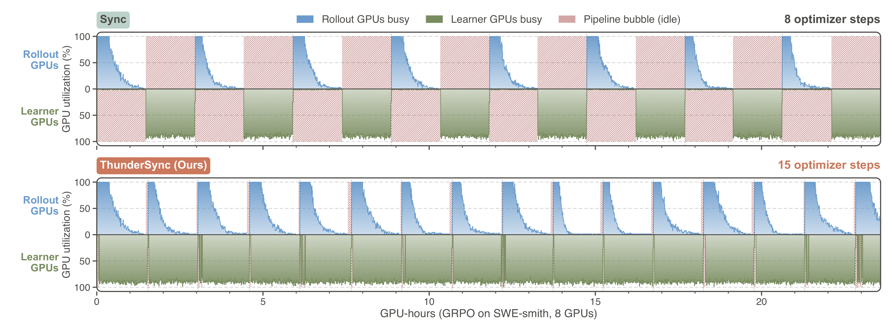
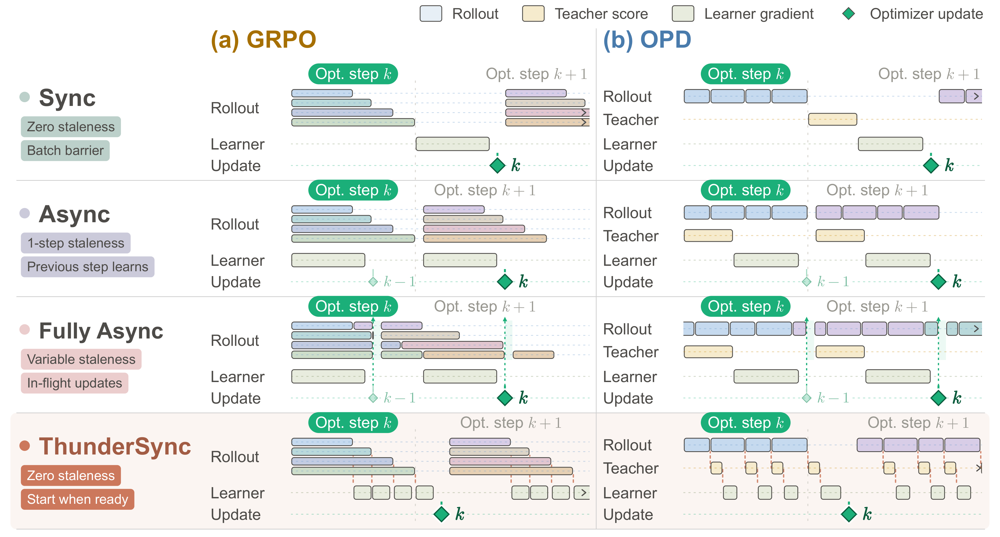

# ThunderSyncRL：Lossless Acceleration of Agentic Reinforcement Learning — 细粒度阅读

## 1. 基本信息与核心判断

- **论文**：ThunderSyncRL: Lossless Acceleration of Agentic Reinforcement Learning。
- **arXiv**：2610.05935v1，2026-10-05 提交；阅读日期：2026-10-08。
- **作者**：Seil Kang、Hangoo Kang、Tarun Suresh、Youngeun Kim、Shreyas Pimpalgaonkar、Seong Jae Hwang、Azalia Mirhoseini。
- **机构**：Stanford University、Yonsei University、Korea University、Bespoke Labs。
- **资料**：[摘要](https://arxiv.org/abs/2610.05935v1) · [论文](https://arxiv.org/pdf/2610.05935v1) · [作者博客](https://seilk.github.io/thundersync) · [GitHub](https://github.com/seilk/thundersync)。
- **本地文件**：[PDF 全文](arxiv_2610_thundersyncrl_lossless_acceleration_of_agentic_reinforcement_learning.pdf) · [TeX 入口](../arxiv_all/arxiv_2610_thundersyncrl_lossless_acceleration_of_agentic_reinforcement_learning_tex/main.tex)。
- **主题 / 层级**：Agent / detailed；阅读了全部主文、方法公式、实验、实现伪代码与相关附录，PDF 共 39 页。
- **代码状态**：2026-10-08 查询作者 GitHub README，内容为“Code release is on the way”。本笔记的实现分析依据论文源码和附录伪代码，没有训练代码审计或训练复现。

**一句话理解**：将“什么时候能算梯度”和“什么时候能更新参数”分开；梯度依赖满足就开始反向，但始终使用同一策略快照，整批结束才执行一次 optimizer step。

**核心贡献**：在 GRPO 中用两个梯度充分统计量消除完整 group 对轨迹反向计算的阻塞；在 OPD 中将已经获得 teacher 分数的 turn 提前送入 learner。它改变训练执行时序，保留论文指定的同步目标与批次语义。

**阅读时必须把握的边界**：

1. “异步执行”与“异步参数更新”不同。ThunderSyncRL 的任务可以并行推进，但同一逻辑批次的策略始终固定。
2. GRPO 提前计算的是不含最终 group advantage 的 score gradient；group 归一化仍需等待全部奖励。
3. OPD 提前反向后，还要完成跨 turn、共享前缀的延迟梯度传播，不能直接 detach 历史状态就声称等价。
4. “Lossless”指目标和数学更新不变；不承诺不同精度、kernel、求和顺序下参数逐 bit 相同。
5. 主实验 Async 是无额外行为策略重要性修正的一步滞后基线；论文没有证明所有带修正的异步系统都更差。
6. 全参数 GRPO 的 FP32 统计缓冲在主机内存中，不能只看 GPU 显存表判断资源需求。

## 2. 背景：agent 训练为何出现大块空闲时间

### 2.1 一条轨迹包含哪些耗时

这里的 agent 是在可执行环境中解决软件修复或终端任务的模型。一次尝试交替经历：读取指令与历史、生成思考和 shell action、运行工具、读取 observation、继续行动，最后由测试或 verifier 给出结果。

轨迹时长不仅取决于生成 token 数，还取决于 shell 命令、容器、验证器以及行动次数。不同轨迹的结束时间差异很大，少数慢轨迹会拖住一个批次。

传统 Sync 将整个 rollout batch 完成作为 learner 的启动条件。快轨迹虽然已经有 token 和奖励，仍要等待其他轨迹；learner 随后集中训练，rollout GPU 又要等待下一版策略。论文的参考配置中，learner 在同步 GRPO/OPD 的 step 时间内约有 49.5% 处于等待。

原图说明：上半部分为四张 rollout GPU，下半部分为四张 learner GPU；斜线区域表示空闲。ThunderSyncRL 在已有奖励的轨迹上提前反向，在 Sync 完成 8 次更新所需的 GPU-hours 内完成 15 次更新。图中的 rollout utilization 是生成槽的忙碌比例，不应与后文 trainer active MFU 混为一谈。

### 2.2 为什么直接跨更新流水线会引入 staleness

Async 在 learner 更新当前批次时，用旧策略生成下一批数据。因此下一次训练时，行为策略和 learner 的当前策略不同。

Fully Async 更进一步：未完成轨迹可以在新权重发布后继续生成。一条轨迹可能包含多个策略版本产生的动作。它获得更自由的流水线，但需要处理 variable policy lag。

已有方法可以采用 importance weighting、过滤、裁剪和滞后控制。这些措施处理的是跨策略版本的数据使用问题。ThunderSyncRL 选择在单个固定策略版本内部释放可计算的工作，减少这类问题发生的条件。

### 2.3 本文切入点：完整批次不是所有反向计算的必要条件

GRPO 的 group advantage 依赖所有奖励，但每条轨迹的 log-probability 对参数的梯度不依赖其他轨迹奖励。OPD 中，一个 turn 的 sampled-token teacher 分数也不依赖未来工具结果。

所以“全批完成后才能更新”并不推出“全批完成后才能开始反向”。本文利用这个依赖关系上的差别，把 learner 工作塞进尚未结束的 rollout 时间窗。

## 3. 总体框架与执行协议

图中蓝色为 rollout，黄色为 teacher scoring，浅绿色为 learner gradient，绿色菱形为 optimizer update。重点是菱形的位置：ThunderSyncRL 提前移动了梯度工作，但仍在整批完成后更新。

### 3.1 四种调度如何区别

| 调度 | learner 启动条件 | 参数更新与 rollout 的关系 | policy lag |
|---|---|---|---|
| Sync | 整个 rollout batch 完成 | 当前批生成完再训练 | 0 |
| Async | 与下一批 rollout 重叠 | 下一批使用旧一版策略 | 1 个 update |
| Fully Async | 完成数据达到更新条件 | 权重更新可发生在轨迹进行中 | 可变、有界 |
| ThunderSyncRL | objective source 的输入固定 | 同批提前反向，批末统一更新 | 0 |

此表为对原框架图的阅读说明，不是额外实验。

### 3.2 Objective source：独立释放的梯度工作单元

设更新编号为 $k$，当前策略参数为 $\theta_k$，逻辑批次为 $\mathcal{B}_k$。

- GRPO source 是一条轨迹；当 token、scored-token mask、奖励 $r_i$ 固定时 ready。
- OPD source 是一个 turn 的被评分动作 token；teacher 使用已实现的 causal context 得到分数后 ready。
- source ready 不等于所有相关工作已完成：共享前缀或历史状态的部分反向可能继续等待 trajectory/group closure。

所有 rollout 都由 $\pi_{\theta_k}$ 生成，所有 learner 梯度都在 $\theta_k$ 计算。更早到达只改变处理时机，不改变批次成员。

### 3.3 Ready queue 与 optimizer barrier

Ready sources 进入尽可能持续工作的队列，不为更小 trajectory index 故意等待。独立 group 可以并发完成 reduction，每个 group 内保持确定的 reduction 顺序。内存 admission cap 可能限制新 group 的反向；因此“最早开始”也受实际资源约束。

批末必须同时满足：所有登记的轨迹完成、所有 group 关闭、所有 source backward 完成、所有延迟上下文反向完成。然后执行分布式 reduction、目标对应的 normalization、global gradient clipping 和一次 optimizer step。

发布 $\theta_{k+1}$ 后，每个 rollout replica 加载新参数，清理依赖策略版本的 cache，并返回 ACK。下一个逻辑批次只有在这些动作完成后才开始。

因此零滞后不是只检查一个 version 字段：还包括权重实际加载、KV/prefix cache 失效和所有 replica 的确认。

## 4. GRPO：group 没结束，为什么能先算梯度

### 4.1 先把轨迹梯度与奖励系数分开

对于同一 prompt 的 $m$ 条轨迹组成的 group $\mathcal{G}$，定义：

$$
S_i(\theta)=\sum_{t\in\mathcal{M}_i}w_{i,t}\log\pi_\theta(a_{i,t}\mid h_{i,t}),\qquad H_i=\left.\nabla_\theta S_i(\theta)\right|_{\theta=\theta_k}.
$$

符号含义：$\mathcal{M}_i$ 是轨迹 $i$ 的 scored assistant token 集合；$h_{i,t}$ 是已实现历史；$w_{i,t}$ 是固定 token 权重；$H_i$ 是参数维度的 score gradient。

$H_i$ 只需要轨迹 token、mask、权重和固定策略，不需要其他轨迹奖励。主调度在自身 reward 到达后释放；附录也指出，可在内容完成时先准备 source gradient，之后再绑定 reward。

group 的奖励均值、总体标准差与 detached advantage 为：

$$
\mu_{\mathcal{G}}=\frac{1}{m}\sum_{i\in\mathcal{G}}r_i,\qquad \sigma_{\mathcal{G}}=\sqrt{\frac{1}{m}\sum_{i\in\mathcal{G}}(r_i-\mu_{\mathcal{G}})^2},\qquad A_i=\frac{r_i-\mu_{\mathcal{G}}}{\sigma_{\mathcal{G}}+\epsilon}.
$$

同步目标对应的 group 更新方向是：

$$
g_{\mathcal{G}}=\frac{1}{m}\sum_{i\in\mathcal{G}}A_iH_i.
$$

这里 advantage 在求导时视为常数。论文把 $g$ 写成上升方向；实现 GRPO 使用 `maximize=True`，不要把这个方向未经变号写入下降 optimizer。

### 4.2 两个充分统计量如何恢复完整 group 梯度

直接展开分子：

$$
\begin{aligned}g_{\mathcal{G}}&=\frac{1}{m(\sigma_{\mathcal{G}}+\epsilon)}\sum_{i\in\mathcal{G}}(r_i-\mu_{\mathcal{G}})H_i\\&=\frac{\sum_i r_iH_i-\mu_{\mathcal{G}}\sum_iH_i}{m(\sigma_{\mathcal{G}}+\epsilon)}.\end{aligned}
$$

定义两个可累计向量：

$$
G^{(1)}_{\mathcal{G}}=\sum_{i\in\mathcal{G}}r_iH_i,\qquad G^{(2)}_{\mathcal{G}}=\sum_{i\in\mathcal{G}}H_i.
$$

于是：

$$
g_{\mathcal{G}}=\frac{G^{(1)}_{\mathcal{G}}-\mu_{\mathcal{G}}G^{(2)}_{\mathcal{G}}}{m(\sigma_{\mathcal{G}}+\epsilon)}.
$$

每完成一条 source，就计算 $H_i$，加入 reward-weighted 与 unweighted 两个缓冲，同时记录奖励。组内全部奖励和梯度到齐后，只需确定两个 scalar 并组合缓冲，不必此时才开始每条轨迹的昂贵反向。

**所谓充分统计量，是针对这次 group 梯度组合而言**；没有声称它们保留轨迹的所有信息。每个缓冲是与可训练参数同量级的向量，仍有显著存储成本。

### 4.3 一个两轨迹例子

以下是阅读例子，不是论文实验。令 $m=2$，奖励为 1、0，则 $\mu=0.5$、$\sigma=0.5$。先到达的正确轨迹允许提前计算 $H_1$，错误轨迹之后计算 $H_2$。

$$
G^{(1)}=H_1,\qquad G^{(2)}=H_1+H_2,\qquad g_{\mathcal{G}}=\frac{H_1-H_2}{4(0.5+\epsilon)}.
$$

当 $\epsilon$ 很小时，它约为 $(H_1-H_2)/2$，与正确轨迹正 advantage、错误轨迹负 advantage 的同步组合一致。等待第二条轨迹是为了知道最终组合系数，不是为了计算第一条轨迹的 score gradient。

### 4.4 原文实际使用哪种 GRPO 归一化

主配置 32 prompts、每组 8 条轨迹，共 256 条。设第 $i$ 条轨迹有 $L_i$ 个 scored tokens，论文设：

$$
w_{i,t}=\frac{1}{32L_i},\qquad g_k=\sum_{\mathcal{G}}g_{\mathcal{G}}=\frac{1}{256}\sum_{i=1}^{256}A_i\frac{1}{L_i}\sum_{t\in\mathcal{M}_i}\nabla_\theta\log\pi_{\theta_k}(a_{i,t}\mid h_{i,t}).
$$

因此它是 trajectory-normalized direction 的平均。不能忘记 $1/32$ 后再简单求和，否则更新尺度改变。标准差用 population standard deviation，即代码中 `unbiased=False`。

所有奖励相同的 group 提供零 policy gradient，但保留在 batch 和计时记录中。没有为了加速而丢弃零方差组。

### 4.5 等价性覆盖范围

分解依赖“奖励系数对已固定 source gradient 的线性组合”。论文的配置是每批一次 optimizer update、无额外 PPO epoch、reference KL 和 entropy bonus 均为零。

**阅读推论**：不能把这套两缓冲公式不加检查地推广到任意 PPO/GRPO 实现。多 epoch 会改变求梯度的参数；非线性的 ratio clipping、动态 loss mask、其他 normalization 或额外项，需要重新分析各自依赖。本文证明的是其声明目标下的等价性。

## 5. OPD：以 turn 为粒度释放监督

### 5.1 Teacher 提供什么信号

Student 在当前策略下与环境交互。冻结 teacher 对 student 实际生成的 assistant tokens 评分；其上下文就是 student 的序列化历史，包括 retained observation 和 reasoning history。

这是外部强 teacher 的 sampled-token OPD。本文返回的是采样动作 token 的 log probability，不是完整词表 logits，也不是把标准答案额外放入同模型上下文的 self-distillation。

第 $j$ 个 turn 的 token advantage 定义为：

$$
A_{j,t}=\operatorname{sg}\left[\log\pi_{\mathrm{T}}(a_{j,t}\mid h_{j,t})-\log\pi_{\theta_k}(a_{j,t}\mid h_{j,t})\right].
$$

$\operatorname{sg}$ 表示 stop-gradient。Teacher 比 student 更支持这个已采样 token 时，系数为正；相反则为负。它不是任务成功 reward，OPD 中环境奖励仅用于监控。

turn 的未归一化上升方向为：

$$
g_j=\sum_{t\in\mathcal{M}_j}A_{j,t}\left.\nabla_\theta\log\pi_\theta(a_{j,t}\mid h_{j,t})\right|_{\theta=\theta_k}.
$$

Teacher 一旦完成本 turn scoring，source 就可以反向。工具执行和未来 turn 仍可在进行中。

### 5.2 伪代码中 ratio 等于 1，为什么仍有梯度

附录先得到 student `logp`，将同一快照的值 detach 为 `old_logp`，随后构造 ratio 与 loss：

$$
\rho_{j,t}(\theta)=\exp\left(\log\pi_\theta(a_{j,t}\mid h_{j,t})-\operatorname{sg}[\log\pi_{\theta_k}(a_{j,t}\mid h_{j,t})]\right),\qquad \ell_j(\theta)=-\sum_{t\in\mathcal{M}_j}\rho_{j,t}(\theta)A_{j,t}.
$$

在 $\theta=\theta_k$ 处，ratio 数值为 1，但它的分子仍连接参数，因而：

$$
\left.\nabla_\theta\rho_{j,t}(\theta)\right|_{\theta=\theta_k}=\nabla_\theta\log\pi_{\theta_k}(a_{j,t}\mid h_{j,t}),\qquad \left.\nabla_\theta\ell_j(\theta)\right|_{\theta=\theta_k}=-g_j.
$$

若把 ratio 整体 detach，梯度就消失；若没有 detach advantage，又会额外求导 student log probability。这两种改动都会偏离原目标。OPD 伪代码使用下降 optimizer，因此写入的是 $-g_j$。

**阅读提示**：不能仅因出现 ratio 就理解为跨行为策略版本的 off-policy correction。ThunderSyncRL 的 numerator 和 detached denominator 来自同一 student 快照。

### 5.3 为什么全局 token normalization 要最后做

每个 ready turn 先累计未归一化梯度和 scored-token count。整个 batch 的方向为：

$$
g_k=\frac{1}{N_k}\sum_{j\in\mathcal{U}_k}g_j,\qquad N_k=\sum_{j\in\mathcal{U}_k}|\mathcal{M}_j|.
$$

$N_k$ 只有在所有轨迹结束后才固定。但 numerator 可以先算。跨 rank 求梯度总和、token 总数，再除以全局 token count，之后才做 clipping。

如果每 turn 先求均值，再对 turns 平均，就会让短 turn 与长 turn 权重相等，改变原来的 token-mean 目标。同样，先在每 rank 归一化再平均，遇到不同 token count 也会出错。

### 5.4 隐藏难点：历史 token 无直接 loss，不代表历史状态无梯度

当前 action 的条件概率依赖前面的 hidden states、attention/recurrent state。即使 prompt、tool observation 和先前 turn 没有本 turn 的直接 loss，当前 loss 仍可能通过这些状态对模型参数产生梯度。

附录采用 `backward_with_boundary_capture`：先执行可提前完成的反向，捕获 cut state 的 adjoints，即 loss 对边界状态的梯度。在 trajectory closure 时 replay deferred state adjoints，在 group closure 时完成 shared-prefix backward。

共享前缀只计算一次，各 continuation 累计对前缀边界状态的贡献，最后将其和通过共享前缀反向。GRPO 的边界贡献也有 reward-weighted 与 unweighted 两套组合。

这个 learner 共享前缀优化适用于 Sync、Async、ThunderSyncRL，不是作者给本方法单独添加的优势；它也不同于 vLLM 推理时的 prefix caching。

**复现关键**：将 history KV/recurrent states detach 后直接按 turn 反向，可能实现一个更便宜的截断目标，却不再是本文声明的完整同步梯度。

## 6. 一次完整训练 update 的执行过程

以下根据正文和 Algorithm 1 整理，保持事件依赖与最终 barrier：

1. 登记本逻辑批次所有 trajectory/group，绑定 policy version $k$，初始化累加缓冲。
2. Rollout workers 并行生成，learner 同时消费 ready events；整个阶段参数固定为 $\theta_k$。
3. GRPO source 到达：计算 score gradient，加入 group 两个缓冲；group 关闭后归一化组合并完成 deferred context backward。
4. OPD turn 到达：冻结 teacher 评分，计算 detached advantage 和未归一化 loss，反向并保存边界梯度；累计 scored tokens。
5. Trajectory/group completion events 触发具备条件的延迟反向、共享前缀反向和缓冲释放。
6. 等待本批所有 rollout、reward/teacher scoring、source gradients 和 deferred work 完成。
7. 分布式求和，执行 objective-specific normalization，global norm clipping，一次 optimizer step。
8. 发布新权重，rollout replicas 加载、清缓存、ACK，然后启动下一批。

实现必须做到事件恰好处理一次。Source 重复入账、漏掉 completion event，或者尚有未完成 backward 就更新参数，分别会改变梯度或破坏版本一致性。

## 7. 调度理论：何时接近 2 倍，何时收益受限

### 7.1 Release time 与完成时间

第 $j$ 个 learner job 的 ready time 为 $\tau_j$，service time 为 $p_j$。按 ready 顺序在单条 learner lane 处理，完成时间满足：

$$
c_0=0,\qquad c_j=\max\{\tau_j,c_{j-1}\}+p_j.
$$

一个 job 要同时等待“自身数据到齐”和“前一个 job 处理结束”。全部 rollout 所需事件收齐的时刻是 $R$；最后的 reduction、optimizer、publication、reload、ACK 耗时合为 $P$。于是：

$$
T_{\mathrm{ThunderSync}}=\max\{R,c_n\}+P,\qquad L=\sum_{j=1}^{n}p_j,\qquad T_{\mathrm{Sync}}=R+L+P.
$$

递推展开为：

$$
c_n=\max_{1\leq j\leq n}\left(\tau_j+\sum_{i=j}^{n}p_i\right).
$$

这揭示最终瓶颈可能来自较晚释放的一串工作，而不只是最后一个 source 的 cost。

### 7.2 Learner tail 与速度上界

定义 $[x]_+=\max(x,0)$，normalized learner tail 为 $\lambda=[c_n-R]_+/R$；$\rho=L/R$ 是 learner/rollout 时间比，$\kappa=P/R$ 是最终串行开销比例。

$$
S=\frac{T_{\mathrm{Sync}}}{T_{\mathrm{ThunderSync}}}=\frac{1+\rho+\kappa}{1+\lambda+\kappa},\qquad S\leq\frac{R+L+P}{\max(R,L)+P}\leq2.
$$

接近 2 倍需要：rollout 与 learner 工作量接近平衡、rollout 结束时几乎没有 learner tail、最终串行 suffix 很小。

如果 learner 很短，rollout 仍决定 step；如果 learner 很长，learner 决定 step。因而使用计算更轻的 MoE 或 LoRA，并不自动带来更高的相对加速。

这个上界针对固定工作、固定硬件和固定 service time 的两阶段重叠模型。不是对所有 RL 系统优化的普遍上界，也不等于每个真实分布式运行都能达到两倍。

### 7.3 为什么要按 service time 衡量 release，而不是数 ready jobs

设 $u=t/R$，$F^-(u)$ 为严格早于 $uR$ 释放的 learner service 占总 service 的比例：

$$
F^-(u)=\frac{1}{L}\sum_{\tau_j<uR}p_j,\qquad 1+\lambda=\max\left\{1,\sup_{0\leq u\leq1}\left[u+\rho\left(1-F^-(u)\right)\right]\right\}.
$$

Late trajectories 也可能有更长上下文、需要更多 learner 算力。很多短 source 已 ready，不代表多数 learner 工作已释放。Strict-before 定义还保证同一时刻刚释放的 jobs 仍被计入剩余服务。

令 release lag $D=\sup_u[u-F^-(u)]$，附录给出：

$$
[\rho-1]_+\leq\lambda\leq[\rho-1]_++\rho D,\qquad \lambda=D\quad\text{当 }\rho=1.
$$

在平衡时，提前释放充分的 learner service，才真正缩短最终 tail。

### 7.4 GRPO 与 OPD 的 analytical release laws

附录假定 normalized trajectory completion time 为独立均匀变量 $U$，条件平均 learner service 正比于 $U^\gamma$。

GRPO 有 $1-\beta$ 比例工作在自身奖励到达后 ready，其余 $\beta$ 等到 group 关闭；group size 为 $m$：

$$
F_{\mathrm{GRPO}}(u)=(1-\beta)u^{\gamma+1}+\beta u^{\gamma+m}.
$$

后一项体现“自身服务已准备，且其他组员都结束”的依赖。Group size 越大、closure work 比例越高，release 越晚。

OPD 将一个 trajectory 建模为 $a$ 个 equal-service turns，在 $jU/a$ 到达 teacher-scored release；$\delta$ 比例工作延迟到 trajectory completion：

$$
F_{\mathrm{OPD}}(u)=\frac{1-\delta}{a}\sum_{j=1}^{a}\min\left(1,\frac{au}{j}\right)^{\gamma+1}+\delta u^{\gamma+1}.
$$

更多 turns 允许更早释放工作，但 deferred service、真实 turn spacing、teacher delay 会限制收益。GRPO 的公式在固定其他 normalized inputs 时不含 turn count；这不意味着真实任务增加 horizon 永远不影响 GRPO runtime。

### 7.5 Batch size、rollout waves 与模型限制

当 batch 超过 rollout capacity，可以在前一波 ready 工作上反向，同时生成后一波。平衡且各 wave 相同的简化模型中，$w$ 波的加速为：

$$
S(w)=\frac{2w+\kappa_{\mathrm{w}}}{w+\kappa_{\mathrm{w}}+\lambda_{\mathrm{w}}}.
$$

尾部和发布开销被更多工作摊薄，极限趋近 2。更大 batch 同时改变优化粒度和内存要求，不能仅依据这个 runtime 模型决定训练 batch。

理论假设各调度执行相同 jobs，service time 不因并发而改变，并有足够内存及时 admission。真实多 rank 需要分别运行递推，取最晚完成的 rank；不能简单池化吞吐忽略 rank imbalance。

本文 scaling setup 使用 capacity $Q=128$，不是主学习曲线配置中的 vLLM active-sequence 数。图中部分三维面和 heatmap 是 analytical prediction，不能当作每个格点都实测。

## 8. 实验设置与评价口径

### 8.1 模型、teacher 与硬件角色

主要 full fine-tuning 模型为 Qwen-3.8-27B；模型效率比较还包括 GLM-4.7-Flash-31B，约 31.22B stored parameters、每 token 约 3B active parameters。正文模型名称按原文保留。

Qwen student revision 为 `1d4bf0f2ff60`，OPD teacher 为 Qwen/Qwen3.8-Flash-Next-FP8，revision `236dfdf28582`。Teacher 冻结，使用发布的 FP8 权重；log-probability normalization 和传输为 FP32，不会消除 FP8 权重引入的近似。

GLM student 为 zai-org/GLM-4.7-Flash，revision `7dd20894a642`；teacher 为 zai-org/GLM-5.3-Flash，FP8 revision `690b705278a3`。Teacher tokenizer 与 student 文件 byte-identical，避免 token-level supervision 对齐问题。其权重约 328.25 GB，使用两张 B200 tensor parallel；H200 比较使用 Qwen。

单节点 8 张 B200 或 H200 的角色：

| 目标 | learner GPUs | rollout GPUs | teacher GPUs |
|---|---:|---:|---:|
| GRPO | 4 | 4 | 0 |
| OPD | 4 | 2 | 2，teacher TP=2 |

Student rollout replica 每个占一张 GPU，每个 replica 最多 16 active generation sequences，所以参考配置 GRPO/OPD 最多分别为 64/32 并发生成序列。等待工具的轨迹数、逻辑 batch 总轨迹数和生成槽数是三个不同概念。

### 8.2 优化超参数：原附录设置

| 设置 | GRPO | OPD |
|---|---|---|
| prompts / update | 32 | 32 |
| trajectories / prompt | 8 | 4 个独立样本 |
| trajectories / update | 256 | 128 |
| optimizer | AdamW | AdamW |
| full fine-tuning learning rate | $10^{-6}$ | $10^{-6}$ |
| LR schedule / warmup | Constant / none | Constant / none |
| Adam betas / epsilon | $(0.9,0.999)$ / $10^{-8}$ | 相同 |
| weight decay | 0 | 0 |
| global gradient norm clip | 1.0 | 1.0 |
| optimizer steps / logical batch | 1 | 1 |
| additional PPO epochs | 0 | 0 |
| reference KL / entropy bonus | 0 / 0 | 0 / 0 |
| loss-bearing tokens | generated assistant tokens | generated assistant tokens |
| reduction | mean over trajectories | global scored-token mean |
| advantage epsilon | $10^{-6}$ | 不适用 |
| student forward | BF16 | BF16 |
| gradient accumulation / Adam state | FP32 host / BF16 | FP32 host / BF16 |
| training seeds | 42、43、44 | 42、43、44 |

主配置更新语言模型参数，不使用视觉组件。Prompt 和 observation tokens 提供上下文，没有直接 loss。不要套用整套框架默认配置而忽略论文显式修改的 batch normalization 和 single-step 语义。

### 8.3 Agent 生成与工具限制

| 设置 | 训练与评价共同设置 |
|---|---|
| 最大 agentic turns | 300 |
| 每 turn 最多 generated tokens | 1,024 |
| 每 trajectory 最多 generated tokens | 16,384 |
| initial prompt 上限 | 16,384 tokens |
| total context 上限 | 131,072 tokens |
| tool observation retained length | 4,096 tokens，head/tail 各 2,048 |
| temperature / top-p / top-k | 1.0 / 1.0 / disabled |
| repetition / presence / frequency penalty | 1.0 / 0 / 0 |
| thinking mode | Enabled，reasoning tokens 计入限额 |
| tool calls / turn | 最多 1 |
| 普通 tool command timeout | 120 秒 |
| rollout weights / KV cache | BF16 / BF16 |
| serving memory fraction | 0.65 |
| chunked prefill / prefix caching | enabled / enabled |
| speculative decoding | disabled |
| 主评价 attempts / task | 3；附录 pass@1/5 使用 5 |

上限彼此独立：300 turns 不表示允许生成 307,200 tokens，trajectory-level 16,384-token 上限先到就结束。达到 generation/context limit 不会删除旧 turns 以继续运行。无法解析的 action 消耗一 turn，并返回固定 parser-error observation。

GRPO 使用 verl 官方 Agent Loop；OPD 使用 SkyRL multi-turn pipeline / SkyRLGymGenerator / SkyRL-Gym；Sync、Async、ThunderSyncRL rollout 均使用 vLLM 和相同 serving 优化。不同任务 trajectory 可并发，某条轨迹等待工具不阻塞其他轨迹生成。

### 8.4 训练数据：静态 cohort 与最终可执行 cohort 不同

软件任务在 SWE-smith Python 训练，终端任务在 SETA-Env 训练；两者分开，不混合。Pinned source revisions：SWE-smith `77cab9055d42`，SETA `3c3bc8975b05`，SWE-bench Verified `78f471bf655a`，Terminal Bench 4.0 `v4.0.0 / 452bf305c6da`。

下表忠实保留原静态 split 表：

| 阶段 | SWE-smith Python | SETA-Env |
|---|---:|---:|
| source tasks | 50,908 | 4,567 |
| 静态字段/文件检查移除 | 11,437 | 0 |
| eligible tasks | 39,471 | 4,567 |
| split groups | 131 repositories | 3,474 source families |
| training tasks | 37,084 | 4,333 |
| development tasks | 2,387 | 234 |
| train / development groups | 124 / 7 | 3,300 / 174 |

SWE-smith 移除的记录均为 problem statement 为空。Repository mirror names 归一化为原仓库名后，131 个仓库与 Verified 的 12 个仓库不重合。SETA 将 evolved task 与原 source family 放在同一 split，避免家族变体跨训练/开发集。

Development split 是作者协议中的 5% group split，而非数据集官方 split；按 normalized group identifier 的 SHA-256 排序选取，并向上取整。

上表在 prompt-length checks、container validation、semantic-overlap review **之前**。真正运行时的排除项和 final cohort 要以 execution manifest 为准，论文表格不能被直接视为每个实验实际使用的最终任务数。

SWE-smith 要先施加 bug-inducing patch，再让 agent 修复；patch 的方向与 SWE-bench solution patch 相反。SETA 验证 no-op 失败且 reference solution 成功。失败环境在所有 schedule 中一致排除；不会因任务难、轨迹长或 uniform rewards 排除。

### 8.5 Reward 与 success 不要混用

- SWE-smith training reward：所有 repair 与 regression tests 通过为 1，否则为 0。
- SETA training reward：设 verifier tests 通过比例为 $p$，$r=p+0.5\mathbf{1}[p=1]$。
- OPD：记录上述 reward 监控进展，但 loss 使用 teacher 分数。
- SWE-bench Verified success：官方 harness 中 FAIL_TO_PASS 和 PASS_TO_PASS 全部通过。
- Terminal Bench 4.0 success：Harbor 官方 verifier 的 task success，而非 SETA partial reward。

Verified 评价全部 500 tasks；Terminal Bench 4.0 全部 66 tasks，保留其 GPU/multi-container 资源和 8 小时外层 timeout，同时使用上述 agent token/turn/tool limits。不能与不同 harness、预算或 Terminal Bench 2.0/3.0 成绩直接比较。

### 8.6 Pass@3、training seed 与固定预算

设 task $i$ 第 $j$ 次尝试是否成功为 $y_{ij}$，主文指标为：

$$
\operatorname{pass@3}=\frac{100}{M}\sum_{i=1}^{M}\mathbf{1}\left[\sum_{j=1}^{3}y_{ij}>0\right].
$$

它是每个 task 三次独立尝试中至少一次成功的比例，不是三次 accuracy 的平均，也不是 majority vote。每次 fresh environment/history，不把前次 evaluator feedback 给后次尝试。

Training seeds 42/43/44 分别评价再平均；同 checkpoint 的三次尝试不等于三个独立训练 run。基础设施故障可按原分配 seed 重试，agent mistakes 或耗尽预算仍计失败；持续不可用任务使评价不完整，而非缩小 denominator。

每 1 小时请求 checkpoint，在下一 optimizer boundary 保存。128 GPU-hours 对应 8-GPU node 的 16 小时；固定预算只取该预算之前已发布的最新 checkpoint，不使用未来 checkpoint。

跨 seed 曲线在共同时间轴上取各 run 最新已发布评价结果，再平均；target crossing 是该 step curve 首次达到预先固定 target 的 checkpoint。它有 checkpoint cadence 导致的离散性。

训练时钟从初始化完成后的第一次 rollout request 起，包含交互、验证、teacher scoring、learner、publication 和 checkpoint pauses；offline evaluation 单独计时。图中美元成本按 B200 每 GPU-hour 6.69 美元的报价换算；这是原文成本假设，不是当前价格核验，且不代表完整基础设施总成本。

## 9. 主结果：速度与能力应分开读

### 9.1 达到相同性能所需 GPU-hours

以下为图中明确标注数字的转录，非从曲线猜测：

| 目标 | benchmark / pass@3 target | Sync GPU-hours | ThunderSyncRL GPU-hours | 原图标注加速 |
|---|---|---:|---:|---:|
| GRPO | SWE-bench Verified / 74.01% | 233.5 | 121.3 | 1.9× |
| GRPO | Terminal Bench 4.0 / 36.61% | 169.3 | 96.4 | 1.8× |
| OPD | SWE-bench Verified / 74.54% | 168.5 | 88.7 | 1.9× |
| OPD | Terminal Bench 4.0 / 38.30% | 224.7 | 121.3 | 1.9× |

这是 end-to-end time-to-performance，包含 learning progress；不同目标或不同 objective 间不能凭它排名算法样本效率。

### 9.2 128 GPU-hours 的性能

| objective / benchmark | ThunderSyncRL pass@3 | Async 相对 ThunderSyncRL | Fully Async 相对 ThunderSyncRL |
|---|---:|---:|---:|
| GRPO / SWE-bench Verified | 74.53% | −2.47 pp | −1.87 pp |
| GRPO / Terminal Bench 4.0 | 36.87% | −1.52 pp | −0.51 pp |
| OPD / SWE-bench Verified | 75.33% | −1.27 pp | −1.60 pp |
| OPD / Terminal Bench 4.0 | 38.89% | −2.02 pp | −2.53 pp |

pp 是百分点，不是相对百分比。“最多 2.47”是摘要对 Async 的比较；图中 OPD/Terminal 对 Fully Async 的差距为 2.53 pp，不应误读成矛盾或将两基线合并。

固定时间优势由两部分构成：比 Sync 每 step 更短，所以可训练更多数据；比 Async 保留零滞后，在本文目标与配置下表现更好。论文没有据此证明 ThunderSyncRL 每个样本都比 Sync 学得更多。

原图展示 SETA post-training 后的 Terminal Bench 4.0 pass@3，以及训练 reward 曲线。Benchmark tasks 被排除于当前 post-training，但上游数据生成和模型预训练的语义曝光并未被证明完全不存在。

### 9.3 Step wall time 与剩余 learner tail

| objective | rollout + verification | Sync 后续 learner work | ThunderSyncRL residual learner work | Sync 总 step | ThunderSyncRL 总 step |
|---|---:|---:|---:|---:|---:|
| GRPO | 650.0 s | 646.4 s | 20.5 s | 1,313.6 s | 687.7 s |
| OPD | 658.5 s | 656.2 s | 11.6 s | 1,330.3 s | 685.7 s |

Publication 仍包含在总 step 中。提前反向基本消除了 rollout 结束后原本数百秒的 learner 阶段，但 **rollout 本身没有因梯度分解减少到原来一半**。

Async 的总 step 为 GRPO 695.0 s、OPD 692.9 s；Fully Async 为 690.0 s、689.3 s。ThunderSyncRL 与它们的 wall-time 很接近，主要价值是同时实现零 policy lag，而非比 Async 再快一倍。

## 10. 原始效率表：模型、硬件与 LoRA

### 10.1 Trainer active MFU 是什么

论文定义的是以完整 step 时间为分母的 learner-side MFU：

$$
\operatorname{MFU}^{\mathrm{active}}_k=\frac{F_k^{\mathrm{train}}}{T_k^{\mathrm{step}}\sum_{d\in\mathcal{D}_{\mathrm{train}}}P_d}.
$$

时间包含 waiting、环境、teacher、learner、publication，并发时间只计一次。分子与 capacity denominator 仅属于 learner；teacher 和 rollout FLOPs 不计入。Context tokens 即使 loss mask 为零，仍计实际 learner 运算；activation checkpoint recomputation 增加 elapsed time，不额外增加 credited model FLOPs。

因此 MFU 变高可以是消除空闲导致，并不表示 GEMM kernel 吞吐提升。跨 GPU/model 比较还受不同 FLOP count 和 peak-rate denominator 影响。B200/H200 使用 dense-BF16 peak 2,250/989.5 TFLOP/s。

每 seed 完成 40 updates，去掉 1–4 startup，profile 5–40 共 36 updates。表格的均值与 sample SD 来自三个 seed summaries，不把 108 个相关 updates 当作独立 run。

### 10.2 Full fine-tuning：跨模型 B200 原表

为避免过宽表格，按模型拆分；列、数值和原表最佳值粗体保留。G/O 分别指 GRPO/OPD；MFU 为百分数，memory 为每 learner GPU decimal GB，speedup 相对对应 Sync。

**Qwen-3.8-27B，8×B200：**

| Method | lag↓ | G MFU↑ | G speedup↑ | G memory↓ | O MFU↑ | O speedup↑ | O memory↓ |
|---|---|---|---|---|---|---|---|
| Sync | **0** | 24.0 ± 0.3 | 1.00 ± 0.00 | **117.0 ± 0.8** | 23.4 ± 0.4 | 1.00 ± 0.00 | **118.0 ± 0.9** |
| Async | 1 | 45.4 ± 0.2 | 1.89 ± 0.03 | 117.2 ± 1.1 | 44.8 ± 0.5 | 1.92 ± 0.04 | 119.3 ± 1.0 |
| Fully Async | Variable | 45.7 ± 0.2 | 1.90 ± 0.03 | 118.6 ± 1.2 | 45.1 ± 0.3 | 1.93 ± 0.04 | 120.1 ± 1.1 |
| **ThunderSyncRL** | **0** | **45.9 ± 0.1** | **1.91 ± 0.04** | 122.8 ± 1.3 | **45.3 ± 0.2** | **1.94 ± 0.03** | 121.3 ± 1.2 |

**GLM-4.7-Flash-31B，8×B200：**

| Method | lag↓ | G MFU↑ | G speedup↑ | G memory↓ | O MFU↑ | O speedup↑ | O memory↓ |
|---|---|---|---|---|---|---|---|
| Sync | **0** | 12.2 ± 0.1 | 1.00 ± 0.00 | **124.0 ± 1.0** | 11.5 ± 0.1 | 1.00 ± 0.00 | **122.1 ± 0.8** |
| Async | 1 | 19.8 ± 0.2 | 1.62 ± 0.03 | **124.0 ± 1.4** | 18.4 ± 0.2 | 1.60 ± 0.03 | 122.5 ± 1.3 |
| Fully Async | Variable | 19.9 ± 0.3 | 1.63 ± 0.04 | 125.2 ± 1.3 | 18.5 ± 0.2 | 1.61 ± 0.03 | 123.4 ± 1.2 |
| **ThunderSyncRL** | **0** | **20.0 ± 0.2** | **1.64 ± 0.03** | 129.4 ± 1.9 | **18.7 ± 0.1** | **1.63 ± 0.02** | 124.1 ± 1.5 |

Qwen 更接近阶段平衡，所以加速接近 2；GLM learner work 更短，rollout bound 更明显。GLM stored parameters 很大，所以不能从“3B active”推断其显存一定更小。

### 10.3 Full fine-tuning：Qwen 跨硬件原表

原表 B200 行与上表相同；此处完整保留另一平台 H200：

| Method | lag↓ | G MFU↑ | G speedup↑ | G memory↓ | O MFU↑ | O speedup↑ | O memory↓ |
|---|---|---|---|---|---|---|---|
| Sync | **0** | 31.3 ± 0.4 | 1.00 ± 0.00 | **117.1 ± 0.9** | 29.8 ± 0.4 | 1.00 ± 0.00 | 118.5 ± 1.0 |
| Async | 1 | 50.4 ± 0.5 | 1.61 ± 0.04 | 117.5 ± 1.2 | 49.2 ± 0.4 | 1.65 ± 0.03 | **118.2 ± 1.1** |
| Fully Async | Variable | 50.7 ± 0.4 | 1.62 ± 0.03 | 118.9 ± 1.3 | 49.5 ± 0.5 | 1.66 ± 0.04 | 119.0 ± 1.1 |
| **ThunderSyncRL** | **0** | **51.0 ± 0.3** | **1.63 ± 0.03** | 121.9 ± 1.4 | **49.8 ± 0.4** | **1.67 ± 0.03** | 120.4 ± 1.3 |

H200 上 learner 更慢，配置变得 learner-bound，相对加速下降。其 Sync MFU 高于 B200 不代表训练更快，只说明 learner 在完整 step 中等待占比和硬件 capacity denominator 不同。

### 10.4 LoRA 原表

LoRA Qwen rank=32、alpha=64、dropout=0、LR=$10^{-5}$，attention/MLP projections 与附录列出的 recurrent/input/output projections 为 targets。GLM LoRA 仅 attention targets，routed experts、embeddings、output head 冻结，共 42,063,872 adapter parameters。Batch、generation 和 evaluation limits 不变。

**Qwen-3.8-27B LoRA，8×B200：**

| Method | lag↓ | G MFU↑ | G speedup↑ | G memory↓ | O MFU↑ | O speedup↑ | O memory↓ |
|---|---|---:|---:|---:|---:|---:|---:|
| Sync | 0 | 19.5 | 1.00 | 75.4 | 19.0 | 1.00 | 73.4 |
| Async | 1 | 32.6 | 1.67 | 76.0 | 32.1 | 1.69 | 74.0 |
| Fully Async | Variable | 32.8 | 1.68 | 77.1 | 32.3 | 1.70 | 74.8 |
| **ThunderSyncRL** | 0 | 33.0 | 1.69 | 79.2 | 32.5 | 1.71 | 76.0 |

**GLM-4.7-Flash-31B LoRA，8×B200：**

| Method | lag↓ | G MFU↑ | G speedup↑ | G memory↓ | O MFU↑ | O speedup↑ | O memory↓ |
|---|---|---:|---:|---:|---:|---:|---:|
| Sync | 0 | 10.9 | 1.00 | 75.1 | 10.3 | 1.00 | 73.1 |
| Async | 1 | 17.7 | 1.62 | 75.6 | 16.5 | 1.60 | 73.6 |
| Fully Async | Variable | 17.8 | 1.63 | 76.3 | 16.6 | 1.61 | 74.2 |
| **ThunderSyncRL** | 0 | 17.9 | 1.64 | 77.3 | 16.7 | 1.62 | 75.0 |

冻结 base weights 去掉其 parameter-gradient 和 optimizer work，但仍需 forward 与 input-gradient propagation。因此 Qwen 的可重叠 learner work 变少，相对加速低于全参数配置；GLM 原本 rollout-bound，变化较小。原 LoRA 表未提供 ± 数字，不补造 uncertainty。

## 11. 扩展实验与“Lossless”的验证

### 11.1 固定 batch replay 的 update equivalence

作者记录 Qwen Sync 连续 10 个 logical batches 的 tokens、mask、reward、teacher scores，然后从相同初始参数分别 replay Sync 与 ThunderSyncRL。固定 batches 隔离 learner 计算，避免 rollout 随后因参数差异而改变。

比较第一批 clipping 之前的梯度，以及每次 update 的 relative parameter gap：

$$
\Delta_k=\frac{\|\theta_k^{\mathrm{ours}}-\theta_k^{\mathrm{sync}}\|}{\|\theta_k^{\mathrm{sync}}-\theta_0\|}.
$$

分母是训练走过的参数距离，不是原参数总范数。

| B200 检查 | GRPO | OPD |
|---|---:|---:|
| FP32 ThunderSyncRL vs Sync gradient relative error | $5.1\times10^{-7}$ | $1.1\times10^{-6}$ |
| BF16 Sync vs FP32 gradient relative error | 0.77% | 4.2% |
| BF16 ThunderSyncRL vs FP32 gradient relative error | 0.96% | 1.2% |

FP32 下 10 updates 的 parameter gap 低于 $6\times10^{-5}$；BF16 schedules 的差异与 BF16/FP32 reference 曲线同量级。H200 也提供对应图，支持数学等价在数值精度内实现。

这是有限 replay 验证，不能声称无限长训练逐 bit 等价。OPD 的 BF16 本方法误差更小，也不代表它在数学上采用了更优目标。

### 11.2 轨迹异质性、batch 与 horizon

图 a 是独立 scaling setup 中每 objective 超过 150 measured steps 的结果与 least-squares fits。平衡时，GRPO 随 trajectory duration spread 增大，加速从 1.58× 上升到 1.95×；OPD 的 turn-level release 在较小 spread 时已有收益，范围为 1.73–1.94×。

图 b 是预测面，保持 rollout/learner stage balance；batch 变大通过 successive waves 摊薄 final tail。更多 OPD turns 帮助释放工作，但收益递减。不能把图 a 的 measured points 与图 b 的 predicted surface 混在一起作“全部实测”解释。

### 11.3 Analytical prediction、trace prediction 与真实 wall-clock

588 paired configurations，GRPO/OPD 各 294：batch sweep 固定 40 turns，horizon sweep 固定 512 trajectories；每格 7 个 nominal stage ratios、2 repetitions。所有格点内 Sync 与 ThunderSyncRL 的 workload、model、GPU roles、precision 相同，但格点之间 allocation 可以不同。

设 analytical、trace-replayed、measured speedup 分别为 $s_i$、$o_i$、$f_i$，作者计算：

$$
e_i=100\frac{|o_i-s_i|}{s_i},\qquad d_i=100\frac{o_i-f_i}{o_i}.
$$

平均 $e_i$ 为 1.5911%，最大 10.5541%；平均 $d_i$ 为 6.5148%。正文四舍五入为 1.6%、10.6%、6.5%。前者是 release-law model 与实测 trace 的差异，后者是 trace prediction 与实际执行的剩余 overhead；不能把两项都称为同一种预测误差。

Trace 包含 source identity、policy version、rank、ready time、service start/end、token count、deferred completion。Teacher waiting 与延迟反向不能从 trace 中删掉。公共 optimizer/publication suffix 已包含在模型，因此 6.5% 差距不是全部 publication cost。

Analytical sweep 固定 $Q=128$、$m=8$、$\beta=0.02$、$\delta=0.45$、$\gamma=0.49$、$\kappa_{\mathrm{w}}=0.05$。这些是模型参数，不是每个 workload 都应沿用的常数。

### 11.4 Pass@1 与 pass@5

附录每 checkpoint 每 task 运行 5 次，从中计算 pass@1 和 pass@5，提供 Qwen 与 GLM 两种 student、GRPO/OPD 两种目标在两个 benchmarks 的成本曲线。

通用 estimator 为：

$$
\operatorname{pass@}k=\frac{100}{M}\sum_{i=1}^{M}\left(1-\frac{\binom{n-c_i}{k}}{\binom{n}{k}}\right),\qquad n\geq k.
$$

$c_i$ 是 $n$ 次尝试的成功次数；pass@1 对应平均尝试成功率，$n=k$ 时是至少一次成功的经验比例。附录曲线见图表索引，不能用主文 pass@3 数字替代 single-attempt 能力。

### 11.5 没有提供什么样的消融

论文主要提供跨模型/硬件/LoRA、调度对比、scaling 和 equivalence checks。它没有一个完整的模块去除表，将 reward-linear buffers、boundary replay、queue policy、admission cap、shared-prefix reuse 各自去掉再比较最终 agent 成绩。

Shared-prefix reuse 是共同优化，因此主结果不能归因于本方法独占这项技术。没有提供系统化的任务失败案例分类；runtime 依赖与 memory 约束是本文讨论的主要失败/受限条件。

## 12. 实际部署成本：GPU 表之外的 host RAM

### 12.1 全参数 GRPO 的缓冲为什么很大

ThunderSyncRL 四个 learner ranks 各自复制 BF16 student，AdamW state 分片，使用 activation checkpointing；FP32 gradient accumulator 放在 host memory。每个 open GRPO group 另有两套 FP32 统计向量。

若每 rank 可训练参数量为 $P_{\mathrm{param}}$，同时 open groups cap 为 $k_{\mathrm{cap}}$，缓冲上界是：

$$
M_{\mathrm{host,rank}}\leq4(2k_{\mathrm{cap}}+1)P_{\mathrm{param}}\ \mathrm{bytes}.
$$

这里 4 是 FP32 每元素字节数。它包含一个 batch accumulator 加上每组两个统计量；与第 7 节 publication suffix $P$ 不同，本文此处显式更名避免符号混淆。

参考设置 $k_{\mathrm{cap}}=1$，四 ranks 合计 Qwen 约 1.30 TB、GLM 约 1.49 TB。尚未包括整个节点所有其他用途的 RAM。该数字是声明的缓冲上界，不是论文提供的实际全节点 RAM peak。

因此 GPU peak 仅增加几 GB 并不意味着总内存额外代价很小。Host capacity、pinned-memory bandwidth、CPU↔GPU transfer、NUMA placement 都可能制约 source admission 和真实吞吐。

### 12.2 Admission cap 的取舍

Cap 限制每 rank 同时持有 group statistics 的组数。新 group 的 tokens 可以等待，但暂不执行其 backward，避免创建更多参数维度的缓冲。这样减少 RAM 需求，也可能把部分 learner work 推迟到后面。

更大 cap 不保证总时间更短：还可能增加数据搬运和资源竞争。原文讨论了 memory/time trade-off，没有给出 cap 的全量敏感性表。

### 12.3 GPU peak 的测量范围

原表测量 learner `torch.cuda.max_memory_allocated()` 的 peak，以 decimal GB 报告，取 ranks 和 profiled updates 中最大值；包括模型、optimizer、activations、临时与 GPU deferred-state buffers。

Host FP32 accumulators、rollout KV caches、teacher memory 不在该 learner GPU peak 里。Qwen teacher tensors 约 185.5 GB before quantization scales/caches/runtime buffers，单独放在 teacher pool；不能用 learner 121 GB 的数字估计整节点资源。

## 13. 与 harness、agent RL、OPD 的关系

### 13.1 它位于训练 runtime，agent harness 仍负责交互

Agent harness/interface 规定 task prompt、tools、action parsing、history、终止条件和环境；ThunderSyncRL 处理 rollout/teacher/learner 的 source readiness、梯度累计、policy update barrier。

把 pi/OpenCode 一类推理 harness 接入训练，并不会自动得到本文加速：还要暴露可靠的 trajectory/turn events、scored masks、policy version、teacher scoring 和可保持梯度等价的 learner 实现。

### 13.2 相对于已有 agent RL systems

Agent Lightning、VerlTool 更关注训练基础设施和工作流接入；AReaL/AsyncFlow 等包含 actor-learner 解耦和 staleness 处理；RolloutPipe 类方法提前在 group-ready 粒度处理工作。

本文具体新增点是：GRPO 不必等待完整 group 才开始每个 source 的 backward；OPD 不必等整条 trajectory 的所有 turns 才启动已评分 action 的 backward。它保留 batch-synchronous 参数更新。

论文没有对所有这些系统做统一端到端 head-to-head，也没有证明每种 existing system 都无法实现更细粒度 source scheduling。

### 13.3 与 OPD 笔记里的方法贡献不同

[OG-OPSD](../OPD/arxiv_2610_outcome_guided_on_policy_self_distillation.md)改变蒸馏信号方向和监督位置：根据 outcome 选择 FKL/RKL、选择错误轨迹前缀。ThunderSyncRL 保持这里定义的 OPD 目标，改变何时计算。

两者可以作为研究上的不同层面考虑，但不能直接宣称已验证组合：OG-OPSD 的 outcome-dependent routing 等待 trajectory result，共享 cutoff 等统计也有自己的 ready time。只有重新分析每项 loss 的依赖后，才能决定哪些梯度真的能按 turn 提前计算。

## 14. 优点、证据边界与待解决问题

### 14.1 最有价值的地方

**代数分解与 runtime 依赖对应清晰。** GRPO 两个缓冲的推导简单、明确，解释了如何先做昂贵部分，再确定 scalar weights。

**没有靠偷偷丢掉慢任务获得加速。** 每个登记 source 都要完成，uniform-reward groups 保留，轨迹长度和 completion order 不改变 logical batch membership。

**性能、step 时间、MFU、precision parity 分开测量。** 既有实际 agent benchmarks，也有固定 batch replay，能区分调度带来的吞吐与 learner 数学更新。

**附录揭示了关键工程条件。** 全局 token mean、boundary adjoints、shared-prefix backward、ACK/cache invalidation、host buffer 上界，比仅提供概念流水线图更有复现价值。

### 14.2 读结果时需要保留的限制

1. **Async 对比范围有限。** 一步滞后基线没有额外 behavior-policy importance correction；主结果不代表已战胜经过单独调优的全部异步 RL objectives。
2. **Fixed-time 与 fixed-work 不同。** 更短 step 允许更多 batches；没有仅靠 fixed-time 曲线证明比 Sync 更高样本效率。
3. **内存代价较高。** Full fine-tuning GRPO TB 级 host buffers 限制可部署环境；main GPU 表不是完整资源账单。
4. **Multi-node 未充分验证。** 当前主要为单节点 8-GPU，跨节点通信、延迟和 straggler ranks 会改变 release traces。
5. **理论依赖假设。** 固定 service time、uniform completion 等 release-law 模型是分析近似；真实 memory/packing/teacher competition 要重新 profile。
6. **数据去污染证据有限。** 静态 repo disjointness、task-ID exclusion 不等于语义 decontamination 或全模型生命周期未见过任务。
7. **Numerical parity 不是逐 bit parity。** BF16 有有限精度差异；固定 10 batches replay 不覆盖无限训练稳定性。
8. **模块消融与失败分类不全。** 未系统分离每个工程组件对 wall-time/最终性能的贡献。
9. **公开实现尚未发布。** 当前无法检查 boundary replay、host accumulation 或 launch manifests 的实际可运行版本。
10. **小 benchmark 的不确定性。** Terminal 只有 66 tasks，三个 attempts 与三个 training seeds 是不同层面；固定预算 pp 差距仍需结合更完整 uncertainty records 判断。

上游训练数据的 semantic-overlap review、final cohort counts、resolved launch configs 在论文中多次指向 run manifests/code release。当前公开 README 不足以核验这些记录，不将协议描述当作已经独立验证的材料。

## 15. 复现路线与可落地研究

### 15.1 先复现 learner 等价，再跑复杂 agent

第一步在小模型、固定 logical batch 上实现 Sync 与 streaming，固定 tokens/masks/rewards/teacher scores，比较 clipping 前 gradient、clipping 后 gradient、optimizer state 和 parameter delta。GRPO 覆盖 mixed rewards、uniform rewards、不同 trajectory lengths；OPD 覆盖不同 turn lengths、不同 rank token counts 和共享上下文。

第二步加入真实 completion traces，仅改 arrival order；验证不丢 source、不重复累计，参数在 barrier 前完全不变。先用 FP32 检查，再加入 BF16、不同 reduction order 和分布式。

第三步接入 agent environment 和 teacher scoring，检查 sampler/scorer context 一致、mask 正确、version/hash一致、cache失效。最后才测 time-to-performance，避免梯度实现错误与 agent 随机性混在一起。

### 15.2 最容易踩的实现问题

- GRPO 使用 sample SD 而非 population SD，或忘记 trajectory weights 与 prompt 数归一化。
- OPD 按 turn/rank 先求 mean，导致 short turns 或低 token ranks 权重过大。
- 每 source clipping，或 normalized group 单独 clipping；本文在全局方向完成后 clipping。
- 边界 state detach、遗漏 deferred context/shared-prefix backward。
- optimizer 在 group closure 就 step，破坏整个 batch 固定快照。
- source/event 重复处理，统计量与 token count 不一致。
- 只发布权重不清缓存、不等 replica ACK。
- 用 GPU memory 表推断 host memory 足够，或把 $Q=128$ 当作主实验 active sequences。
- 只统计 active kernels，漏掉 tool、teacher、publication 和 idle gaps，从而人为提高 MFU。

### 15.3 针对本工作可开展的实验

**内存受限调度。** 在固定 objective 下扫 admission cap、LoRA/full fine-tuning 与不同 host budgets，报告 RAM peak、transfer volume、ready-to-service delay、learner tail 与 end-to-end 时间。目标是找到缓冲容量和重叠收益的实际曲线。

**Teacher-ready 的 OPD profiling。** 分别统计 action completion、teacher-score completion、learner service 和 tool completion，区分瓶颈究竟是 teacher、工具还是 student backward。比较小 teacher、量化 teacher、不同 scoring batch policies，但保持 teacher 与目标在每项调度比较内一致。

**更严格的异步对比。** 加入有明确 importance/staleness correction 的 Async，并分别给出 matched-data 与 matched-time 比较，不把不同 objectives 的结果伪装成纯调度对比。

**Multi-node 与 rank imbalance。** 记录 per-rank release traces，比较静态 group assignment、动态 ready-source assignment 和 memory-aware admission；优先验证边界梯度与 distributed normalization 等价。

**扩展到 outcome-dependent distillation。** 给每个 loss 分量列出 ready dependencies，例如 answer reward、group statistics、teacher logits、cutoff；提前计算可复用的线性 source directions，推迟真正依赖 final outcome 的 scalar routing。此为研究设想，论文未实验。

**更贴近真实 harness 的长工具任务。** 固定 model/interface/任务集与 token预算，比较网络检索、长编译、GUI工具、终端等 workload 的 release-service distributions，避免仅用 turn count 预测加速。

## 16. 原图与源码索引

图均来自作者 TeX 资产，PDF 原件保留；PDF figures 转为 PNG 用于 Markdown，不重绘。主文结果表与附录重要表已在正文转录。

| 资产 | 原件 / 预览 | 说明 |
|---|---|---|
| 主成本与能力曲线 | [PDF](assets/arxiv_2610_thundersyncrl_lossless_acceleration_of_agentic_reinforcement_learning_tex/headline_cost_quality.pdf) · [PNG](assets/arxiv_2610_thundersyncrl_lossless_acceleration_of_agentic_reinforcement_learning_tex/headline_cost_quality.png) | SWE-bench pass@3 / reward |
| pipeline bubbles | [PDF](assets/arxiv_2610_thundersyncrl_lossless_acceleration_of_agentic_reinforcement_learning_tex/bubble_motivation.pdf) | 已嵌入第 2 节 |
| method overview | [PDF](assets/arxiv_2610_thundersyncrl_lossless_acceleration_of_agentic_reinforcement_learning_tex/method_overview.pdf) | 已嵌入第 3 节 |
| step / MFU | [PDF](assets/arxiv_2610_thundersyncrl_lossless_acceleration_of_agentic_reinforcement_learning_tex/step_walltime_mfu.pdf) | 已嵌入第 9 节 |
| time / performance | [PDF](assets/arxiv_2610_thundersyncrl_lossless_acceleration_of_agentic_reinforcement_learning_tex/time_performance_comparison.pdf) | 已嵌入第 9 节 |
| terminal transfer | [PDF](assets/arxiv_2610_thundersyncrl_lossless_acceleration_of_agentic_reinforcement_learning_tex/terminal_bench_transfer.pdf) | 已嵌入第 9 节 |
| dispersion scaling | [PDF](assets/arxiv_2610_thundersyncrl_lossless_acceleration_of_agentic_reinforcement_learning_tex/dispersion_scalability.pdf) | measured / predicted 分开 |
| prediction comparison | [PDF](assets/arxiv_2610_thundersyncrl_lossless_acceleration_of_agentic_reinforcement_learning_tex/speedup_prediction_row.pdf) | analytical / trace / measured |
| B200 parity | [PDF](assets/arxiv_2610_thundersyncrl_lossless_acceleration_of_agentic_reinforcement_learning_tex/update_parity_b200.pdf) | 已嵌入第 11 节 |
| H200 parity | [PDF](assets/arxiv_2610_thundersyncrl_lossless_acceleration_of_agentic_reinforcement_learning_tex/update_parity_h200.pdf) · [PNG](assets/arxiv_2610_thundersyncrl_lossless_acceleration_of_agentic_reinforcement_learning_tex/update_parity_h200.png) | 附录等价检查 |
| SWE pass@1/5 | [PDF](assets/arxiv_2610_thundersyncrl_lossless_acceleration_of_agentic_reinforcement_learning_tex/pass_at_1_and_5_swebench.pdf) · [PNG](assets/arxiv_2610_thundersyncrl_lossless_acceleration_of_agentic_reinforcement_learning_tex/pass_at_1_and_5_swebench.png) | 5 attempts |
| Terminal pass@1/5 | [PDF](assets/arxiv_2610_thundersyncrl_lossless_acceleration_of_agentic_reinforcement_learning_tex/pass_at_1_and_5_terminal_bench.pdf) · [PNG](assets/arxiv_2610_thundersyncrl_lossless_acceleration_of_agentic_reinforcement_learning_tex/pass_at_1_and_5_terminal_bench.png) | 5 attempts |
| fixed-batch balance sweep | [PNG](assets/arxiv_2610_thundersyncrl_lossless_acceleration_of_agentic_reinforcement_learning_tex/scalability_ratio_grid_fixed_traj.png) | analytical，非 measured |
| fixed-horizon balance sweep | [PNG](assets/arxiv_2610_thundersyncrl_lossless_acceleration_of_agentic_reinforcement_learning_tex/scalability_ratio_grid_fixed_turns.png) | analytical，非 measured |

关键源码：[Methods](../arxiv_all/arxiv_2610_thundersyncrl_lossless_acceleration_of_agentic_reinforcement_learning_tex/Sections/Methods.tex) · [Experiments](../arxiv_all/arxiv_2610_thundersyncrl_lossless_acceleration_of_agentic_reinforcement_learning_tex/Sections/Exps.tex) · [Configurations](../arxiv_all/arxiv_2610_thundersyncrl_lossless_acceleration_of_agentic_reinforcement_learning_tex/_Appendix/configurations.tex) · [Implementation](../arxiv_all/arxiv_2610_thundersyncrl_lossless_acceleration_of_agentic_reinforcement_learning_tex/_Appendix/implementation.tex) · [Scalability theory](../arxiv_all/arxiv_2610_thundersyncrl_lossless_acceleration_of_agentic_reinforcement_learning_tex/_Appendix/scalability_theory.tex)。

阅读覆盖：主文背景、相关工作、GRPO/OPD 方法、实验和结论，以及附录数据、配置、评价、理论、数值等价、LoRA、效率测量与实现均已整理。本文是细粒度分析，不是逐段全文翻译；阅读例子与研究设想已明确标记，未把它们当作原文结果。
